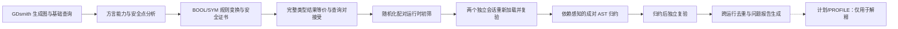

# GraphSymPerf：面向图数据库等价查询性能异常的运行时优先验证框架

> English title: **GraphSymPerf: Runtime-First Validation of Equivalent-Query Performance Anomalies in Graph Database Systems**
>
> 文档状态：CCF-A 类会议论文第一版中文初稿；目标会议、页数限制和匿名要求待确定。文中的 `[RESULT GAP]` 与 `[MATERIAL GAP]` 是必须补齐的证据缺口，而不是可直接投稿的内容。

## 摘要

图数据库管理系统（Graph Database Management System, GDBMS）依赖复杂的模式匹配、路径遍历和查询优化过程。已有工作已经能够通过差分测试、查询分区、蜕变测试和等价查询重写发现图数据库中的逻辑、异常和性能问题。然而，性能异常的自动化报告仍面临三项相互关联的困难：查询变换的语义等价性需要同时考虑三值逻辑、空值、重复项、顺序和变量作用域；短时运行测量容易受到缓存、执行顺序和系统噪声影响；未经归约和去重的候选难以直接形成开发者可处理的报告。本文提出 GraphSymPerf，一个面向图数据库等价查询性能异常的运行时优先测试框架。GraphSymPerf 使用 GDsmith 生成图和基础查询，在可证明的安全位置应用带证书的布尔等价变换与对称变换；候选查询对必须通过完整的类型敏感结果等价检查。框架随后采用随机化配对执行进行初筛，并在两个独立会话中重新加载相同图快照，结合自身对照和绝对噪声下限进行复验。只有通过复验的候选才进入依赖感知的成对抽象语法树归约，并在归约后再次执行同等强度的验证，最终经过去重生成可提交问题报告。计划中的正式评估覆盖 7 种图数据库、每种 16 个分片和每分片 1,000 个接受查询对，共 112,000 个接受查询对。现有公开报告快照包含 29 个问题，其中 25 个为性能问题、4 个为逻辑问题；10 个已修复、5 个已确认、1 个未采纳、13 个仍在等待回复。一次 Neo4j 3,000 对试运行产生 1 个初筛候选，但独立复验将其拒绝，说明仅依靠发现阶段倍率会保留不稳定信号。`[RESULT GAP: 完成正式跨系统矩阵、基线比较、消融和归约评估后更新摘要结果。]`

**关键词：** 图数据库；蜕变测试；等价查询；性能异常；查询变换；测试用例归约

## 1 引言

图数据库通过节点、边和属性直接表达连接关系，并使用 Cypher 等查询语言执行图模式匹配。查询优化器必须在标签过滤、关系遍历、连接顺序和索引访问之间做出选择。语义等价的查询可能触发不同的执行路径，因此它们既能构成无人工标准答案的测试预言，也能暴露某些查询写法下的异常退化。

现有图数据库测试研究已经形成多条技术路线。GDsmith 通过图引导和数据引导生成复杂且非空的 Cypher 查询，并使用差分测试发现错误结果和崩溃问题 \cite{hua2023gdsmith}。GDBMeter 将查询分区引入图数据库测试 \cite{kamm2023gdbmeter}，Gamera 进一步设计了图结构感知的蜕变关系 \cite{zhuang2023gamera}。与本文最接近的 GRev 已将等价查询重写用于图数据库逻辑、性能和异常问题检测 \cite{mang2024grev}。在关系数据库领域，AMOEBA 也通过结构和表达式变换构造等价 SQL 查询对以检测性能问题 \cite{liu2022amoeba}。因此，GraphSymPerf 的研究空缺不是“等价查询能否发现性能问题”，而是如何将初筛候选转化为语义可信、运行时可复验、规模可归一化且适合提交给开发者的证据。

### 1.1 动机

简单比较两个查询的一次或少数几次执行时间，容易把预热差异、后台活动或候选筛选带来的极值偏差误当作数据库缺陷。另一方面，如果只使用很高的固定倍率或固定时间差过滤噪声，又可能遗漏稳定但规模较小的退化。性能预言必须同时回答三个问题：两条查询是否真正等价、差异是否超过当前环境噪声、差异能否在独立执行环境中保持。

开发者还需要小而完整的复现材料。自动生成查询通常包含大量与异常无关的模式、变量和谓词。单边删除结构可能破坏等价关系，使用执行计划本身决定候选是否成立又会把解释材料混入测试预言。GraphSymPerf 因此采用“运行时先判定、计划后解释”的分层策略：普通执行时间与结果等价性决定候选是否成立，执行计划和性能计数器只在候选通过归约后用于提出根因假设。

### 1.2 研究挑战

**挑战一：有条件的语义等价。** Cypher 的三值逻辑、`NULL`、重复项、聚合、无序 `LIMIT/SKIP`、路径绑定和变量作用域会使表面简单的代数变换失效。单次图上的结果相同也不能替代变换的适用性证明。

**挑战二：噪声下的性能判定。** 执行顺序、缓存状态和系统活动会改变短查询的运行时间。大规模筛选还会产生选择偏差：在数千个查询对中最大的倍率，往往难以在新样本中重现。

**挑战三：跨系统可比性。** 不同图数据库支持的 Cypher 子集、标识符规则、驱动返回类型和图加载方式不同。为兼容方言而删除标签、关系类型或谓词可能直接破坏待验证关系。

**挑战四：从候选到问题报告。** 候选必须经过复验、归约、归约后复验和跨历史问题去重。否则，较大的候选数量不能转化为可信的开发者反馈。

### 1.3 本文贡献

本文当前版本主张以下三项贡献，正式投稿前需由完整实验进一步支撑。

1. 提出一种安全点驱动的等价查询生成方法。每次布尔或对称规则变换均绑定规则版本、证明标识、抽象语法树位置、作用域、类型与空值条件以及目标数据库能力；静态适用性证书与动态完整结果等价检查共同构成接受门禁。
2. 设计一条运行时优先的异常验证链。该链将宽松初筛、两个独立会话的复验、自身噪声对照、成对语法树归约和归约后复验分开，并禁止使用执行计划或开发者反馈改变候选真值。
3. 建立一个覆盖 7 种图数据库的可审计评估协议和问题生命周期，将接受查询对、初筛候选、验证通过、归约有效、可提交和已提交六种状态明确区分，并保存版本、随机种子、图指纹和证据哈希。

需要强调的是，本文不主张首次将等价查询重写用于图数据库性能测试；该能力已由 GRev 展示。本文的核心增量是候选可信度、证据链完整性和开发者报告可用性。

## 2 背景与相关工作

### 2.1 图数据库自动化测试

GDsmith 面向 Cypher 图数据库生成彼此关联的图和查询，并通过图引导的模式生成与数据引导的条件生成提高非空复杂查询比例 \cite{hua2023gdsmith}。GraphSymPerf 复用其生成边界，但不复用其差分测试预言；所有性能测量与等价检查均在目标数据库上完成。

GDBMeter 把查询分区作为图数据库逻辑错误预言，将原查询结果与若干分区查询结果的组合进行比较 \cite{kamm2023gdbmeter}。Gamera 从图原生结构出发构造基本、复合和动态图蜕变关系，主要面向逻辑问题 \cite{zhuang2023gamera}。较新的 GQS 不再比较多个数据库或多个变换结果，而是先确定期望结果中的属性值，再合成应返回这些值的 Cypher 查询，从而为逻辑问题提供显式 ground truth \cite{yin2025gqs}。这些工作说明了图数据库测试预言的多种设计空间，但都未把稳定的同版本运行时不对称作为主要目标。

GRev 使用抽象语法图和随机游走覆盖生成等价查询，并通过结果、执行时间和异常行为之间的不一致检测多类问题 \cite{mang2024grev}。其论文明确讨论了环境因素造成的性能误报，并采用至少 5 倍、至少 1,000 ms 的门槛以及 5 次重现。GraphSymPerf 与 GRev 的差异不在于是否生成等价查询，而在于变换适用性的显式证书、发现样本与验证样本分离、两个独立会话、A/A 与 B/B 对照、归约后重新验证以及问题生命周期约束。`[RESULT GAP: 在兼容目标和共同查询子集上完成与 GRev 的直接比较。]`

### 2.2 数据库性能错误检测

AMOEBA 为 PostgreSQL 和 CockroachDB 构造语义等价 SQL 查询对，并通过响应时间差异发现潜在性能问题 \cite{liu2022amoeba}。APOLLO 则比较同一查询在两个数据库版本上的执行时间，检测和诊断性能回归 \cite{jung2019apollo}。前者与 GraphSymPerf 共享“同版本、等价查询”的总体预言，后者说明了性能验证、归约和开发者可读报告的重要性。GraphSymPerf 聚焦图模式语义、Cypher 方言差异和同一图数据库版本内的查询形态不对称。

### 2.3 蜕变测试与测试用例归约

蜕变测试在缺少直接测试预言时，通过输入变换与输出关系检查程序行为 \cite{chen2018metamorphic}。GraphSymPerf 将每条蜕变关系进一步限制到可审计的安全位置，并把动态结果一致作为防线而非等价性的唯一论据。测试用例归约借鉴了最小化失败输入的思想 \cite{zeller2002dd}，但性能候选需要同时保持查询对、规则见证、结果等价性和慢侧方向，因此不能直接进行单输入删除。

GraphQE 使用基于 U-semiring 的图原生代数表达和 SMT 求解证明 Cypher 查询在有序 bag 语义下的等价性 \cite{tang2025graphqe}。它表明通用 Cypher 等价性证明正在成为可用能力，也对 GraphSymPerf 的规则证书提出了更高要求。当前框架使用规则特定证明义务和运行时完整结果比较，并未实现通用等价性证明。正式版本应评估 GraphQE 能覆盖多少核心规则实例，以及无法覆盖的方言结构如何处理。

## 3 问题定义

给定目标图数据库 (D)、固定图快照 (G)、只读查询 (Q) 和规则变换 \(\tau\)，框架生成 \(Q'=\tau(Q)\)。规则证书 (C_\tau) 描述变换适用的语法位置、变量作用域、类型、空值条件和方言能力。查询对首先需要满足：

\[
\operatorname{Result}_D(G,Q) \equiv_t \operatorname{Result}_D(G,Q'),
\]

其中 \(\equiv_t\) 表示完整的类型敏感等价关系：比较值类型、`NULL`/missing、重复次数、数值精度以及查询语义要求的顺序。任何结果截断、非确定函数、未固定参数或图快照漂移都会使该查询对失效。

设独立验证会话 (s\) 中两条查询的配对执行样本为 (T_s(Q)) 和 (T_s(Q'))。GraphSymPerf 仅在两个独立会话中慢侧方向一致，合并中位倍率达到阈值、置信区间下界达到阈值，并且绝对时间差超过 A/A 噪声下限时，将候选提升为 `VALIDATION_PASSED`。该定义识别的是“等价查询形态之间稳定且显著的运行时不对称”，根因是否为优化器缺陷仍需后续解释和开发者判断。

框架依次使用以下状态：`accepted query pair`、`runtime candidate`、`VALIDATION_PASSED`、`REDUCED_VALID`、`SubmitReadyIssue` 和 `SUBMITTED`。崩溃、挂起、内存耗尽或连接失效单独记录为可靠性发现，不计入性能问题。

## 4 GraphSymPerf 方法

### 4.1 框架概览

图 1：GraphSymPerf 的运行时优先证据链。实线表示决定候选状态的步骤；虚线表示不参与候选真值判定的解释材料。

### 4.2 图与基础查询生成

框架固定使用带提交哈希的 GDsmith 作为唯一生成器。原生支持的目标使用对应后端；Apache AGE、ArcadeDB 和 LadybugDB 可通过隔离代理生成图与查询，但生成结果必须在目标数据库中重新加载和执行。代理不参与运行时预言。所有方言兼容决策必须保持语义；无法证明无损的结构直接拒绝，并继续生成以补足接受查询对预算。

### 4.3 安全点与规则证书

规则分为 `CORE`、`EXPERIMENTAL`、`CONTROL` 和 `REMOVED` 四级。正式实验只允许 `CORE` 规则自动进入提升链。当前核心布尔规则覆盖常量真/假、空值划分、空值矛盾和三值逻辑下的完备排中结构；核心对称规则覆盖独立模式顺序、谓词顺序和标签顺序。节点顺序、双重否定、De Morgan、定长路径和标签位置改写等尚未完成全部证明义务的规则只能用于试验或定向搜索。

每个安全证书至少绑定规则标识与版本、证明标识、AST 路径、作用域变量、类型/可空性、子句上下文、前置条件和目标能力哈希。若某个数据库、规则和版本出现完整的类型结果不一致，框架隔离该组合并保存反例。结果截断或驱动类型无法规范化仅拒绝当前查询对，不被误写成规则反例。

### 4.4 接受查询对与初筛

查询对必须依次通过解析、目标方言能力、核心安全证书、两侧普通执行、未截断的完整类型结果等价以及 AST 哈希去重。每个源查询最多产生两个来自不同核心规则的变体，避免同一语料被大量相似变换占用。

初筛采用 3 次预热和 5 组随机 AB/BA 配对执行。初筛阈值较宽松，只负责减少后续独立复验的成本。发现阶段倍率仅作为筛选历史字段，不出现在最终开发者报告的主结论中。

### 4.5 独立运行时验证

验证在两个新的操作系统进程中分别建立连接、清空数据库并重载候选绑定的图快照。每个会话均回读节点、边、标签、类型和属性以检查图指纹，然后再次执行完整类型结果等价检查。两侧分别经过 5 次预热，随后执行 20 组平衡随机配对，AB 和 BA 各 10 次。A/A 与 B/B 对照用于检查结果稳定性和环境噪声。

当前提升条件为：两个会话中的慢侧方向一致；合并中位倍率不低于 3.0；95% bootstrap 置信区间下界不低于 2.0；中位绝对时间差大于 A/A 绝对差的第 99 百分位。任一会话不完整、图指纹变化、方向相反或发生基础设施事件，候选均不能提升。阈值是当前实验协议的一部分，并非图数据库性能问题的通用定义；后续需要通过敏感性分析报告其影响。

### 4.6 成对 AST 归约

归约器仅接收 `VALIDATION_PASSED` 候选。每个删除提案依次检查两侧可解析和作用域保持、规则见证仍存在、完整类型结果仍等价，以及宽松运行时症状仍保留。归约在成对 AST 上进行，禁止只修改一侧。得到局部 1-minimal 结果后，框架从零运行两个独立验证会话；只有通过归约后验证的结果才能标记为 `REDUCED_VALID`。预算耗尽或证据不完整的部分归约只能供人工分析，不能自动生成问题报告。

### 4.7 去重、解释与报告

可提交对象必须同时绑定原始与归约查询、两次验证、核心规则证书、慢侧方向、数据库版本、图快照和去重结论。精确重复直接阻止提交，可能重复进入人工队列。执行计划、`PROFILE` 或性能计数器只在归约后采集，用于提出根因假设；它们不能把验证失败的候选改判为有效问题。

## 5 研究问题与评估方法

本文计划回答以下研究问题（Research Question, RQ）。

- **RQ1—有效性（Effectiveness）：** 在固定接受查询对预算下，GraphSymPerf 能发现多少经独立验证后仍显著的性能异常？
- **RQ2—候选精度（Candidate Precision）：** 初筛候选经过原始验证、归约和归约后验证时的存活漏斗与主要拒绝原因是什么？
- **RQ3—规则效用（Rule Utility）：** 各核心规则的适用覆盖、接受数量、隔离情况、验证通过数量和数据库分布如何？
- **RQ4—归约效果（Reduction Effectiveness）：** 归约能减少多少字符和 AST 节点，是否达到局部 1-minimal，并保留多少经验证的运行时差异？
- **RQ5—跨系统通用性（Generality）：** 同一协议在 7 种图数据库上的方言覆盖、拒绝原因、有效问题和开发者反馈如何分布？

### 5.1 正式实验矩阵

正式配置覆盖 Neo4j、Memgraph、FalkorDB、AgensGraph、ArcadeDB、Apache AGE 和 LadybugDB。每个系统运行 16 个分片，每个分片接受 1,000 个完整等价查询对，共计划 112,000 个接受查询对。每个分片最多生成 10,000 个种子，最长运行 6 小时，使用独立随机种子并按源 AST 和查询对哈希去重。达到生成或时间预算但未达到接受数量的分片记为 `INCOMPLETE`，不能混入完整分片分母。

### 5.2 指标与报告口径

RQ1 以接受查询对为分母，分别报告初筛候选、`VALIDATION_PASSED`、`REDUCED_VALID`、`SubmitReadyIssue` 和 `SUBMITTED`。RQ2 报告每个阶段的存活数量及语义失败、噪声内差异、方向不一致、环境事件和归约失效等原因。RQ3 按数据库和规则报告适用率、接受数、隔离数和验证产出。RQ4 报告字符数、AST 节点数、归约尝试数、局部最小性和归约前后验证倍率。RQ5 报告目标能力覆盖、代理边界、问题类型和开发者状态；等待回复的问题作为未决样本单列，不当作确认或否定。

所有结果必须绑定 GraphSymPerf、GDsmith、规则模式、验证器、归约器、数据库、驱动、镜像摘要、CPU、运行清单和随机种子。跨版本累计问题不能加入某一轮正式实验的产出分子。

### 5.3 基线与消融

最直接的外部基线是 GRev。计划在双方共同支持的数据库和 Cypher 子集上，按相同时间或接受查询对预算比较初筛候选、人工复现成本和开发者可提交产出。若其公开制品不能在当前数据库版本上稳定运行，应报告不可比字段，而不是自行补写结果。

内部消融包括：仅使用初筛而不做独立验证、去除 A/A 与 B/B 对照、去除成对归约、仅使用动态结果相等而不要求安全证书，以及按规则族分别运行。涉及语义风险的消融只用于测量拒绝和误报，不允许自动提交。`[RESULT GAP: 完成基线与消融实验。]`

## 6 初步评估结果

### 6.1 公开问题报告快照

截至 2026-07-22，项目维护的公开问题列表包含 29 条报告，覆盖 Neo4j、Memgraph、FalkorDB、ArcadeDB、Apache AGE 和 LadybugDB 六个上游项目。表 1 汇总了用户维护的开发者状态；“已确认”与“已修复”合计 15 条，作为开发者验证问题。“等待回复”不参与有效率计算。

| 数据库 | 报告数 | 性能问题 | 逻辑问题 | 已修复 | 已确认 | 未采纳 | 等待回复 |
|---|---:|---:|---:|---:|---:|---:|---:|
| Neo4j | 7 | 6 | 1 | 1 | 1 | 1 | 4 |
| Memgraph | 5 | 5 | 0 | 0 | 1 | 0 | 4 |
| FalkorDB | 1 | 1 | 0 | 0 | 0 | 0 | 1 |
| ArcadeDB | 6 | 5 | 1 | 6 | 0 | 0 | 0 |
| Apache AGE | 3 | 3 | 0 | 0 | 1 | 0 | 2 |
| LadybugDB | 7 | 5 | 2 | 3 | 2 | 0 | 2 |
| **合计** | **29** | **25** | **4** | **10** | **5** | **1** | **13** |

表 1：现有公开报告及其人工维护状态。完整 URL 和 2026-07-22 的 GitHub open/closed 状态见 `bug_list_snapshot.md`。

GitHub API 复核显示这 29 条 issue 均存在，当前有 15 条关闭、14 条开放。open/closed 是平台工作流状态，不能自动替代“已修复、已确认、未采纳、等待回复”的人工语义分类。该问题集来自多个阶段、规则族和协议版本，只能作为累计外部效度证据，不能用于计算当前运行时优先协议的无偏发现率或验证精度。

### 6.2 Neo4j 3,000 对试运行

一次面向 Neo4j 2026.05.0 Community 的试运行完成 3 个分片和 3,000 个接受查询对，没有分片失败、重试、数据库重启或内存耗尽。该运行使用 `and_excluded_middle_or_null` 规则，初筛阈值为 2.0 倍。唯一候选在发现阶段达到 2.203 倍和 3.565 ms 的中位差，但两个独立进程中的复验倍率只有 1.048 倍与 1.077 倍，绝对差分别为 0.022 ms 与 0.032 ms，未超过对应噪声下限。该候选因此被拒绝，没有形成可提交报告。

这一结果支持的是“独立复验能过滤发现阶段的不稳定极值”，而不是“GraphSymPerf 已具有较高缺陷发现率”。此外，该运行使用的 GDsmith checkout 含未提交的构建兼容补丁，且未保存全部 3,000 对的紧凑计时摘要，因此只能作为带来源哈希的试运行证据，不能标为正式主实验。

### 6.3 当前可以与不可以得出的结论

当前证据表明，框架已经形成从生成、等价检查、初筛到独立复验和问题跟踪的可执行链条；累计公开问题也说明规则变换能够覆盖多种真实图数据库行为。现有证据尚不能回答正式的 RQ1–RQ5：29 条公开报告不是统一版本、固定预算和同一验证协议下产生的样本，而 3,000 对试运行只覆盖一个数据库和一个规则，并且没有验证通过的候选。

`[RESULT GAP: 完成 7×16×1,000 正式矩阵，补齐逐规则漏斗、跨系统比较、归约结果、GRev 基线和阈值敏感性分析。]`

## 7 讨论

### 7.1 为什么采用运行时优先

执行计划差异可以帮助解释异常，却不能单独证明用户可观察的性能退化。不同计划可能具有相近运行时间，相同计划也可能因算子实现或估计误差表现不同。GraphSymPerf 因此先用普通执行、结果等价性和噪声门禁决定候选，再收集计划证据。该设计把“发现异常”和“解释根因”分开，避免为追求计划多样性而改变测试分布。

### 7.2 高门槛与漏报之间的权衡

两个独立会话、3 倍中位倍率、置信区间下界和绝对噪声门槛会降低候选数量，但也可能漏掉规模较小、只在大型数据上放大的真实问题。本文不把当前阈值视为普遍标准。正式评估应报告多个阈值下的候选漏斗和人工复验成本，并保留低于提升线但绝对时间差较大的候选供离线分析。

### 7.3 开发者反馈的解释

开发者确认或修复能够支持问题的实际价值，但受项目活跃度、版本计划和维护者资源影响。等待回复并不等于误报，关闭也不一定等于修复。本文将 pipeline stage 与 developer status 分开，并为提交后的状态设置固定观察窗口。只有带维护者评论、修复提交、发行说明或明确关闭理由的记录，才能标记为开发者验证问题。

## 8 有效性威胁

**构造效度。** 等价查询之间的运行时不对称不必然对应优化器缺陷，也可能是数据库文档允许的实现选择。本文把自动输出称为“性能异常”，最终缺陷状态由开发者反馈或充分的根因证据确定。

**内部效度。** 缓存、后台负载、JIT、连接状态和图加载均可影响计时。随机化配对、两个独立会话、A/A 与 B/B 对照和图指纹降低但不能消除这些影响。当前单机试运行也不能代表其他硬件。

**外部效度。** 七个目标仍不能覆盖所有图数据库和查询语言。代理生成边界限制了部分系统的原生语法空间。当前公开问题集中在六个上游项目，尚未提供 AgensGraph 的提交结果。

**结论效度。** 现有 29 条问题来自不同时间和协议，不能与正式矩阵混合计算产出率。3,000 对试运行的阴性结果只适用于一个数据库、一个版本、一个规则和当前图规模。正式结论必须等待固定矩阵和敏感性分析。

**相关工作可比性。** GRev 是最直接的先前工作，但数据库版本、查询语言和预算可能不一致。未完成公平的共同子集比较前，本文不声称在有效性或效率上优于 GRev。

## 9 可复现性、伦理与声明

**可复现性。** 正式制品将提供版本化运行清单、随机种子、数据库与驱动版本、镜像摘要、图和查询哈希、规则证书、原始与归约验证结果及问题 URL。双盲投稿时应使用匿名制品链接。`[MATERIAL GAP: 确定目标会议后补充匿名仓库和 artifact evaluation 要求。]`

**伦理与负责任报告。** 本研究不涉及人类受试者、动物实验或个人敏感数据。生成图为合成数据。项目仅针对用户授权的本地或测试数据库实例运行，并通过上游公开 issue tracker 进行负责任报告；不进行生产系统负载测试。资源消耗、超时和异常终止应完整记录，阴性结果不得删除。

### Data Availability / Code Availability

代码和非敏感实验制品计划随论文公开。`[MATERIAL GAP: 填写最终仓库、许可证、归档 DOI 和数据保留范围。]`

### Conflicts of Interest

`[MATERIAL GAP: 作者填写利益冲突声明。]`

### Funding

`[MATERIAL GAP: 作者填写资助来源与项目号。]`

### CRediT Contributions

`[MATERIAL GAP: 按 CRediT 角色填写作者贡献。]`

### AI Use Disclosure

本初稿使用生成式 AI 协助组织结构、检查表述和整理已核验材料；所有研究主张、实验结果、引用和最终文本均须由作者复核并承担责任。投稿前应按目标会议当年政策调整披露范围。

## 10 结论

本文提出 GraphSymPerf，通过安全证书约束的 BOOL/SYM 等价变换和运行时优先证据链发现图数据库性能异常。框架将完整类型结果等价、随机化初筛、两个独立会话、噪声对照、成对 AST 归约、归约后复验和问题去重串联为明确的状态机。现有 29 条公开报告和 Neo4j 3,000 对试运行证明了问题空间的实际相关性与严格复验的必要性，但尚不足以支持跨系统有效性结论。下一步工作的核心不是继续累积不可比较的案例，而是完成固定 112,000 接受查询对矩阵，并以统一分母回答五个研究问题。

## 参考文献

1. Ziyue Hua, Wei Lin, Luyao Ren, Zongyang Li, Lu Zhang, Wenpin Jiao, and Tao Xie. 2023. *GDsmith: Detecting Bugs in Cypher Graph Database Engines*. ISSTA 2023, 163–174. [https://doi.org/10.1145/3597926.3598046](https://doi.org/10.1145/3597926.3598046). `hua2023gdsmith`
2. Matteo Kamm, Manuel Rigger, Chengyu Zhang, and Zhendong Su. 2023. *Testing Graph Database Engines via Query Partitioning*. ISSTA 2023, 140–149. [https://doi.org/10.1145/3597926.3598044](https://doi.org/10.1145/3597926.3598044). `kamm2023gdbmeter`
3. Zeyang Zhuang, Penghui Li, Pingchuan Ma, Wei Meng, and Shuai Wang. 2023. *Testing Graph Database Systems via Graph-Aware Metamorphic Relations*. PVLDB 17(4), 836–848. [https://doi.org/10.14778/3636218.3636236](https://doi.org/10.14778/3636218.3636236). `zhuang2023gamera`
4. Qiuyang Mang, Aoyang Fang, Boxi Yu, Hanfei Chen, and Pinjia He. 2024. *Testing Graph Database Systems via Equivalent Query Rewriting*. ICSE 2024, Article 143, 1–12. [https://doi.org/10.1145/3597503.3639200](https://doi.org/10.1145/3597503.3639200). `mang2024grev`
5. Xinyu Liu, Qi Zhou, Joy Arulraj, and Alessandro Orso. 2022. *Automatic Detection of Performance Bugs in Database Systems Using Equivalent Queries*. ICSE 2022, 225–236. [https://doi.org/10.1145/3510003.3510093](https://doi.org/10.1145/3510003.3510093). `liu2022amoeba`
6. Jinho Jung, Hong Hu, Joy Arulraj, Taesoo Kim, and Woonhak Kang. 2019. *APOLLO: Automatic Detection and Diagnosis of Performance Regressions in Database Systems*. PVLDB 13(1), 57–70. [https://doi.org/10.14778/3357377.3357382](https://doi.org/10.14778/3357377.3357382). `jung2019apollo`
7. Tsong Yueh Chen, Fei-Ching Kuo, Huai Liu, Pak-Lok Poon, Dave Towey, T. H. Tse, and Zhi Quan Zhou. 2018. *Metamorphic Testing*. ACM Computing Surveys 51(1), 1–27. [https://doi.org/10.1145/3143561](https://doi.org/10.1145/3143561). `chen2018metamorphic`
8. Andreas Zeller and Ralf Hildebrandt. 2002. *Simplifying and Isolating Failure-Inducing Input*. IEEE Transactions on Software Engineering 28(2), 183–200. [https://doi.org/10.1109/32.988498](https://doi.org/10.1109/32.988498). `zeller2002dd`
9. Zijing Yin, Si Liu, and David Basin. 2025. *Testing Graph Databases with Synthesized Queries*. Proceedings of the ACM on Management of Data 3(4), Article 268, 1–26; presented at SIGMOD 2026. [https://doi.org/10.1145/3749186](https://doi.org/10.1145/3749186). `yin2025gqs`
10. Lei Tang, Wensheng Dou, Yingying Zheng, Lijie Xu, Wei Wang, Jun Wei, and Tao Huang. 2025. *Proving Cypher Query Equivalence*. ICDE 2025, 3931–3944. [https://doi.org/10.1109/ICDE65448.2025.00293](https://doi.org/10.1109/ICDE65448.2025.00293). `tang2025graphqe`

## 附录 A：第一版结果缺口清单

- `[RESULT GAP]` 完成 7 个目标、112 个分片和 112,000 个接受查询对的正式运行。
- `[RESULT GAP]` 按数据库和规则输出完整的接受—初筛—验证—归约—提交漏斗。
- `[RESULT GAP]` 完成与 GRev 的共同目标、共同语法子集和共同预算比较。
- `[RESULT GAP]` 完成验证会话、噪声对照、安全证书和归约的消融实验。
- `[RESULT GAP]` 完成倍率阈值、绝对时间差、图规模和缓存模式的敏感性分析。
- `[RESULT GAP]` 完成归约字符数、AST 节点数、局部最小性和性能保留评估。
- `[RESULT GAP]` 评估 GraphQE 对核心规则实例的证明覆盖与额外成本。
- `[MATERIAL GAP]` 固定目标 CCF-A 会议及其当年模板、页数、匿名和 AI 披露政策。
- `[MATERIAL GAP]` 补齐作者、机构、资助、CRediT、利益冲突、匿名制品和归档链接。
