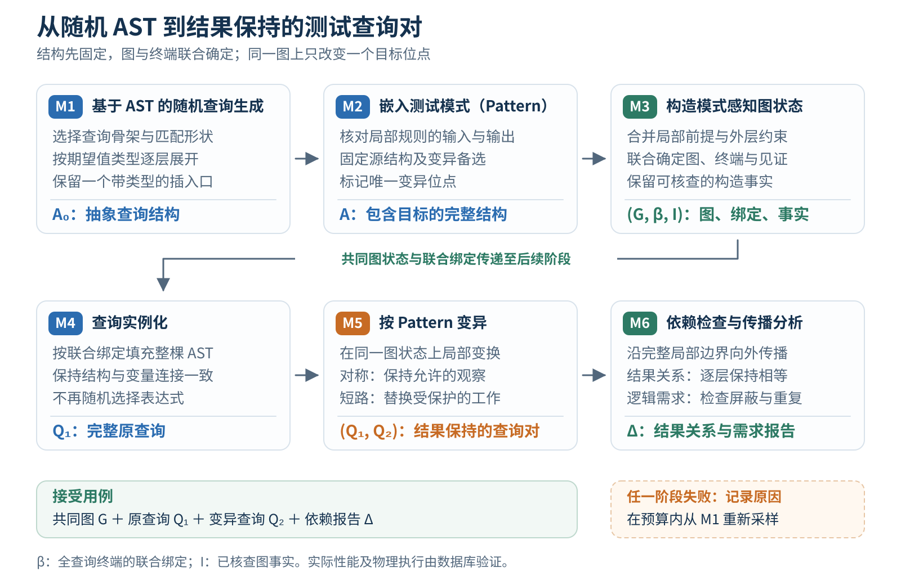
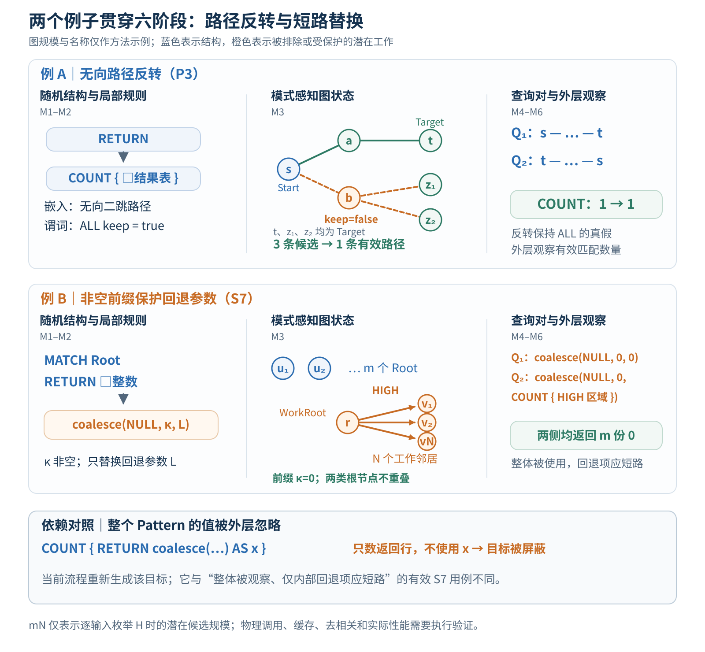

# GraphSymPerf：面向图数据库性能测试的六阶段查询构造方法

## 1 M1：基于 AST 的随机查询生成

### 1.1 先生成查询结构，再引入测试模式与图数据

第一阶段生成抽象语法树（Abstract Syntax Tree，AST），确定查询包含哪些子句、匹配结构、表达式和子查询，以及它们如何组合。此时不选择具体测试模式（Pattern），也不读取已有图数据。查询中的标签、关系类型、属性键和部分常量保留为符号终端，供后续构图时联合确定。

查询子句之间传递的是中间结果表（intermediate result table，下文简称结果表）：一批带有列名、保留重复行的查询结果。结果表可以为空，同一行也可以出现多次。例如，三行 `id=1、id=2、id=2` 构成的结果表，其行数为3。本文的“结果表接口”表示一个能够产生这种结果的子查询位置；“整数接口”则表示一个产生整数值的表达式位置。

本文采用 GDsmith 的查询骨架（Cypher skeleton）、期望值类型（expected value type）和变量生命周期（variable life cycles）等概念，组织结构生成过程。GDsmith 先形成包含待补全图匹配模式和表达式的骨架，再结合已有图及变量值表完成查询；本文将结构选择提前至构图之前，具体取值及图数据在 M3 中联合确定。[GDsmith，§3.2.1–3.2.3](https://taoxiease.github.io/publications/issta23-gdsmith.pdf)

图1给出六阶段的产物与衔接关系。A₀ 表示第一阶段的抽象 AST；A 表示嵌入 Pattern 后的 AST；G、β、I 分别表示图数据、联合绑定和图状态事实；Q₁、Q₂ 分别表示原查询与变异查询；Δ 表示依赖分析结果。每个查询对在同一份 G 上比较。

### 1.2 随机生成子句骨架

生成器首先在允许的查询子句中逐步选择后继，形成以返回子句结束的序列。例如，可以生成 `MATCH → WITH → RETURN`，也可以只生成 `RETURN`。可选匹配和去重投影为序列提供不同的行语义：前者涉及无匹配时的空值扩展，后者改变重复行的保留方式。`WHERE` 随对应的匹配或中间投影生成，其变量必须在该位置可见。

因此，随机选择的单位是“下一个合法子句”，而非一条预先保存的完整查询。骨架生成结束时，只确定每个子句需要哪些内部结构，例如图匹配项、布尔条件或投影表达式。



**图1｜六阶段方法总览。** 随机生成的查询结构提供外层上下文，Pattern 提供局部结构及变换关系；图状态构造将二者的要求联合实现。M4 使用接受的绑定完成整个查询，M5 在同一图上执行一次局部变异，M6 分别检查结果关系及逻辑求值需求。有限尝试内无法完成某一阶段时，记录原因并重新生成结构。

### 1.3 按类型与变量生命周期递归展开

随后，生成器逐个展开骨架中的位置。每次展开先读取该位置的语法类别、期望值类型、当前可见变量和剩余预算，再从满足这些条件的产生式中随机选择一个。新产生式引入的子位置继续按相同方式展开。

例如，一个返回整数的位置可以选择整数叶子、`CASE`、`coalesce` 或 `COUNT` 子查询。若选择 `CASE`，就产生一个布尔条件位置和两个整数分支；若其中一个整数分支继续选择 `COUNT`，则需要进一步生成被计数的结果表。布尔位置则可以展开为比较、空值判断、布尔连接、条件表达式或存在性子查询。

变量按实际定义和使用顺序维护。匹配子句引入节点与关系变量；后续条件只能引用可见变量。中间投影只向后导出保留的变量和新别名，未导出的变量不再可见。可选匹配新引入的变量具有可空性，不能在结构生成时被当作必定存在的实体。

图匹配模式组合（pattern combinations）与本文的测试模式 Pattern 是两个概念：前者描述查询如何匹配节点和关系，后者描述需要测试的局部语义关系。当前图匹配结构可以组合为：

| 匹配形状 | 结构示意 | 形成方式 |
|---|---|---|
| 单节点 | a | 引入或复用一个节点变量 |
| 单边 | a → b | 连接两个节点变量 |
| 链 | a → b → c → … | 后一个匹配复用前一个匹配的终点 |
| 分支 | a → b，a → c | 多个匹配共享起点 |
| 汇合 | a → c，b → c | 多个匹配共享终点 |
| 闭环 | a → b → c → a | 后续匹配连接回已定义节点 |
| 独立分量 | a → b，c → d | 各分量使用不同的新变量 |

复合形状通过多个匹配子句共享变量生成，各子句保留其独立的匹配语义。标签组合、关系方向、关系类型集合和属性约束可以进一步变化。链按边逐段构造，其长度由匹配组规模、子句数量和总 AST 预算共同限制。子查询结果表还可以组合普通查询、保留重复行的联合与条件分支；不同分支使用一致的列接口。

### 1.4 在展开过程中预留带类型的嵌入接口

生成器在递归展开时预留一个带类型的接口，用于 M2 插入 Pattern。接口可能接受结果表、布尔值或整数值，其位置与外层结构一起确定。当前接口位于最终返回表达式的子树中，可以嵌套在计数、存在性判断、条件分支或其内部查询中。

普通表达式位置和 Pattern 接口具有不同用途：前者必须在 M1 中展开完成；后者保留至 M2。与具体图有关的符号终端则保留至 M3。三者的分离确定了各阶段可以改变的内容。

本文使用两个说明性案例贯穿后续六阶段。变量名、标签与规模参数在各阶段保持一致。

**例 A：统计内层结果表的行数。** 假设 M1 选择仅含返回子句的骨架，返回值为整数，并选择 `COUNT` 消费一个结果表接口：

```text
RETURN
└── COUNT
    └── □结果表
```

相应抽象查询为：

```text
RETURN COUNT { □结果表 } AS n
```

此时尚未决定子查询匹配什么。后续用 P3 测试无向路径的反转关系。

**例 B：对外层每一行返回一个整数。** 假设 M1 选择 `MATCH → RETURN`，匹配一个节点集合，并在整数返回值处留下接口：

```text
MATCH (u:〈外层标签〉)
RETURN □整数 AS value
```

此时尚未决定整数表达式。后续用 S7 测试非空前缀保护的回退表达式替换。

**算法1｜生成带类型接口的抽象 AST**

```text
输入：查询语法 Γ，目标能力 C，结构预算 B，随机种子 r
输出：抽象 AST A₀，接口 h，符号终端集合 T；或失败

1  随机生成以 RETURN 形式结束的合法子句骨架 S
2  选择接口类别 τₕ ∈ {结果表，布尔值，整数值}
3  建立初始变量环境与共享结构预算
4  按子句顺序展开 S：
5      对每个待展开位置，确定期望类型和当前可见变量
6      枚举 Γ、C 及剩余预算共同允许的产生式
7      随机选择产生式并递归展开，沿返回表达式的一条路径传递接口预留要求
8      匹配完成后登记新变量，再生成可引用它们的条件
9      投影完成后更新导出变量、别名来源和可空性
10 当该路径到达允许的终结位置时，保留一个 τₕ 类型接口
11 将需要图信息的终端保留为符号，其余结构全部完成
12 检查类型、变量生命周期、预算和唯一接口
13 返回 (A₀，h，T)
```

## 2 M2：往 AST 中嵌入定义好的 Pattern

### 2.1 用局部结构与语义关系定义 Pattern

第二阶段将一个指定的 Pattern 放入 M1 预留的接口。Pattern 描述局部优化机会，包括原局部结构、变异结构、输入输出接口、成立前提、结果关系和希望改变的潜在工作。可表示为：

> P = (K，K′，接口，成立前提，结果关系，工作目标)。

其中，K 和 K′ 是同一局部关系的两种结构，尚可包含符号终端。对称类 Pattern 通过反转或交换建立结果对应；短路类 Pattern 通过决定性条件，使某一内部片段的变化不影响完整局部结果。

Pattern 因而不规定整条查询的外层结构，也不直接返回一张完整图。外层结构已经由 M1 确定，图数据将在 M3 根据局部与全局要求共同构造。

### 2.2 检查接口，再固定局部结构

嵌入首先检查语法类别与输出类型。结果表接口接受一个产生结果表的子查询结构；布尔接口要求局部结构产生布尔值；整数接口要求产生整数值。需要接口适配时，必须明确由哪个计数或存在性运算完成转换。

随后，为 Pattern 中的局部变量使用独立名称，避免与宿主已有变量发生意外捕获。局部结构所需的外部绑定必须由接口声明，不能仅因变量名称相同就把两个绑定视为同一实体。嵌入后，接口以外的 AST 保持不变，并标记后续允许变异的位置。

M2 同时固定源结构 K 及声明的变异形式 K′。M3 由此能够检查两种形式所需的图条件；M5 才实际对完整原查询执行变异。M2 结束后，所有算子结构均已确定，后续构图只能选择仍未绑定的终端。

### 2.3 两个案例的嵌入结果

**例 A：嵌入 P3。** 在结果表接口中放入一个无向有界路径匹配，并要求路径上每个节点都满足 `keep=true`。本例选择恰好两跳：

```text
RETURN COUNT {
    匹配：起点 s 到终点 t 的无向两跳路径 p
    条件：p 上所有节点的 keep 均为 true
} AS n
```

P3 的变异形式反转路径的书写方向。端点的角色条件随原变量保留；允许观察的内容包括路径长度、节点局部全称条件和有效匹配数量。路径节点序列本身会随反转改变，不能被当作不变的输出。

**例 B：嵌入 S7。** 在整数接口中放入：

```text
MATCH (u:〈外层标签〉)
RETURN coalesce(NULL, κ, L) AS value
```

κ 是待绑定的决定项，要求每个实际输入上均非空；L 是低工作回退表达式。声明的变异形式将 L 替换为 H。等价关系建立在整个 `coalesce` 上，不要求 L 与 H 自身相等。

本例的 κ 使用符号字面量，H 在内部定义自己的图读取锚点，不隐式捕获外层 u。外层 u 决定产生多少输入行，局部表达式独立决定每行返回什么值。

## 3 M3：根据 Pattern 构造模式感知图状态

### 3.1 将完整查询与局部前提合并为构造要求

第三阶段构造模式感知图状态（Pattern-aware Graph State）。其输入是已经固定结构的 A、Pattern 的成立前提及变异备选、工作规模参数和构造预算；输出为图数据 G、联合绑定 β，以及可检查的图状态事实 I。

图状态要求来自整个查询，而非仅来自 Pattern。具体包括外层匹配和过滤条件、共享变量及相关输入、局部变换前提、行数或值要求，以及需要形成的潜在工作区域。构造目标可以写为：

> 外层查询要求 ∧ Pattern 成立前提 ∧ 变异备选要求 ∧ 工作规模要求 ∧ 构造预算。

例如，局部路径只要求存在一个有效见证，但外层若要求计数大于2，则直接被计数的结果表至少需要三行。外层与局部约束共享同一变量或属性时，必须使用一致的实体与取值，不能分别构造后直接拼接。

### 3.2 沿固定结构分解值与行数要求

构造过程分析已确定的算子，将父位置的要求向子位置分解。若条件要求为 TRUE，则根据其真实三值语义生成子要求；若计数需要落在某个区间，则向直接输入结果表施加数量约束。常见分解如下：

| 父位置的要求 | 对子位置的要求 |
|---|---|
| `NOT e` 为 TRUE | e 为 FALSE |
| `a AND b` 为 TRUE | a 与 b 均为 TRUE |
| `a OR b` 为 TRUE | 至少一个操作数为 TRUE，保留其他合法组合 |
| WHERE 保留当前行 | 条件精确为 TRUE；FALSE 和 NULL 均不保留该行 |
| `COUNT {R}` 大于2 | R 对当前输入至少返回三行 |
| `EXISTS {R}` 为 TRUE | R 至少返回一行作为见证 |
| `EXISTS {R}` 为 FALSE | R 返回零行 |
| `coalesce` 由第 j 项决定 | 前 j−1 项为 NULL，第 j 项非空 |

FALSE、NULL 与分析未知分别处理。NULL 是查询语义中的取值；分析未知表示当前规则或证据不足，不能作为另一个可随意赋值的真值。

### 3.3 联合选择终端，并按要求构造图

符号终端具有有限候选域。构造过程在这些域的联合组合中搜索，而非对每个位置独立随机抽取一次。对于一组候选绑定，先统一共享实体及属性要求，再建立满足条件的节点、关系、路径或空匹配情形，并检查数量与值约束。

在语义见证成立后，构造过程扩大 Pattern 声明的工作区域。例如，可以增加最终被过滤的路径候选，或扩大不会改变短路上下文输出的回退读取区域。扩张必须同时保持外层条件和变异前提，不能仅保证局部输出不变。

每个候选图还需接受原结构与变异备选的共同检查。小规模图可以完整解释查询，核查结果的类型、NULL 和重复行数量；较大图使用已验证的构造规则及增长事实，并保留加载后的检查条件。有限搜索中发生冲突时，尝试其他绑定或构造分支；预算耗尽则返回失败。

### 3.4 例 A：有效路径不变，失败候选随规模增长

为 P3 构造图族 Gₐ(N)，其中 N≥1：

> 节点：{s，a，t，b，z₁，…，z_N}。<br>
> 关系：s—a、a—t、s—b，以及每条 b—zᵢ；关系类型均为 T。

s 是唯一满足 `Start` 标签及 `id=1` 的节点；t 和所有 zᵢ 带有 `Target` 标签。只有 b 的 `keep=false`，其余节点均为 `true`。图中没有其他连接。

```text
             a ───── t:Target
            /
s:Start ───
            \
             b ───── z₁:Target
          keep=false ├── z₂:Target
                     └── … z_N:Target
```

图中从 s 到 `Target` 的两跳候选共有 N+1 条。其中 s—a—t 通过全称条件，其余 s—b—zᵢ 都因 b 而失败，因此有效路径数始终为1。节点数为 N+4，关系数为 N+3。

当 N=2 时，图中有六个节点、五条关系、三条两跳候选和一条有效路径。这个小图既提供结果见证，也说明如何在保持结果的同时扩大待检查的候选区域。

### 3.5 例 B：非空决定项与独立的回退工作区域

为 S7 构造图族 Gᵦ(m,N)，其中 m≥1、N>1：图中存在 m 个 `Root` 节点，以及一个独立的 `WorkRoot(id=1)` 节点 r；r 通过 N 条 `HIGH` 关系连接到 N 个工作节点。r 和工作节点均不带 `Root` 标签。

联合绑定将 κ 确定为非空整数0。L 为常量0；H 统计 r 的 `HIGH` 邻居，单独求值为 N。外层匹配因此产生 m 个输入，而每个输入上的决定项均为0。

当 m=2、N=3 时，图中有两个外层输入节点和一个连接三个邻居的工作区域。两条查询最终都返回两份 `{value:0}`，但回退参数本身分别为0和3。

**算法2｜联合构造图状态与终端绑定**

```text
输入：固定结构 A，Pattern P 及其声明备选，规模 N，构造预算 B
输出：图数据 G，联合绑定 β，图状态事实 I；或失败

1  收集整个 A 与声明备选的符号终端及有限候选域
2  收集外层条件、局部前提、绑定关系和工作目标
3  按固定结构将值、真假和行数要求分解为子要求
4  在预算内枚举终端联合绑定 β：
5      统一同一绑定的实体、属性和值要求
6      在需求备选中构造满足条件的语义见证图
7      按工作目标扩大候选或回退读取区域
8      检查外层约束、局部前提及原结构与备选的结果关系
9      若存在冲突，尝试下一组绑定或构造分支
10     若全部检查成立，保存见证、增长事实及加载检查 I
11     返回 (G，β，I)
12 返回带冲突或预算原因的构造失败
```

## 4 M4：根据已构造图状态实例化整个查询

### 4.1 将联合绑定落实到整棵 AST

第四阶段使用 M3 接受的 β，填充 A 中所有符号终端，得到原查询 Q₁。实例化覆盖外层结构和 Pattern 内部，包括标签、关系类型、属性键、常量和变异载荷所需的终端。共享符号在所有位置使用同一个绑定。

> Q₁ = Instantiate(A；G，β)。

M1 和 M2 已经确定结构，M3 已经确定图与取值。M4 因而只落实接受的绑定，不再随机选择表达式、改变阈值或生成新的匹配结构。实例化后重新检查类型、变量生命周期及终端完整性，并核对查询与构造事实使用的是同一份图状态。

### 4.2 例 A：得到路径计数的完整原查询

```cypher
RETURN COUNT {
  MATCH p=(s:Start {id: 1})-[:T*2..2]-(t:Target)
  WHERE all(x IN nodes(p) WHERE x.keep = true)
} AS n
```

`*2..2` 表示恰好两跳，关系匹配不要求方向。`all` 检查路径上的每个节点。由 Gₐ(N) 的构造事实可知，Q₁ 始终返回一行 `{n:1}`。这里 `COUNT` 统计直接子查询返回的行数。[Cypher COUNT 子查询语义](https://neo4j.com/docs/cypher-manual/current/subqueries/count/)

### 4.3 例 B：得到保留低工作回退项的完整原查询

```cypher
MATCH (u:Root)
RETURN coalesce(NULL, 0, 0) AS value
```

外层每个输入产生一行。`coalesce` 返回首个非空参数，所以 Q₁ 的结果是 m 份 `{value:0}`，重复行数量也属于需要保持的结果。[Cypher coalesce 语义](https://neo4j.com/docs/cypher-manual/current/functions/scalar/#functions-coalesce)

## 5 M5：执行 Pattern 定义的变异

### 5.1 同一图状态上的一次局部变换

第五阶段复制 Q₁，仅在登记的变异位点（mutation site）应用指定 Pattern 的变换，得到 Q₂。图数据 G、非目标结构和非目标终端绑定保持不变。目标是为同一输入构造具有规定结果关系的两种查询形式。

本文使用结果多重集（result bag）作为完整查询的比较对象。多重集保留每个有类型结果行及其出现次数；对于行内路径序列或列表，还需保持相应内部顺序。所构造查询对的目标关系为：

> Bag(Q₁，G) = Bag(Q₂，G)。

该关系在所构造图及已经检查的前提下成立。对称类与短路类使用不同的局部依据。

### 5.2 例 A：通过路径反转建立双射

P3 将起点和终点在路径模式中的书写位置反转，变量原有的标签及属性条件随之保留：

```cypher
RETURN COUNT {
  MATCH p=(t:Target)-[:T*2..2]-(s:Start {id: 1})
  WHERE all(x IN nodes(p) WHERE x.keep = true)
} AS n
```

对于原查询中的每条路径 π=(s，v，t)，反转映射产生 πᴿ=(t，v，s)，反向映射又恢复原路径。匹配不限定关系方向且端点条件未改变，因此这是匹配路径之间的双射。全称条件只检查各节点的 `keep`，与节点在路径中的次序无关。

由此得到：

> 路径双射 → 全称条件真假不变 → 有效路径数量相等 → 两条查询均返回 `{n:1}`。

单一起点与多个候选终点形成不同的访问入口，但是否导致不同执行计划或耗时，需要在数据库上验证。

### 5.3 例 B：在完整短路上下文中替换回退项

S7 将最后一个常量0替换为高工作回退表达式 H：

```cypher
MATCH (u:Root)
RETURN coalesce(NULL, 0, COUNT {
  MATCH (r:WorkRoot {id: 1})-[:HIGH]->(v)
}) AS value
```

H 自行绑定工作锚点 r，并统计 `HIGH` 区域。虽然 L=0、H=N，二者被置于同一个已有非空前缀的上下文中：

> coalesce(NULL，0，L) = coalesce(NULL，0，H) = 0。

因此，替换不改变任何实际输入上的局部输出，根部结果仍为 m 份 `{value:0}`。结果保持的边界是整个 `coalesce`，而非 L 或 H。

图2并列展示两个案例：P3 保持可观察路径对应，S7 保持决定性上下文的输出；它们分别形成对称访问机会和应被短路的潜在工作。



**图2｜两个贯穿案例及外层消费对照。** 蓝色路径表示 P3 的有效见证，经过失败节点的候选不贡献结果；S7 的非空决定项固定整个表达式的输出，回退区域规模可改变。底部对照区分 Pattern 内部的短路与整个 Pattern 被外层忽略这两种情况。

## 6 M6：检查依赖关系并逐层传播

### 6.1 从变异位点沿实际使用关系向外分析

局部结果关系只有经过外层运算后仍然成立，才能成为完整查询的比较依据。M6 借鉴 ValScope 的近似关系传播分析（approximation propagation analysis）：从建立局部关系的完整边界建立通向根节点的祖先链（ancestor chain），先判断父节点对相关输出的语义依赖，再应用传播规则。对称规则的边界可以与变异位点一致；短路规则则从包含决定性条件的完整上下文出发。ValScope 研究集合语义与值语义的查询结果关系；本文沿此组织方式传播结果相等关系，并另行分析逻辑求值需求及潜在工作。[ValScope，§4.4、算法1](https://www.usenix.org/system/files/osdi26-lin-li.pdf)

仅凭 AST 中的包含关系不足以完成依赖检查。分析还需追踪列和别名的实际使用、变量的定义与引用、相关子查询的输入，以及不同位置是否读取共享图区域。

对于一个目标 Pattern，M6 分别回答四个问题：

| 分析对象 | 需要回答的问题 |
|---|---|
| 结果关系 | 局部变换是否保持外层使用的值、行数、存在性或路径观察？ |
| 逻辑求值需求 | 外层需要完整结果表、一个存在性见证、某些列值，还是不需要该部分？ |
| 逻辑输入多重性 | 哪些绑定到达该位置，每个绑定在关系语义中出现多少次？ |
| 工作交互 | 内层变换或图扩张是否影响外层条件、见证或其他位置的共享读取？ |

### 6.2 同时传播结果关系与求值需求

结果关系沿内层到外层逐步提升。计数依赖直接输入结果表的行数，存在性判断依赖该表是否为空；别名与中间投影需要沿后继使用继续追踪。若某个外层观察不保持当前局部关系，就不能继续推导根部结果相同。

逻辑求值需求则从外层消费者向相关子结构传递，并结合实际输入上的守卫或图事实确定。不同消费者的典型规则如下：

| 外层结构 | 结果关系与需求规则 |
|---|---|
| `COUNT {R}` | 观察 R 的行数，不自动需要 R 所有返回列的值 |
| `EXISTS {R}` | 观察 R 是否存在一行；未被其他消费者使用的投影值可以不被需要 |
| `RETURN DISTINCT` | 去重可能依赖投影值，需要追踪相关列值 |
| `WITH` 和别名 | 只对后续匹配、过滤及必要输出实际使用的别名保留值需求 |
| `CASE` | 根据条件选择的分支传递需求，并保留 FALSE 与 NULL 的分支语义 |
| `coalesce` | 需求经过前面的 NULL 项传至第一个非空项，后面的回退项被屏蔽 |
| 可选匹配 | 同时考虑匹配结果和无匹配时的空值扩展 |
| 行数截断 | 区分所需输出行数与取得这些行所需检查的候选数量 |

数量关系必须经过每一个中间运算。例如，内层匹配为空会使 `COUNT` 得到0，但 `RETURN 0` 仍返回一行。因此，`EXISTS { RETURN COUNT { … } AS n }` 不能仅因最内层匹配为空就被判为 FALSE。

### 6.3 例 A：路径结果怎样传至查询根部

例 A 的传播路径为：

```text
路径反转双射 → 节点局部 ALL 条件真假保持
             → 有效匹配行数保持
             → COUNT 整数值保持 → RETURN n
```

外层确实需要路径匹配结果的数量，所以 P3 目标被保留。图中的 N 条失败路径提供候选工作机会；根部结果则由一条有效见证固定为1。若将输出改为路径节点序列，反转就会改变观察对象，原有传播依据不再成立。

### 6.4 例 B：区分整个目标与内部回退项

例 B 中，外层返回值使用整个 `coalesce` 的结果。因此 S7 的完整局部边界有 m 个逻辑输入机会；但每个输入上的非空整数0已经确定输出，内部 H 的逻辑求值需求为零。

```text
外层 MATCH：产生 m 个输入
    ↓
coalesce 整体：其结果被 RETURN 使用
    ├── NULL：继续检查后续项
    ├── 0：确定结果
    └── H：不影响结果，应被短路
```

这是有效的短路测试目标：需要检查的是数据库是否避免了不影响结果的回退工作。不能因为 H 的需求为零就删除整个 S7 用例。

为了描述候选工作如何随输入放大，令 Θₛ 为到达位置 s 的不同绑定集合，mₛ(θ) 为绑定 θ 的多重性，cᵢ(θ) 为查询版本 i 的局部候选量，则可定义：

> Wᵢᵖᵒᵗᵉⁿᵗⁱᵃˡ(s) = Σ[θ∈Θₛ] mₛ(θ) · cᵢ(θ)。

在例 B 中，若每个外层输入都枚举 H 的 N 个邻居，该潜在数量为 mN。这里的 mN 描述一种待检验的工作机会；独立子查询可能被缓存、去相关或直接消除，因此不能由它推出物理调用次数或运行时间下界。

### 6.5 第三个对照：整个 Pattern 的值被外层忽略

将 S7 放到下面的上下文中：

```cypher
RETURN COUNT {
  RETURN coalesce(NULL, 0, COUNT {
    MATCH (r:WorkRoot {id: 1})-[:HIGH]->(v)
  }) AS x
} AS n
```

内层 `RETURN` 产生一行，外层只统计内层返回的行数，不使用 x 的具体值。没有去重或其他值消费者时，外层结果始终为 `{n:1}`。整个 S7 的值都不被外层需要，当前目标被判为外层屏蔽并重新采样。

这个对照从前面同一个 S7 例子延伸而来，其关键区别是依赖边界：

| 情形 | 整个 S7 的值 | 内部回退项 H | 目标处理 |
|---|---|---|---|
| 例 B 直接返回 S7 | 被外层需要 | 被非空前缀屏蔽 | 保留 S7 短路测试 |
| 外层仅计数其投影行 | 不被外层需要 | 同样不影响结果 | 标记整个目标被屏蔽，重新采样 |

当外层本身包含 `CASE`、`coalesce` 或存在性判断等模式上下文时，采用相同规则检查内层目标是否改变其输出、需求或工作条件。当前一次登记一个显式变异目标；外层自然出现的结构作为上下文参与分析。

### 6.6 从逻辑依赖到执行验证

M6 输出依赖路径、根部结果关系、目标的外层需求、内部变化片段的需求，以及逻辑输入和共享读取信息。对于较大图上的未知数量，应保留区间或未知状态；压缩证明图中的计数不直接作为完整图的精确输入次数。

执行验证先在同一图上比较两条完整查询的有类型结果多重集，再收集执行计划和访问计数，分析候选工作，最后在一致配置下预热、平衡执行顺序并重复计时。计划与 AST 位置不能可靠对应时，局部物理调用次数保持未知。这样，结果保持、潜在工作机会和实际性能差异分别由相应证据建立。

**算法3｜依赖检查与传播分析**

```text
输入：原查询 Q₁，变异查询 Q₂，目标 P，图状态 (G，β，I)
输出：依赖报告 Δ；或语义检查失败

1  确定 P 的完整局部边界 e，以及内部实际改变的位点 s
2  核查局部前提，建立 e 两侧的结果关系 ρ
3  构建 e 到根节点的祖先链，并连接列、别名和变量的实际使用
4  沿祖先链向外：
5      若父节点依赖当前节点的相关输出，应用对应规则提升 ρ
6      否则，记录该输出被屏蔽；其他输入未变时父结果保持相等
7      继续追踪其他实际使用，记录无法推导的关系
8  若根部结果关系不能证明，返回语义检查失败
9  从根部实际消费者反向分析值需求和行需求
10 结合守卫、非空前缀和输入域，分别求 e 与 s 的需求
11 分析逻辑输入多重性、共享图读取及外层模式的工作条件
12 若 e 无输入或整个目标被外层屏蔽，标记目标无效
13 若仅 s 被 Pattern 自身的短路前提屏蔽，保留该短路目标
14 保存结果关系、需求、输入域及未知项，返回 Δ
```

### 6.7 六阶段的统一算法与结果保持依据

**算法4｜构造一个可验证的测试用例**

```text
输入：语法 Γ，目标能力 C，指定 Pattern P，规模参数，随机种子，预算 B
输出：共享图 G，查询对 (Q₁，Q₂)，目标标记及依赖报告 Δ；或失败记录

1  在外层尝试预算内重复：
2      以下任一步失败时，立即保存原因并开始下一次尝试
3      M1：独立生成抽象 AST A₀、唯一接口 h 与符号终端
4      M2：检查 P 与 h 的接口，嵌入局部结构及声明备选，得到 A
5      M3：联合构造图数据 G、终端绑定 β 与图状态事实 I
6      M4：落实 β，实例化完整原查询 Q₁ 与已声明变异载荷
7      M5：复制 Q₁，在登记位点按 P 执行一次变异，得到 Q₂
8      M6：检查根部结果关系及依赖，得到 Δ
9      若结果关系未知或目标无效，保存原因并开始下一次尝试
10     返回 (G，Q₁，Q₂，P，目标标记，Δ)
11 返回已尝试阶段和失败原因
```

结果保持由三层条件连接起来：首先，完整 AST 的类型与变量关系合法，G 和 β 满足局部及外层要求；其次，Pattern 在完整局部边界上建立结果相等或保持可观察结果的对应；最后，每个实际外层消费者都保持这一关系。由局部边界向根部逐层应用这些规则，可得到完整查询结果多重集相等。

例 A 的起点是路径反转双射，例 B 的起点是完整 `coalesce` 的值相等。两者通过相同的外层依赖分析进入根部，但各自的潜在工作来自不同机制：前者改变等价匹配的表示，后者扩大被决定性上下文屏蔽的回退区域。

## 附录 A：统一术语与文献对应

| 本文统一用语 | 含义与来源 |
|---|---|
| 查询骨架（Cypher skeleton） | GDsmith 对待补全查询子句序列的称谓；本文在 M1 内继续将其展开为抽象 AST |
| 中间结果表 | 子句或子查询产生的结果行，保留重复行；采用 GDsmith 的表述，下文简称结果表 |
| 抽象 AST | 算子结构已经生成，保留符号终端及一个 Pattern 接口的查询结构 |
| 图匹配模式组合 | GDsmith 的 pattern combinations；描述节点、关系和变量连接，不等同于测试 Pattern |
| 测试模式（Pattern） | 本文定义的局部结构、变换关系、成立前提和工作目标，如 P3、S7 |
| 期望值类型 | 展开某个表达式位置前指定的输出类型，采用 GDsmith 的术语 |
| 变量生命周期 | 变量从定义到投影导出的可见过程，采用 GDsmith 的术语；具体可见范围称变量作用域 |
| 变异位点 | 实际应用局部变换的位置，采用 ValScope 的术语 |
| 完整局部边界 | 建立局部结果关系的结构范围；短路规则中可能大于实际被替换的子树 |
| 祖先链 | 变异位置向查询根部连接的外层节点序列，采用 ValScope 的术语 |
| 近似关系传播分析 | ValScope 原方法中集合与值关系的传播；本文借鉴其依赖驱动的逐层组织方式 |
| 结果关系传播 | 本文将局部结果关系提升至完整查询根部的分析 |
| 逻辑求值需求 | 外层消费者对值、行、见证或分支的需要，属于本文的依赖分析内容 |
| 模式感知图状态 | 根据完整查询与 Pattern 要求联合构造的图、绑定及事实 |
| 潜在工作 | 给定逻辑输入及局部枚举假设下的候选规模，用于形成执行验证假设 |

ValScope 中变异算子的 Scope 指适用的 AST 节点类型；本文涉及变量可见性时使用“变量作用域”，不将二者混用。

## 附录 B：当前方法的实例化范围

当前一次生成一个显式 Pattern 接口并实施一个目标变异；外层已有结构可以作为依赖上下文被识别。M1 保持图独立，M2 固定全部算子结构，M3 在有限终端域和构图能力内联合搜索，M4 只落实绑定。复合匹配采用多个独立 MATCH；普通宿主不生成额外裸变长路径或单边自环。P3 的有界路径使用已有的路径及节点局部全称条件支持。

当前单个链式匹配组最多包含六条边，默认上界为三条边，实际长度还受剩余子句预算限制。有限搜索失败表示在给定预算内未找到可接受用例。新显式图状态的数据库加载与语义验收以 Neo4j 为当前目标；局部物理执行次数仍需可靠的计划对应证据。

## 参考文献

1. Ziyue Hua, Wei Lin, Luyao Ren, Zongyang Li, Lu Zhang, Wenpin Jiao, Tao Xie. 2023. **GDsmith: Detecting Bugs in Cypher Graph Database Engines.** *Proceedings of the 32nd ACM SIGSOFT International Symposium on Software Testing and Analysis (ISSTA ’23)*, pp. 163–174. [DOI: 10.1145/3597926.3598046](https://doi.org/10.1145/3597926.3598046)；[正式论文](https://taoxiease.github.io/publications/issta23-gdsmith.pdf)。本文使用其查询骨架、类型及变量生命周期的组织概念。
2. Li Lin, Liehang Chen, Rongxin Wu. 2026. **ValScope: Value-Semantics-Aware Metamorphic Testing for Detecting Logical Bugs in DBMSs.** *20th USENIX Symposium on Operating Systems Design and Implementation (OSDI ’26)*, pp. 387–403. [USENIX 官方页面](https://www.usenix.org/conference/osdi26/presentation/lin-li)；[正式论文](https://www.usenix.org/system/files/osdi26-lin-li.pdf)。本文使用其变异位点、祖先链及依赖驱动传播的组织方式。
3. Neo4j. **Cypher Manual: COUNT subqueries.** [官方文档](https://neo4j.com/docs/cypher-manual/current/subqueries/count/)。用于直接子查询行数的语义。
4. Neo4j. **Cypher Manual: Scalar functions — coalesce.** [官方文档](https://neo4j.com/docs/cypher-manual/current/functions/scalar/#functions-coalesce)。用于首个非空参数的语义。

文献与在线语义资料核查日期：2026-10-26。
