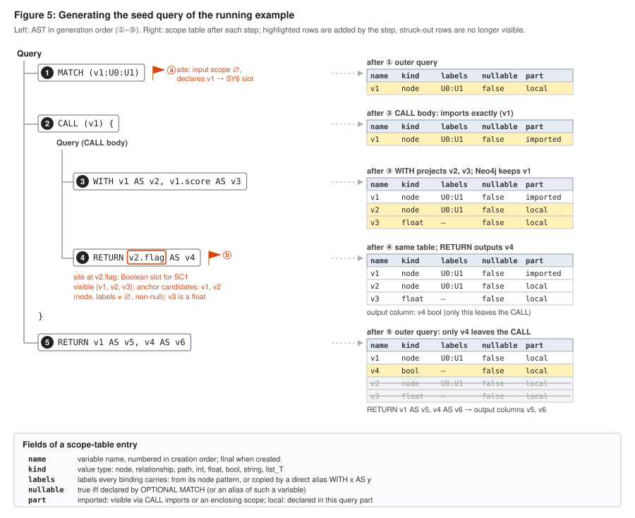
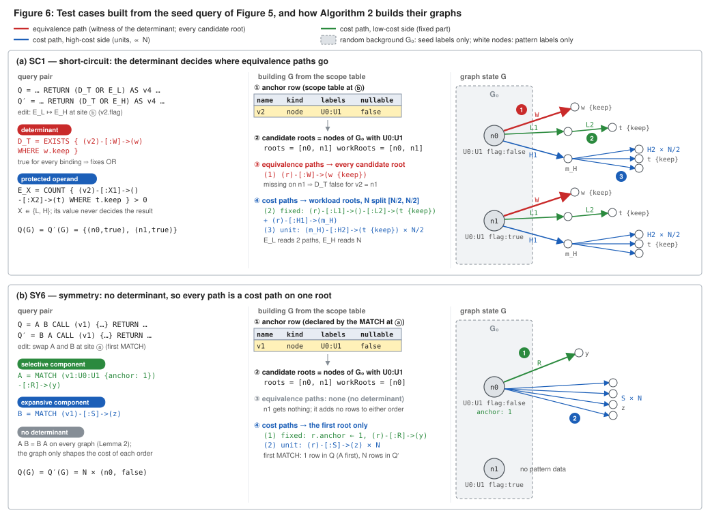

# 4 Approach

This section presents GraphSymPerf. §4.1 gives an overview and the technical challenges. §4.2–§4.6 then describe the six steps of the workflow, and §4.7 shows why the constructed query pairs are equivalent and why their slowdowns reveal missed optimizations.

## 4.1 Overview

A test case of GraphSymPerf consists of a query pair $Q$, $Q'$ and a graph state $G$. We construct the case so that $Q$ and $Q'$ return the same result multiset on $G$, while one of them can be answered with much less work than the other. A graph DBMS that applies the expected optimization should therefore run both queries in similar time, and a stable slowdown indicates a missed optimization.

**Technical challenges.** This design realizes the key insight of §1: each pair encodes an explicit optimization opportunity. SCor [15] applies a related idea to relational DBMSs, drawing low-cost and high-cost items from tables that share one schema but differ in size. Realizing the insight on graph data raises three challenges that such a table-based construction does not face.

- **C1: Cost depends on the bound anchor.** Graph queries reach data by traversing from variables that the enclosing query has bound, as in the correlated subquery `COUNT { MATCH (v2)-->()-->() }`. A larger graph makes such an operand expensive only if the added edges are reachable from the nodes to which the anchor binds.
- **C2: Equivalence depends on the data.** A guard that reads the graph, such as an `EXISTS` test, fixes the result only if it holds for *every* binding that reaches the mutation point.
- **C3: Queries and data must agree on names.** The high-cost region appears only in $Q'$, yet it must exist in $G$; at the same time, the data added for the pattern must not be picked up by the rest of the query, or both queries slow down together.

GraphSymPerf addresses C1 by choosing anchors through scope analysis and placing the workload where they bind (§4.3, §4.5), C2 by writing the witness of every determinant on every candidate root (§4.5, Lemma 1), and C3 by giving every name its final value when it is created, in separate namespaces (§4.4). Beyond short-circuiting, it introduces *symmetry* patterns, which reorder interchangeable components and whose equivalence does not depend on the data (Lemma 2).

**Figure 4: Overview of GraphSymPerf.**

**Workflow.** Figure 4 shows the six steps of GraphSymPerf. ① A grammar-guided generator produces a random seed query with final names and constants, and a scope table that records the kind, labels and nullability of every variable visible at each AST node (§4.2). ② GraphSymPerf selects a mutation pattern and a compatible mutation point, embeds the pattern there, and prepares a local edit. A short-circuit pattern protects a low-cost operand $L$ with a determinant that already fixes the result, and its edit replaces $L$ with a high-cost operand $H$; a symmetry pattern places a cheap and an expensive component in an order-insensitive construct, and its edit reorders them. Embedding also records which graph data the pattern needs (§4.3). ③ GraphSymPerf takes the embedded query as the base query $Q$ and applies the edit to a copy of $Q$ to obtain $Q'$ (§4.4). ④ It then generates a graph state that keeps both queries equivalent and contains *few* matches for the low-cost side and *many* matches, scaled by $N$, for the high-cost side (§4.5). ⑤ Finally, it executes both queries on the graph DBMS under test and ⑥ reports a missed optimization only if their results agree and the slowdown is large and stable (§4.6). Algorithm 1 implements steps ①–③, and Algorithm 2 implements step ④.

**Running example.** We illustrate the approach with one seed query. Figure 5 generates it step by step and shows the scope table that the generator maintains; Figure 6 builds two test cases from it, one with the short-circuit pattern SC1 and one with the symmetry pattern SY6.



**Figure 5: Generating the seed query of the running example.** Left: the AST in generation order; the circled numbers ①–⑤ give the order in which the generator creates the clauses, and within a clause it creates the expressions from left to right. Right: the scope table after each step, with the fields `name`, `kind`, `labels`, `nullable` and `part` defined in Table 2; rows added by a step are highlighted, and a struck-out row is no longer visible. The two flags mark the AST nodes at which the scope analysis records a site that a pattern of Figure 6 later uses: ⓐ the first `MATCH`, whose input scope is empty and which declares `v1` (a slot for SY6), and ⓑ the projection `v2.flag`, a Boolean expression with `v1`, `v2` and `v3` visible (a slot for SC1). Labels, property keys and constants are final when they are drawn, so the AST that step ⑤ completes is already an executable query.



**Figure 6: Test cases built from the seed query of Figure 5.** (a) SC1 replaces `v2.flag` with $D_T$ `OR` $E_L$ to obtain $Q$, and replaces $E_L$ with $E_H$ to obtain $Q'$. (b) SY6 replaces the first `MATCH` with two components $A$ and $B$ that share `v1`, and swaps them. Each part has three columns. The left column shows the query pair and the definitions of its parts; in (a) the determinant $D_T$ is marked, while (b) has no determinant and instead marks the selective component $A$ and the expansive component $B$. The middle column shows how Algorithm 2 builds the graph: the anchor's row of the scope table gives the labels `U0:U1`, which resolve to the candidate roots `[n0, n1]` of the random background graph $G_0$; below it, `req` lists the paths to write, split into *equivalence* paths, which go on every candidate root, and *cost* paths, which go on the workload roots. The right column shows the resulting graph: $G_0$ is grey and carries only seed labels; the white nodes added by Algorithm 2 carry only pattern labels; the determinant's witness path (1) is drawn on both roots, and the low-cost path (2) and the high-cost region (3) on the workload roots. `{keep: true}` marks the end nodes that satisfy the omitted predicates `WHERE ·.keep`. $N \gg 1$ is the workload scale, and $Q(G)$ denotes the result multiset of $Q$ on $G$. Queries and graphs abbreviate labels, property keys and relationship types.

```text
Algorithm 1: Query Generation and Mutation
Input:  target graph DBMS with capability set B, mutation pattern p
Output: query pair (Q, Q′) and graph requirements req,
        or ⊥ if p is not applicable
 1: // Step 1: Random AST generation
 2: T ← GenerateAST(B)                              ▷ final names and constants; a scope table per node
 3: // Step 2: Pattern embedding
 4: sites ← {s ∈ T | p is applicable at s}
 5: if sites = ∅ then return ⊥
 6: Select a mutation point s from sites at random.
 7: a ← SelectAnchor(variables visible at s or declared by T[s])
 8: if p is a short-circuit pattern then
 9:     (E_L, E_H) ← WorkOperands(p, a)             ▷ same shape, low- and high-cost regions
10:     D ← Guard(p, a)                             ▷ fixes the result for every binding of a
11:     F ← p.Form(D, E_L);  edit ← replace E_L with E_H
12: else                                            ▷ symmetry pattern
13:     F ← p.Form(T[s], a);  edit ← swap the two components of F
14: end if
15: Replace T[s] with F;  req ← p.Requirements(a, F)
16: // Step 3: Query mutation
17: Q ← T;  Q′ ← apply edit to a copy of Q          ▷ edit adds no names or constants
18: if not Consistent(Q, Q′) then return ⊥          ▷ scope, output columns, textual change
19: return (Q, Q′, req)
```

## 4.2 Random AST Generation

The seed query supplies the context in which a pattern is embedded: the clauses around the mutation point, the variables in scope, and the outputs that observe the mutated value. GraphSymPerf generates it from the compact grammar in Figure 7.

**Figure 7: Compact syntax supported by GraphSymPerf.**

```text
Q    ::= C* RET | Q UNION [ALL] Q
C    ::= [OPTIONAL] MATCH P (, P)* [WHERE BE]
       | WITH IT (, IT)* [WHERE BE]
       | UNWIND LE AS id
       | CALL (id*) { Q }
RET  ::= RETURN [DISTINCT] IT (, IT)* [ORDER BY id+ [SKIP int] [LIMIT int]]
IT   ::= E AS id
P    ::= [id =] NP (RP NP)*
NP   ::= (id (:ℓ)+ [{k: c}]) | (id)
RP   ::= -[[id] :r [*1..int]]-> | <-[…]- | -[…]-
BE   ::= BE AND BE | BE OR BE | NOT BE | E COP E
       | E IS [NOT] NULL | EXISTS { SQ }
E    ::= id | id.k | c | BE | E AOP E
       | CASE WHEN BE THEN E ELSE E END
       | coalesce(E, E) | COUNT { SQ } | size(LE)
SQ   ::= Q | MATCH P WHERE BE
LE   ::= [E (, E)*] | COLLECT { Q }
COP  ::= = | <> | < | > | <= | >=
AOP  ::= + | - | *
```

A node pattern either introduces a fresh variable, which carries at least one label, or refers to an already bound variable, written `(id)`; every relationship pattern has a type. The namespace separation of §4.4 relies on these two restrictions.

**Generation.** `GenerateAST` (Algorithm 1, line 2) expands the grammar top-down from $Q$. At each step, it samples only among productions that are well typed, reference only variables in scope, and belong to the capability set $B$ of the target DBMS. $B$ records the dialect differences that affect generation, such as whether `CALL` may appear inside expression subqueries, whether a `WITH` clause keeps imported variables, and whether subqueries are written as full queries, as `MATCH` bodies or as pattern comprehensions. Generation limits $\Omega$ bound the expansion budget, the number of clauses and the nesting depth; once the budget is exhausted, only terminating productions remain. To keep results deterministic, the generator precedes every `SKIP` or `LIMIT` with an `ORDER BY` over all scalar output columns and applies aggregates only to constants.

**Names and constants.** Terminals are final when the generator draws them. Labels (`ℓ`) come from `Random_label_0`–`Random_label_3`, relationship types (`r`) from `Random_relationship_0`–`Random_relationship_2`, and property keys (`k`) are one key per value type, `property_int`, `property_float`, `property_bool` and `property_string`. A constant (`c`) is drawn by type from the small domains from which the background graph also draws its property values (§4.5): integers from −2 to 4, the floats 0.5, 1.5 and 2.5, both Booleans, and the strings `a`, `b` and `c`. Each name records its kind (label, relationship type or typed key), so later steps can collect the labels, types and keys that the query uses. Step ① therefore ends with an instantiated query: it can be rendered and executed as it is, and no later step fills in a name or a constant.

**Scope table.** While it expands the grammar, the generator maintains a *scope table* that lists the variables a production may reference. Each entry describes one query variable with the fields of Table 2.

**Table 2: Fields of a scope-table entry.**

| Field | Values | Meaning |
|---|---|---|
| `name` | `v1`, `v2`, … | The variable's name, numbered in creation order and final when created. |
| `kind` | `node`, `relationship`, `path`, `int`, `float`, `bool`, `string`, `list_T` | The value type. A production references only entries of the kind it needs; a property access `x.k` needs a node or relationship. |
| `labels` | a set of seed labels, possibly empty | The labels that every binding of the variable carries: those written in the node pattern that declares it, or those of the source of a direct alias `WITH x AS y`. It is empty for relationships, paths and scalars. |
| `nullable` | `true`, `false` | Whether the variable can be null because it is declared by an `OPTIONAL MATCH` or aliases such a variable. A non-null node variable is bound to an existing node in every row. |
| `part` | `imported`, `local` | `imported` entries are visible because an enclosing `CALL` imports them or because an expression subquery sees its enclosing scope; `local` entries are declared in the current query part. |

The variables visible at a point are the imported and local entries together. Each clause updates the table when it is complete:

- `MATCH` adds every fresh node, relationship and path variable to `local`, with the labels of its node pattern; `nullable` is true for `OPTIONAL MATCH`. A reference `(x)` to a bound variable adds nothing.
- `WITH` replaces `local` with its projected aliases. A direct alias copies `kind`, `labels` and `nullable` from its source; any other expression gives its kind and no labels. The `imported` entries remain visible if $B$ says that the DBMS keeps `CALL` imports across `WITH` (Neo4j does; ArcadeDB does not, so they are dropped).
- `UNWIND` adds its variable to `local` with the element kind of the list.
- `CALL (x, …) { Q }` generates $Q$ against a new table whose `imported` part holds exactly `x, …`. When $Q$ is complete, the columns that $Q$ returns are added to the caller's `local` part; nothing else leaves the `CALL`.
- An expression subquery (`EXISTS`, `COUNT`, `COLLECT` or a pattern comprehension) generates its body against a child table whose `imported` part is everything visible; the variables it declares do not leave the subquery.
- `RETURN` ends the query part; its aliases are the output columns.

**Generation order.** The generator first decides the form of the query, a single part or a `UNION` of two parts with the same output columns, then the number of clauses, then creates the clauses from left to right and finally the `RETURN`. The expressions of a clause are created from left to right against the table as it stands before the clause, except that the `WHERE` of a `MATCH` also sees the variables the `MATCH` declares. Every expression is created for a required kind; at a leaf, the generator picks a visible entry of that kind, a property of a visible node or relationship under the key of that kind, or a constant of that kind.

Figure 5 traces the generation of the running example. ① The table is empty, so the first `MATCH` declares a fresh node `v1` and draws two labels, `U0:U1`. ② `CALL` draws a subset of the visible variables to import and takes `v1`; its body starts with `v1` as its only, imported, entry. ③ The `WITH` aliases `v1` as `v2`, which copies `node`, `U0:U1` and non-null, and then creates a float expression whose leaf is a property of `v1` under the float key `score`, named `v3`. Because Neo4j keeps `CALL` imports, `v1` remains visible next to `v2` and `v3`. ④ The inner `RETURN` creates a Boolean expression whose leaf is a property of `v2` under the Boolean key `flag`, named `v4`; when the `CALL` ends, only `v4` enters the outer table. ⑤ The outer `RETURN` projects the visible `v1` and `v4`. The result is the instantiated seed query

```cypher
MATCH (v1:U0:U1)                   // ①
CALL (v1) {                        // ②
  WITH v1 AS v2, v1.score AS v3    // ③
  RETURN v2.flag AS v4             // ④
}
RETURN v1 AS v5, v4 AS v6          // ⑤
```

**Scope analysis.** After generation, a scope analysis walks the finished AST with the same rules and records a *site* for every AST node $s$: the position of $s$, the node itself, and a copy of the scope table visible at $s$. For a `MATCH` clause, the recorded table is its input, that is, the table before the clause. The scope analysis also rejects a query that references an invisible variable or mixes kinds. The sites are the only input that pattern embedding (§4.3) reads besides the AST. Figure 5 marks the two sites that Figure 6 uses: at ⓐ, the first `MATCH`, the recorded table is empty; at ⓑ, the projection `v2.flag`, it holds

| `name` | `kind` | `labels` | `nullable` | `part` |
|---|---|---|---|---|
| `v1` | `node` | `U0:U1` | false | imported |
| `v2` | `node` | `U0:U1` | false | local |
| `v3` | `float` | – | false | local |

The seed query does not depend on the pattern, so the same seed query can host different patterns.

**Gremlin.** For Gremlin, GraphSymPerf generates the linear subset of Figure 7, which excludes `UNWIND`, `CALL` and pagination, and renders it as traversal steps (Table 3). Its scope table has a single current entry, the object that the traverser carries, with a `kind` and `labels` (set by `hasLabel`), plus the entries that earlier `as(·)` steps have named and `select(·)` can read back; a reduction such as `count()` clears the named entries. We present the approach in terms of Cypher; the Gremlin adaptation differs only in steps ① and ②.

**Table 3: Rendering of Figure 7 constructs in Gremlin.**

| Construct | Gremlin |
|---|---|
| `MATCH (x:ℓ)` | `g.V().hasLabel(ℓ)` |
| `MATCH (x)-[:r]->(y:ℓ)` | `.out(r).hasLabel(ℓ)` |
| `WHERE` | `.filter(·)` |
| `WITH x AS y` | `.as(y)`, read back with `.select(y)` |
| `CASE`, `coalesce` | `.choose(·)`, `.coalesce(·)` |
| `COUNT {…}` | `.count()` |

## 4.3 Pattern Embedding

**Patterns.** [Table 1](pattern-catalog.en.md) lists 16 mutation patterns in two families. *Short-circuit patterns* (SC1–SC8) rely on an unchanged *determinant*, a guard or demand condition that fixes the result before a protected operand is evaluated; the mutation replaces this operand with a more expensive one. *Symmetry patterns* (SY1–SY8) rely on an algebraic symmetry such as commutativity; the mutation reorders two unchanged components. Each pattern accepts one kind of syntactic slot: Boolean expressions host SC1, SC2, SC7, SY1 and SY2; scalar expressions host SC3 and SC4; row sources with scalar output host SC5, SC6 and SC8; single-edge path patterns host SY3 and SY4; and mandatory `MATCH` clauses without `WHERE` host SY5–SY8.

**Determinants.** Every short-circuit form contains an unchanged part that fixes its result; we call it the *determinant* $D$ of the form. Precisely, let $F$ be a short-circuit form with protected operand $E$. $D$ is a determinant of $F$ if, for every input binding $\eta$ that reaches the mutation point, the value of $D$ under $\eta$ fixes the value of $F$ under $\eta$, or, for a row source, its output rows, whatever $E$ evaluates to. For SC1 the determinant is a true `OR` operand $D_T$ and for SC2 a false `AND` operand $D_F$; for SC3 it is the first `WHEN` condition, which is true; for SC4 the non-null prefix $V$ of `coalesce`; for SC5 the zero demand `LIMIT 0`; for SC6 the $k$ witness rows before `LIMIT k`; for SC7 the first row of the `EXISTS` subquery; and for SC8 the empty mandatory input. A determinant either reads no data, such as a literal, a constant comparison, `LIMIT 0` or `WHERE FALSE`, or it reads the graph from the anchor, such as an `EXISTS` or `COUNT` test over a witness region. In the second case, $D$ is decisive only on a graph that contains its *witness*, the data that makes $D$ take its decisive value for a binding; §4.5 therefore writes the witness on every candidate root.

Symmetry patterns have no determinant. Both components are evaluated in either order, and the two forms are equal because the construct is symmetric, not because one part fixes the result (Lemma 2); this holds on every graph. The components differ only in cost: one is *selective*, with few matches on $G$, and the other is *expansive*, with matches in proportion to $N$, and the written order may decide how often the planner evaluates the expansive one. The guard-swap variant of SY1 and SY2 places a constant or witnessed operand next to a high-cost operand and swaps them. That operand fixes the value of `AND` or `OR`, but the swap is equivalent without it, so for SY1 and SY2 it only lets one of the two orders skip the high-cost operand.

Algorithm 1 accesses a pattern $p$ only through its slot, its applicability conditions from Table 1, a function `Form` that builds the fragment replacing the slot, and a function `Requirements` that derives the graph requirements; short-circuit patterns additionally provide candidate pools for their operands (`WorkOperands`) and determinants (`Guard`). We say that $p$ is *applicable* at an AST node $s$ if $s$ fits the slot of $p$, $B$ supports every construct that $p$ introduces, and the context of $s$ satisfies the applicability conditions of $p$. For example, SY5–SY8 require that neither component uses variables introduced only by the other, and SY3 and SY4 require that the enclosing query does not observe the order of the path.

**Mutation point selection** (Algorithm 1, lines 4–6). GraphSymPerf reads the site of every AST node (§4.2), keeps the nodes at which $p$ is applicable and samples one of them. Choosing by the scope table rather than by name matters. At site ⓑ of Figure 5, the projection `v2.flag` is a Boolean slot for SC1 with `v1`, `v2` and `v3` in scope; `v1` remains visible after the `WITH` because the target DBMS keeps the imports of `CALL`. Although `v2` never appears in a labelled `MATCH`, it inherits `U0:U1` and non-nullability from `v1` through the alias and can therefore start a correlated path; `v3` is a float and cannot. A choice by name could pick `v3`, and a check limited to the labels of the current clause would miss `v2`. The first `MATCH` is a slot for SY6: its input scope is empty, but the clause itself declares `v1`, which the later `CALL (v1)` uses, so SY6 reuses `v1` as the shared root of its components.

**Anchor selection** (line 7). An anchor candidate is a visible entry of the scope table with `kind` = `node`, a non-empty `labels` set and `nullable` = false; at ⓑ, these are `v1` and `v2`. The three fields serve three purposes: the anchor must be a node from which a path can start, its labels later identify the nodes it can bind to (§4.5), and a non-null anchor is bound to an existing node in every row. `SelectAnchor` chooses between a *correlated* fragment, which reuses a visible non-null node variable with known labels as its anchor so that its cost depends on the bindings produced by the seed query (C1), and an *uncorrelated* fragment, which starts from a fresh root and exercises subqueries that do not depend on outer bindings. When candidates exist, it chooses a correlated fragment with probability $p_c$; otherwise it uses a fresh root. Clause-level symmetry patterns such as SY6 always reuse the variables that the replaced clause declares.

**Short-circuit embedding** (lines 8–11). GraphSymPerf samples a work candidate, namely a one-hop count, a two-hop count, a non-matching `EXISTS` or a row source, and instantiates it twice from the anchor $a$: once on a low-cost region and once on a high-cost region. The resulting operands $E_L$ and $E_H$ have the same shape, but their relationship types and end labels belong to disjoint regions. The determinant $D$ must have the same value for every binding of $a$; it is a literal, a constant comparison, a count or existence test over a separate witness region, or a property of the anchor wrapped in `coalesce`. The embedded form $F$ uses $E_L$, and the edit replaces $E_L$ with $E_H$. For instance, SC1 rewrites a Boolean expression and SC4, the pattern of the motivating example in Figure 2, rewrites a scalar expression:

$$BE \;\rightarrow\; D_T \;\texttt{OR}\; E_L, \qquad E \;\rightarrow\; \texttt{coalesce}(\texttt{NULL},\, V,\, E_L),$$

$$E_X \;::=\; \texttt{COUNT}\,\{\texttt{MATCH}\,(a)\text{-}[{:}r_X]\text{->}()\text{-}[{:}r'_X]\text{->}(t)\;\texttt{WHERE}\;t.\texttt{keep}\} > 0 \;\mid\; \cdots, \qquad X \in \{L, H\},$$

where $D_T$ is a determinant that is always true and $V$ is an unchanged non-null value. In Figure 6(a), SC1 uses the anchor `v2`, an existence test as its determinant and a two-hop count as its work operand. Here and in Figure 6, we omit the labels of the fresh nodes `w`, `t` and the unnamed middle nodes; each of them carries a label from the pattern namespace (§4.4):

```text
D_T = EXISTS { MATCH (v2)-[:W]->(w) WHERE w.keep }
E_X = COUNT  { MATCH (v2)-[:X1]->()-[:X2]->(t) WHERE t.keep } > 0      X ∈ {L, H}
F   = D_T OR E_L                                                      replaces v2.flag
```

**Symmetry embedding** (lines 12–13). The form reuses the components at the mutation point or extends them with fresh ones, and the edit reorders two components without changing either. In Figure 6(b), SY6 replaces the first `MATCH` at site ⓐ with two mandatory components that share only `v1`. The recipe also chooses which component is selective, here $A$ with a single `R` edge, and which is expansive, here $B$ with $N$ `S` edges; the property `{anchor: 1}` restricts the root to a single node:

```text
A = MATCH (v1:U0:U1 {anchor: 1})-[:R]->(y)
B = MATCH (v1)-[:S]->(z)
F = A B,  edit = swap A and B
```

**Graph requirements** (line 15). Embedding also records what the graph state must contain. The requirements `req` consist of three parts:

- the *anchor*, the scope-table entry of $a$; its `labels` identify the candidate roots;
- the *equivalence paths*, the witnesses of the determinant, which every candidate root needs so that $D$ keeps its decisive value. They are empty if the determinant reads no data, and always empty for symmetry patterns;
- the *cost layout*, which states whether one root or every root carries the workload and, for each such root, a *fixed part* built once and a *unit* repeated in proportion to $N$. The fixed part holds the low-cost side ($E_L$, or the selective component) and the unit one high-cost match ($E_H$, or one match of the expansive component).

All random choices of the pattern are made here and recorded in `req`: the anchor, the kind of determinant, the work candidate and, for a symmetry pattern, which component is selective. Given `req`, the pattern part of the graph is determined. The middle columns of Figure 6 show `req` for the running example, and Table 5 (§4.5) lists the requirements of all patterns.

**Gremlin.** GraphSymPerf supports SC1–SC8, SY1, SY2 and SY5–SY7 for Gremlin. Short-circuit patterns and SY1/SY2 are embedded at `filter`, `map` or final traversal steps; SY5–SY7 insert a declarative `match()` step with two patterns after the root `V().hasLabel(·)` and exchange those patterns. Because a traverser carries a single current object, the anchor is either that object or a node named by an earlier `as(·)` step and reached through `select(·)`, so every Gremlin fragment is correlated. The work operands are one-hop traversals such as `out(r_X).has('keep', true)`, and the short-circuit edit replaces the relationship type $r_L$ with $r_H$.

## 4.4 Query Generation and Mutation

**Names and constants** (Algorithm 1, lines 2 and 9–15). Every name is final when it is created, so no binding step follows embedding. The seed names and constants are fixed in step ① (§4.2). Embedding names everything the pattern adds, including the edit and the graph requirements, in a separate `Pattern_` namespace. Each name records its kind (label, relationship type, or typed property key), which the background graph and the schema declarations of §4.5 use. Table 4 shows part of the names for SC1 and where each name is used.

**Table 4: Part of the names used by SC1 in Figure 6(a).**

| Abbreviation | Owner | Name | $Q$ | $Q'$ | $G$ |
|---|---|---|:-:|:-:|:-:|
| `U0`, `U1` | seed | `Random_label_0`, `Random_label_1` | ✓ | ✓ | ✓ |
| `flag`, `score` | seed | `property_bool`, `property_float` | ✓ | ✓ | ✓ |
| `W` | pattern | `Pattern_p_witness_edge` | ✓ | ✓ | ✓ |
| `L1`, `L2` | pattern | `Pattern_p_low_first_edge`, `Pattern_p_low_edge` | ✓ | | ✓ |
| `H1`, `H2` | pattern | `Pattern_p_high_first_edge`, `Pattern_p_high_edge` | | ✓ | ✓ |
| labels of `w`, `m`, `t` | pattern | `Pattern_p_witness`, `Pattern_p_low_middle`, `Pattern_p_low`, … | ✓ | ✓ | ✓ |

Naming at creation provides two guarantees on which the rest of the approach relies.

*Shared names.* $Q$, $Q'$ and $G$ use the same names, including names that only some of them mention. In Table 4, the high-cost types `H1` and `H2` never occur in $Q$, yet §4.5 must build $N$ paths of exactly these types for $Q'$ to traverse; conversely, `L1` and `L2` occur in $Q$ but not in $Q'$. Embedding creates the edit and the graph requirements together with $F$, so $Q'$ and $G$ refer to the same names, and the mutation itself draws no names or constants. Hence $Q$ and $Q'$ differ only at the mutation point.

*Namespace separation.* Seed labels and relationship types are disjoint from pattern labels and relationship types. Since every fresh node pattern carries a label and every relationship pattern a type (§4.2), the seed query can reach the data added for the pattern only through the paths that the pattern itself writes. Suppose instead that the high-cost end nodes carried the seed labels `U0:U1`: the seed pattern `MATCH (v1:U0:U1)` would also bind `v1` to these $N$ nodes, both queries would change in result and cost, and the cost difference would no longer be confined to the mutation point. Property keys are not separated; a pattern marker such as `keep` may also occur on background nodes and in seed predicates. This is harmless, because a seed predicate can reach a pattern node only through a pattern label or type.

**Mutation** (lines 17–18). The embedded AST is the base query $Q$; GraphSymPerf applies the edit to a copy of $Q$ to obtain $Q'$; the short-circuit mutation replaces $E_L$ with $E_H$, and the symmetry mutation reorders the two components of $F$. A static check then requires both queries to satisfy the scope rules of §4.2, to expose the same output columns, and to differ in text. Whether their results are equal is decided by execution (§4.6). Figure 6 shows the resulting pairs.

## 4.5 Graph State Generation

Algorithm 2 builds the graph state $G$ from the requirements `req`. Only the background graph is random. The rest is derived: the host witness from the seed query, and the pattern data from `req`, starting at the nodes that the anchor's scope-table entry identifies. For the pattern data, Algorithm 2 answers two questions separately. Which paths does the equivalence of $Q$ and $Q'$ depend on, and on which roots must they exist? Which paths carry the cost, and on which roots should it concentrate?

```text
Algorithm 2: Graph State Generation
Input:  query pair (Q, Q′), graph requirements req, workload scale N
Output: graph state G on which Q and Q′ are equivalent, or ⊥
 1: // Step 1: Background graph
 2: G ← RandomGraph(seed names) ∪ HostWitness(Q)    ▷ random part, then one host match
 3: // Step 2: Candidate and workload roots
 4: roots ← nodes of G with every label in req.anchor.labels, in creation order
 5: if roots = ∅ then roots ← [a new node with the anchor's labels]
 6: if req.layout = PerRoot then                    ▷ short-circuit patterns, SY1, SY2
 7:     workRoots ← roots
 8: else                                            ▷ SY3–SY8
 9:     workRoots ← [first node of roots]
10: end if
11: if req needs a unit on every workload root and N < |workRoots| then return ⊥
12: // Step 3: Equivalence paths
13: for each root r in roots do
14:     for each path w in req.equivalence do
15:         AddPath(G, r, w)                        ▷ makes D decisive when the anchor binds to r
16:     end for
17: end for
18: // Step 4: Cost paths
19: (q_1, …, q_k) ← Split(N, k = |workRoots|)       ▷ near-equal shares that sum to N
20: for i ← 1 to k do
21:     h ← AddPath(G, workRoots[i], req.fixed)     ▷ built once: low-cost side
22:     for j ← 1 to q_i do
23:         AddPath(G, h, req.unit)                 ▷ one high-cost match
24:     end for
25: end for
26: // Step 5: Schema registration
27: Register the labels, types and keys of Q, Q′ and G in the DBMS schema.
28: return G

29: function AddPath(G, u, f)
30:     Create the nodes, edges and properties of fragment f, starting from node u.
31:     return the node of f to which later fragments attach
32: end function
```

**Background graph** (lines 1–2). `RandomGraph` is the only random step of Algorithm 2. It creates $n_0$ nodes, gives each one or two labels drawn from the seed labels, and sets the marker properties `keep` and `value` and, with high probability, each seed key to a value drawn from the domain of its type (§4.2). It then adds $m_0$ edges with uniformly drawn endpoints and seed relationship types. It does not solve the predicates of the seed query; it only provides a context that is independent of the pattern. Because it uses seed names only, no background node carries a pattern label (§4.4). The random choices of the pattern itself, such as the anchor, the kind of determinant and the selective component, were made in step ② and are recorded in `req`, so for a given seed the rest of Algorithm 2 is deterministic. In Figure 6, $G_0$ consists of two unconnected nodes `n0` and `n1` labelled `:U0:U1`, with `flag` set to `false` and `true`.

**Host witness** (line 2). Random edges rarely complete a multi-hop host pattern, so without help many pairs return no rows and the workload sits on roots that the seed query never reaches. `HostWitness` therefore adds one instance of the seed query's mandatory matching: for Cypher, every non-optional `MATCH` path, with its labels, relationship types, shortest allowed length and literal property filters (inline maps and `=` conjuncts in `WHERE`); for Gremlin, the root traversal's `out`/`in`/`both` + `hasLabel` steps and simple `has` filters, continuing past the pattern's own steps. A node variable reuses the first existing node with its labels, which symmetry recipes also choose as their root. Pattern-owned names (`Pattern_` types, `p_` keys) are left to the recipe. Because `HostWitness` runs before the candidate roots are collected, a planted node that carries the anchor's labels is a candidate like any other and receives the equivalence and cost paths of lines 12–25; Lemma 1 is therefore unaffected. After line 25, the candidate roots of a short-circuit anchor also receive the equality filters that the seed query places on the anchor itself. The queries are never changed.

**From the scope table to the roots** (lines 3–11). The anchor's entry in the scope table determines where the pattern data starts. Its `kind` is `node` and its `nullable` is false, so every binding of the anchor at the mutation point is an existing node; its `labels` are carried by every such node. The candidate roots are therefore the nodes that carry all of these labels (line 4), and every binding of the anchor is a candidate root (A3, §4.7). If there are none, a new root is created. Filtering by label alone over-approximates the inputs, since other predicates of the seed query may stop some candidates from reaching the mutation point. The workload roots are all candidates for short-circuit patterns, SY1 and SY2, and only the first candidate for the other symmetry patterns. SY8 is the one exception: it adds three roots next to the first, so that the four roots cover the cases in which both, one or neither of its optional branches match (Table 5). Line 11 rejects a case whose pattern needs at least one unit on every workload root but whose $N$ is smaller than the number of such roots; for example, SC7 needs a high-cost match on every root so that `EXISTS` keeps its value.

**Which paths go where.** Algorithm 2 decides the placement of each path that `req` mentions by one question: can the path change the result of $Q$ or $Q'$? Only the witness of a determinant can. If it is missing for one binding, $D$ loses its decisive value for that binding, the protected operand decides the result, and $Q$ and $Q'$ may differ. The witness is therefore an *equivalence path*, and it goes on every candidate root, because the anchor may bind to any of them. The paths of $E_L$ and $E_H$ cannot change the result: $D$ already fixes it, so their values are irrelevant, and they only determine how much work an evaluation that ignores $D$ performs. They are *cost paths* and go on the workload roots; the no-match `EXISTS` candidate even writes end nodes that fail its predicate. Symmetry patterns have no determinant, so none of their paths can change the result, and all of them are cost paths. They go on a single root, where the selective component gets a fixed part and the expansive component gets the $N$ units; every other candidate contributes the same rows to both forms. The guard-swap variant of SY1 and SY2 writes its operand's witness on every root, but as a cost path: it lets one order skip the high-cost operand for every binding.

**Equivalence paths** (lines 12–17). For each candidate root, Algorithm 2 adds every path of `req.equivalence` (Table 5). A determinant that reads no data, such as a literal or `LIMIT 0`, needs none; one that reads an anchor property, such as `coalesce(a.p_guard, true)`, needs that property on every root instead of a path.

**Cost paths** (lines 18–25, 29–32). `Split` divides $N$ into near-equal integer shares over the workload roots. For each workload root, line 21 builds the fixed part once, and lines 22–24 attach $q_i$ units to the node `h` that the fixed part returns. Only the units count towards $N$. Because `h` can be an inner node, a two-hop high-cost region creates its middle node once, and each further match adds a single edge from it. A fragment may also consist of properties only, such as `anchor = 1` in SY6.

**Schema registration** (lines 26–27). Finally, Algorithm 2 declares the labels, relationship types and property keys of both queries and of $G$ in the DBMS schema, so that empty regions are declared as well.

**Running example.** The trace below runs Algorithm 2 on Figure 6. $G_0$ is random. The host witness of `MATCH (v1:U0:U1)` reuses `n0` and adds nothing. Both anchors have `labels` = `U0:U1` in the scope table, so both cases have the candidate roots `[n0, n1]`. In SC1, the determinant $D_T$ is an `EXISTS` test over `W`, so its witness is an equivalence path on both roots: `v2` can bind to `n0` in one call and to `n1` in another, and a witness on `n0` cannot make the `EXISTS` true for `n1` (marker (1) in Figure 6(a)). Markers (2) and (3) are the low-cost path and the high-cost region, both cost paths. SY6 has no determinant; it places its selective arm and its $N$ expansive edges on `n0` (markers (1) and (2) in Figure 6(b)), while `n1` contributes no rows in either join order.

```text
Trace on Figure 6.   G₀ = { n0:U0:U1 {flag: false},  n1:U0:U1 {flag: true} }   (random)
                     HostWitness(MATCH (v1:U0:U1)) reuses n0, adds nothing

SC1   req.anchor      = v2 : node, U0:U1, non-null      req.layout = PerRoot
      determinant     = D_T = EXISTS { (v2)-[:W]->(w) WHERE w.keep }
      req.equivalence = [ (r)-[:W]->(w {keep}) ]                        ▷ (1)
      req.fixed       = (r)-[:L1]->()-[:L2]->(t {keep}),  (r)-[:H1]->(m_H)   ▷ (2), returns m_H
      req.unit        = (m_H)-[:H2]->(t {keep})                         ▷ (3)

      roots = [n0, n1]     workRoots = [n0, n1]     q = [N/2, N/2]
      n0 :  (1) W   (2) L1-L2   H1 to m_H   (3) N/2 × H2 from m_H
      n1 :  (1) W   (2) L1-L2   H1 to m_H   (3) N/2 × H2 from m_H
      Q(G) = Q′(G) = {(n0, true), (n1, true)}     E_L reads 2 paths, E_H reads N

SY6   req.anchor      = v1 : node, U0:U1, non-null      req.layout = OneRoot
      determinant     = none
      req.equivalence = [ ]
      req.fixed       = r.anchor ← 1,  (r)-[:R]->(y)    ▷ (1) selective A, returns r
      req.unit        = (r)-[:S]->(z)                   ▷ (2) expansive B

      roots = [n0, n1]     workRoots = [n0]         q = [N]
      n0 :  anchor = 1   (1) one R edge   (2) N × S edge
      n1 :  nothing
      Q(G) = Q′(G) = N × (n0, false)              first MATCH: 1 row in Q, N rows in Q′
```

Table 5 summarizes the requirements of all patterns. Short-circuit patterns spread the workload over every candidate root, because the determinant must be decisive for every binding; symmetry patterns concentrate it on one root, because their equivalence needs no data.

**Table 5: Determinants and graph requirements of the mutation patterns.**

| Patterns | Determinant | Equivalence paths on every candidate root | Workload roots | Fixed part per workload root | Unit |
|---|---|---|---|---|---|
| SC1, SC2 | a true `OR` or false `AND` operand | one witness match if $D$ is an `EXISTS` or `COUNT` test | all | one low-cost match and the shared prefix of the high-cost matches | one high-cost match |
| SC3 | the first `WHEN` condition, which is true | as for SC1 | all | as for SC1 | one high-cost match |
| SC4 | the non-null `coalesce` prefix $V$ | one witness match if $V$ is a `COUNT` | all | as for SC1 | one high-cost match |
| SC5 | `LIMIT 0` | none | all | one low-cost row | one high-cost row |
| SC6 | $k$ witness rows before `LIMIT k` | $k$ witness rows | all | one low-cost row | one high-cost row |
| SC7 | the first row of `EXISTS` | one low-cost and at least one high-cost row (line 11) | all | one low-cost row | one high-cost row |
| SC8 | the empty mandatory input `WHERE FALSE` | none | all | one low-cost row | one high-cost row |
| SY1, SY2 | none | none; the guard-swap operand's witness is a cost path on every root | all | as for SC1 | one high-cost match |
| SY3 | none | none | first | the endpoint constraint on the root | one edge from the root, or from a node that fails the endpoint constraint |
| SY4 | none | none | first | one valid bounded path | one bounded path that fails the node predicate at a shared hub or at its end |
| SY5 | none | none | first | a selective component matching at most one node | one node of the expansive component |
| SY6 | none | none | first | the selective arm (one edge) | one edge of the expansive arm |
| SY7 | none | none | first | one complete chain | one right-hand edge that does not join the root |
| SY8 | none | none | four roots covering both, either and neither branch | one selective-branch edge on each root where it matches | one expansive-branch edge on a root where it matches |

## 4.6 Execution and Performance Checking

GraphSymPerf loads $G$ once per test case and does not modify it during measurement.

**Result check.** GraphSymPerf first executes $Q$ and $Q'$ and compares their outputs as typed result multisets, including column names and row multiplicities. Values are normalized by type before comparison, so that null, Booleans, integers, floating-point numbers and strings never compare equal across types, and graph entities are compared by identity. Under the assumptions of §4.7, $Q$ and $Q'$ are equivalent on $G$; a mismatch therefore indicates either a logic bug in the DBMS or a violated assumption, and it is reported as a result inconsistency rather than a performance issue. Every later execution is checked against the same reference result.

**Timing.** GraphSymPerf measures the pair in two phases, *discovery* and *confirmation*. A phase consists of $w$ untimed warm-up rounds followed by $n$ timed rounds; each round runs both queries once, and consecutive rounds alternate between the orders $QQ'$ and $Q'Q$ so that caching favours neither query. Let $t$ and $t'$ be the median times of $Q$ and $Q'$ in a phase, and call the query with the larger median the slower one. The phase passes if

$$\frac{\max(t, t')}{\min(t, t')} \ge \rho, \qquad \operatorname{median}_i\,(\text{slower}_i - \text{faster}_i) \ge \delta, \qquad \frac{\lvert\{i : \text{slower}_i > \text{faster}_i\}\rvert}{n} \ge \kappa.$$

The ratio threshold $\rho$ requires a large relative gap, the absolute threshold $\delta$ discards millisecond-scale gaps that noise dominates, and the consistency threshold $\kappa$ requires the same query to be slower in most rounds. The last condition is a one-sided sign test: if both queries had the same running-time distribution, each round would favour either query with probability $1/2$, and a fixed query would be slower in at least $\lceil \kappa n \rceil$ of $n$ rounds with probability

$$p(n, \kappa) \;=\; \sum_{i = \lceil \kappa n \rceil}^{n} \binom{n}{i}\, 2^{-n}.$$

**Performance checking.** A pair that passes discovery ($n = n_d$) is measured again in a longer confirmation phase ($n = n_c > n_d$). GraphSymPerf reports a *stable slowdown* only if confirmation also passes and identifies the same slower query, which bounds the chance of reporting pure noise by $p(n_c, \kappa)$. Queries that exceed the per-query timeout $\tau$ are recorded separately. For every pair whose timing completes, GraphSymPerf archives the profiled execution plans of both queries, together with the per-root allocations of §4.5, as evidence of the work that the DBMS fails to avoid.

**Scale response.** The ratio test above can miss a real gap. When both queries also share a large cost that grows with $N$, for example a label scan that the DBMS cannot restrict to seed nodes, both medians grow with $N$ and their ratio stays below $\rho$, although the extra work of the slower query also grows with $N$. The construction gives a second, scale-based signal. Neither a short-circuited operand nor a reordered component should make one form do work in proportion to $N$, so on an engine that applies the expected optimization the gap between the two forms should not depend on $N$.

GraphSymPerf therefore re-examines every pair that completes discovery without a gap at a second scale. It rebuilds the test case from the same seed with $N/s$ units instead of $N$. The seed fixes the background graph, the queries and `req`, and the queries must render identically; only the number of units, and hence the size of the high-cost side, changes. GraphSymPerf runs a discovery phase on the small graph. Let the slower query be the one with the larger median at scale $N$, and let $g_N$ and $g_{N/s}$ be the differences between its median and the other query's median at the two scales; $g_{N/s}$ is taken in the same direction and may be negative. The pair passes if

$$\frac{g_N}{\max(g_{N/s}, 1\,\text{ms})} \ge \gamma, \qquad g_N - g_{N/s} \ge \delta, \qquad \frac{\lvert\{i : \text{slower}_i > \text{faster}_i\}\rvert}{n} \ge \kappa,$$

where the sign test counts the rounds at scale $N$. A passing pair is measured in a fresh confirmation phase at both scales and becomes a *scale candidate* if the three conditions hold again with the same slower query. The first condition requires the gap to grow by a factor of at least $\gamma$ when the units grow by $s$; the second discards growth that is too small to rise above noise; the third is the sign test of the timing step. Subtracting the medians cancels the cost that both forms share, so a shared label scan does not count as growth. The defaults are $s = 10$ and $\gamma = 3$: a gap that grows in proportion to $N$ grows about tenfold, whereas a gap of fixed size stays near a factor of 1.

A stable slowdown has a different meaning for each family. For a short-circuit pair, a slower $Q'$ indicates that the DBMS evaluates the protected operand although the determinant already fixes the result. For a symmetry pair, a slowdown in either direction indicates that the plan depends on the syntactic order of two interchangeable components. §4.7 explains why such a slowdown reflects a missed optimization rather than an artifact of the constructed data.

## 4.7 Correctness

This section states the assumptions behind the construction, shows that they make $Q$ and $Q'$ equivalent on $G$, and explains why a stable slowdown between them reveals a missed optimization.

**Definition 1 (Equivalent query pair).** $Q$ and $Q'$ are *equivalent on* $G$, written $Q \equiv_G Q'$, if they expose the same output columns and $Q(G) = Q'(G)$ as bags of rows.

**Assumptions.** GraphSymPerf relies on three assumptions.

- **A1 (Determinism).** $Q$ and $Q'$ are read-only, and because the generator removes order-dependent outputs (§4.2), each denotes a single bag on $G$. Query semantics is compositional: replacing a subexpression or clause with one that yields the same value, or the same bag, for every input binding preserves the result.
- **A2 (Total operands).** Every operand that a pattern protects, replaces or reorders evaluates without a runtime error to a Boolean, an integer or `null`. This holds by construction, since these operands are built from literals, constant comparisons, `COUNT` and `EXISTS` subqueries over read-only patterns, type conversions of counts, and `coalesce`.
- **A3 (Label-sourced anchors).** Every binding of the anchor at the mutation point is a node that carries the anchor's labels. The anchor is non-null, and its labels come from a `MATCH` pattern (a `hasLabel` step in Gremlin) or from an alias of a matched variable; a fresh root is matched by its own label. Hence every binding of the anchor is a candidate root in Algorithm 2 (line 4).

**Lemma 1 (Short-circuit equivalence).** Let $p$ be a short-circuit pattern and let $G$ be produced by Algorithm 2. Under A1–A3, $Q \equiv_G Q'$.

*Proof sketch.* Let $\eta$ be any input binding that reaches the mutation point. By A3, $\eta$ binds the anchor to a candidate root, and Algorithm 2 installs the witness of the determinant $D$ on every candidate root (lines 12–17); literal, constant-comparison and `coalesce`-wrapped guards do not depend on the graph at all. Hence $D$ takes the same decisive value under every $\eta$: `true` for `OR` and `CASE`, and `false` for `AND`. As discussed in §2.4, a decisive operand fixes the value of `OR` and `AND` for every operand that is free of side effects and errors, including one that evaluates to `null`, and by A2 the protected operand is such an operand. Thus $F$ and its edited form yield the same value under every $\eta$. The remaining short-circuit patterns follow the same argument with their own decisive condition: the first true `WHEN` of SC3, the non-null `coalesce` prefix of SC4, the unchanged demand of SC5, SC6 and SC8 (`LIMIT 0`, $k$ identical witness rows before `LIMIT k`, or an empty mandatory input), and, for SC7, a match in both regions on every candidate root, which line 11 of Algorithm 2 enforces. By A1, equal values at the mutation point give $Q(G) = Q'(G)$. $\square$

Lemma 1 holds only on graphs that contain the witnesses, which is exactly why Algorithm 2 places them on every candidate root as equivalence paths (C2).

**Lemma 2 (Symmetry equivalence).** Let $p$ be a symmetry pattern. Under A1 and A2, $Q(G') = Q'(G')$ for *every* graph $G'$.

*Proof sketch.* For SY1 and SY2, `AND` and `OR` are commutative in three-valued logic, and by A2 neither operand raises an error in either position. For SY5–SY7, the two mandatory `MATCH` clauses carry no `WHERE` and neither uses variables introduced only by the other. Cypher enforces relationship uniqueness within a single `MATCH` clause, so each clause yields the same set of matches in either position, and the result is the bag join of these matches on their shared variables, which is commutative. In the comma-separated form of SY5, both parts belong to one `MATCH`, so the uniqueness rule ranges over the same relationships in either order. Labels and properties attached to a component, such as `{anchor: 1}` in SY6, move with that component. For SY8, both `OPTIONAL MATCH` branches depend only on the mandatory root, and left outer joins with mutually independent right sides commute, including their `null` extensions. For SY3 and SY4, reversing a path pattern yields the same bindings of its node and relationship variables, and GraphSymPerf rejects the case if the enclosing query observes the order of the path. By A1, $Q(G') = Q'(G')$. $\square$

Because Lemma 2 holds for every graph, symmetry patterns have no equivalence paths; the graph state only shapes their cost.

**From equivalence to missed optimizations.** An equivalent pair alone does not show that a slowdown is a defect, because the DBMS might lack any correct way to avoid the extra work. We therefore report a pair only when its slower query admits an evaluation strategy that is correct on *every* graph and, on $G$, does no more work than the faster query. Both families satisfy this condition.

For short-circuit pairs, the decisive operand precedes the protected one in written order in every form that has one: the guard of `OR` and `AND`, the first `WHEN` of `CASE`, the non-null prefix of `coalesce`, the witness branch of `UNION ALL`, and the empty `MATCH` of SC8. Even an engine that evaluates strictly from left to right can therefore skip the protected operand once the decisive one is known (§2.4), and the demand-based forms can stop consuming rows once their `LIMIT` is met or their `EXISTS` test finds a row. This per-binding decision is correct on every graph. Since the determinant is either a constant or a one-hop witness test, skipping $E_H$ makes the cost of $Q'$ match that of $Q$ on $G$. For symmetry pairs, Lemma 2 implies that the plan chosen for the faster query is a correct plan for the slower one on every graph, so a planner that treats both forms alike would give them the same cost.

In both cases, the faster strategy does not depend on the data in $G$; $G$ only makes the cost of not using it visible, and the stable-slowdown criterion of §4.6 rules out gaps caused by noise. Strategies of both kinds are implementable in practice: Neo4j documents that an existential subquery stops after its first row [22], and ArcadeDB developers fixed missed opportunities of both families by evaluating `coalesce` arguments incrementally [2] and by reordering independent pattern components [1]. Whether developers consider a particular strategy worth implementing remains their decision; GraphSymPerf reports each pair with both execution plans so that it can be judged.

**Limitations.** Candidate roots over-approximate the anchor bindings, so some workload may be placed on roots that never reach the mutation point; this can cause a missed detection but not a false report. The host witness narrows this gap but does not solve arbitrary predicates: comparisons other than `=`, constant-false filters, and Gremlin steps such as `union` or `map` stop it. Namespace separation does not hide pattern data from scans without a label or type restriction; such scans read the same $G$ in both queries, so they preserve equivalence but may dilute the cost ratio.
