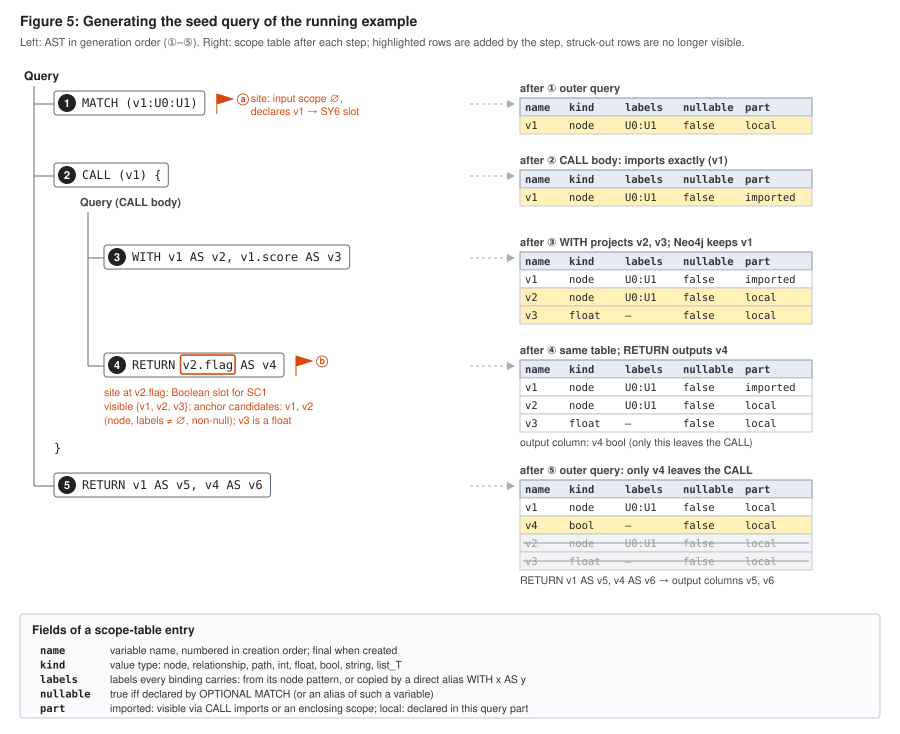
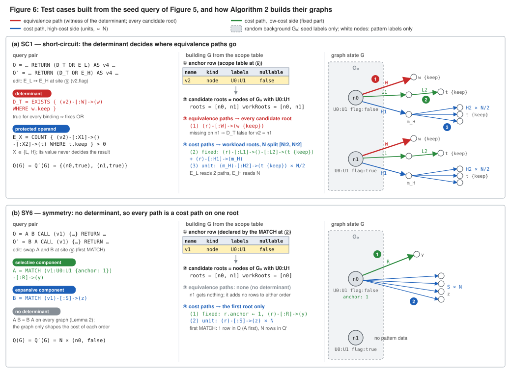

# 4 方法

本节介绍 GraphSymPerf。§4.1 给出方法概览与技术挑战；§4.2–§4.6 依次介绍工作流程的六个步骤；§4.7 说明构造出的查询对为什么等价，以及为什么它们之间的性能差异能够揭示漏掉的优化。

> 说明：本文是 `approach.md` 的中文对照版，逐段对应。算法伪代码保持英文原样，以便与英文版逐行对照。

## 4.1 概览

GraphSymPerf 的一个测试用例由查询对 $Q$、$Q'$ 和图状态 $G$ 组成。我们构造的用例满足：$Q$ 和 $Q'$ 在 $G$ 上返回相同的结果多重集，但其中一条查询所需的工作量远小于另一条。因此，一个应用了预期优化的图数据库应当以相近的时间执行这两条查询；稳定的性能下降则说明存在漏掉的优化。

**技术挑战。** 这一设计实现了 §1 中的关键洞见：每个查询对都编码了一个明确的优化机会。SCor [15] 在关系数据库上应用了相近的思路，它从模式相同但大小不同的表中分别取出低成本项和高成本项。要在图数据上实现这一洞见，会遇到三个基于表的构造方式不会遇到的挑战。

- **C1：代价取决于锚点绑定到哪个节点。** 图查询通过从外层查询已绑定的变量出发进行遍历来访问数据，例如相关子查询 `COUNT { MATCH (v2)-->()-->() }`。只有当新增的边能从锚点所绑定的节点到达时，更大的图才会让这样的操作数变得昂贵。
- **C2：等价性依赖数据。** 读取图数据的决定项（例如 `EXISTS` 检查）只有对到达变异点的**每一个**绑定都成立时，才能确定结果。
- **C3：查询与数据的命名必须一致。** 高成本区域只出现在 $Q'$ 中，却必须存在于 $G$ 中；同时，为模式新增的数据不能被查询的其余部分读到，否则两条查询会一起变慢。

针对 C1，GraphSymPerf 通过作用域分析选择锚点，并把工作量放在锚点所绑定的位置（§4.3、§4.5）；针对 C2，它把每个决定项的见证写到每一个候选根上（§4.5、引理 1）；针对 C3，它让每个名字在创建时就取最终值，并放在分离的命名空间中（§4.4）。除短路之外，GraphSymPerf 还引入了**对称**模式：这类模式调换可互换的组件，其等价性不依赖于数据（引理 2）。

**图 4：GraphSymPerf 概览。**

**工作流程。** 图 4 展示了 GraphSymPerf 的六个步骤。① 由语法引导的生成器生成一条随机种子查询，名字和常量都已是最终值；同时生成一张作用域表，记录每个 AST 节点处可见变量的类型、标签和可空性（§4.2）。② GraphSymPerf 选择一个变异模式和一个兼容的变异点，在该处嵌入模式，并准备一个局部编辑。短路模式用一个已经确定结果的决定项保护低成本操作数 $L$，其编辑把 $L$ 替换为高成本操作数 $H$；对称模式把一个廉价组件和一个昂贵组件放在一个与顺序无关的结构中，其编辑调换二者的顺序。嵌入时还会记录该模式需要哪些图数据（§4.3）。③ GraphSymPerf 以嵌入后的查询作为基础查询 $Q$，并把编辑应用到 $Q$ 的副本上得到 $Q'$（§4.4）。④ 然后它生成一个图状态，使两条查询保持等价，并为低成本一侧提供**少量**匹配、为高成本一侧提供**大量**匹配（数量随 $N$ 增长）（§4.5）。⑤ 最后，它在被测图数据库上执行两条查询；⑥ 只有当两者结果一致、且性能下降幅度大而稳定时，才报告漏掉的优化（§4.6）。算法 1 实现步骤 ①–③，算法 2 实现步骤 ④。

**贯穿示例。** 我们用同一条种子查询说明本方法。图 5 逐步生成这条查询，并给出生成器维护的作用域表；图 6 在它上面构造两个测试用例：一个使用短路模式 SC1，一个使用对称模式 SY6。



**图 5：贯穿示例中种子查询的生成过程。** 左侧：按生成顺序排列的 AST；圈码 ①–⑤ 表示生成器创建各子句的先后顺序，同一子句内的表达式从左到右创建。右侧：每一步之后的作用域表，字段 `name`、`kind`、`labels`、`nullable` 和 `part` 的定义见表 2；高亮行是该步新增的条目，删除线表示该条目不再可见。两面小旗标出作用域分析记录了位置、且后面图 6 会用到的两个 AST 节点：ⓐ 第一条 `MATCH`，其输入作用域为空，它声明了 `v1`（SY6 的槽位）；ⓑ 投影 `v2.flag`，这是一个布尔表达式，可见变量为 `v1`、`v2` 和 `v3`（SC1 的槽位）。标签、属性键和常量在抽取时就是最终值，因此第 ⑤ 步完成的 AST 已经是一条可以执行的查询。



**图 6：在图 5 的种子查询上构造的测试用例。** (a) SC1 把 `v2.flag` 替换为 $D_T$ `OR` $E_L$ 得到 $Q$，再把 $E_L$ 替换为 $E_H$ 得到 $Q'$。(b) SY6 用共享 `v1` 的两个组件 $A$、$B$ 替换第一条 `MATCH`，并调换二者。每个子图分三栏。左栏给出查询对及其各部分的定义；(a) 标出决定项 $D_T$，(b) 没有决定项，改为标出选择性组件 $A$ 和扩张性组件 $B$。中栏说明算法 2 怎样构图：锚点在作用域表中的那一行给出标签 `U0:U1`，据此在随机背景图 $G_0$ 中解析出候选根 `[n0, n1]`；其下的 `req` 列出要写入的路径，分为放在每个候选根上的**等价路径**和放在工作根上的**代价路径**。右栏是得到的图：$G_0$ 为灰色，只带种子查询的标签；算法 2 新增的白色节点只带模式标签；决定项的见证路径 (1) 画在两个根上，低成本路径 (2) 和高成本区域 (3) 画在工作根上。`{keep: true}` 标出满足被省略的谓词 `WHERE ·.keep` 的末端节点。$N \gg 1$ 为工作量规模，$Q(G)$ 表示 $Q$ 在 $G$ 上的结果多重集。查询和图中的标签、属性键和关系类型均使用了缩写。

```text
Algorithm 1: Query Generation and Mutation
Input:  target graph DBMS with capability set B, mutation pattern p
Output: query pair (Q, Q′) and graph requirements req,
        or ⊥ if p is not applicable
 1: // Step 1: Random AST generation
 2: T ← GenerateAST(B)                              ▷ final names and constants; a scope table per node
 3: // Step 2: Pattern embedding
 4: sites ← {s ∈ T | p is applicable at s}
 5: if sites = ∅ then return ⊥
 6: Select a mutation point s from sites at random.
 7: a ← SelectAnchor(variables visible at s or declared by T[s])
 8: if p is a short-circuit pattern then
 9:     (E_L, E_H) ← WorkOperands(p, a)             ▷ same shape, low- and high-cost regions
10:     D ← Guard(p, a)                             ▷ fixes the result for every binding of a
11:     F ← p.Form(D, E_L);  edit ← replace E_L with E_H
12: else                                            ▷ symmetry pattern
13:     F ← p.Form(T[s], a);  edit ← swap the two components of F
14: end if
15: Replace T[s] with F;  req ← p.Requirements(a, F)
16: // Step 3: Query mutation
17: Q ← T;  Q′ ← apply edit to a copy of Q          ▷ edit adds no names or constants
18: if not Consistent(Q, Q′) then return ⊥          ▷ scope, output columns, textual change
19: return (Q, Q′, req)
```

## 4.2 随机 AST 生成

种子查询为模式的嵌入提供上下文：变异点周围的子句、作用域内的变量，以及观察变异后取值的输出。GraphSymPerf 根据图 7 中的紧凑语法生成种子查询。

**图 7：GraphSymPerf 支持的紧凑语法。**

```text
Q    ::= C* RET | Q UNION [ALL] Q
C    ::= [OPTIONAL] MATCH P (, P)* [WHERE BE]
       | WITH IT (, IT)* [WHERE BE]
       | UNWIND LE AS id
       | CALL (id*) { Q }
RET  ::= RETURN [DISTINCT] IT (, IT)* [ORDER BY id+ [SKIP int] [LIMIT int]]
IT   ::= E AS id
P    ::= [id =] NP (RP NP)*
NP   ::= (id (:ℓ)+ [{k: c}]) | (id)
RP   ::= -[[id] :r [*1..int]]-> | <-[…]- | -[…]-
BE   ::= BE AND BE | BE OR BE | NOT BE | E COP E
       | E IS [NOT] NULL | EXISTS { SQ }
E    ::= id | id.k | c | BE | E AOP E
       | CASE WHEN BE THEN E ELSE E END
       | coalesce(E, E) | COUNT { SQ } | size(LE)
SQ   ::= Q | MATCH P WHERE BE
LE   ::= [E (, E)*] | COLLECT { Q }
COP  ::= = | <> | < | > | <= | >=
AOP  ::= + | - | *
```

节点模式要么引入一个新变量（新变量至少带一个标签），要么引用一个已绑定的变量，写作 `(id)`；每个关系模式都带有类型。§4.4 的命名空间隔离依赖于这两条限制。

**生成。** `GenerateAST`（算法 1 第 2 行）从 $Q$ 开始自顶向下展开语法。每一步只在满足以下条件的产生式中抽样：类型正确、只引用作用域内的变量、并且属于目标数据库的能力集 $B$。$B$ 记录影响生成的方言差异，例如 `CALL` 能否出现在表达式子查询中、`WITH` 子句是否保留导入的变量，以及子查询写成完整查询、`MATCH` 体还是模式推导式。生成上限 $\Omega$ 约束展开预算、子句数量和嵌套深度；预算耗尽后，只剩终结产生式可选。为保证结果确定，生成器在每个 `SKIP` 或 `LIMIT` 之前加上按全部标量输出列排序的 `ORDER BY`，并且只对常量做聚合。

**名字与常量。** 终结符在生成器抽取时就是最终值。标签（`ℓ`）取自 `Random_label_0`–`Random_label_3`，关系类型（`r`）取自 `Random_relationship_0`–`Random_relationship_2`，属性键（`k`）每种值类型一个：`property_int`、`property_float`、`property_bool` 和 `property_string`。常量（`c`）按类型从小值域中抽取，背景图的属性值也从同样的值域中抽取（§4.5）：−2 到 4 的整数，浮点数 0.5、1.5、2.5，两个布尔值，以及字符串 `a`、`b`、`c`。每个名字都记录自己的类别（标签、关系类型或带类型的属性键），后续步骤据此收集查询用到的标签、类型和属性键。因此，步骤 ① 结束时得到的就是一条已经实例化的查询：它可以直接渲染和执行，后续步骤不再填入任何名字或常量。

**作用域表。** 展开语法的同时，生成器维护一张**作用域表**，列出产生式可以引用的变量。每个条目描述一个查询变量，字段见表 2。

**表 2：作用域表条目的字段。**

| 字段 | 取值 | 含义 |
|---|---|---|
| `name` | `v1`、`v2`、… | 变量名，按创建顺序编号，创建时即为最终名字。 |
| `kind` | `node`、`relationship`、`path`、`int`、`float`、`bool`、`string`、`list_T` | 值类型。产生式只引用所需类型的条目；属性访问 `x.k` 要求 `x` 是节点或关系。 |
| `labels` | 种子标签的集合，可以为空 | 该变量的每个绑定都带有的标签：声明它的节点模式中写出的标签，或直接别名 `WITH x AS y` 的源变量的标签。关系、路径和标量的该字段为空。 |
| `nullable` | `true`、`false` | 该变量是否可能为空：由 `OPTIONAL MATCH` 声明、或是这类变量的别名时为真。非空的节点变量在每一行中都绑定到一个已存在的节点。 |
| `part` | `imported`、`local` | `imported` 条目可见，是因为外层 `CALL` 导入了它，或因为表达式子查询能看到外层作用域；`local` 条目在当前查询部分中声明。 |

某一位置可见的变量就是 `imported` 和 `local` 两部分的并集。每个子句在完成时按如下规则更新作用域表：

- `MATCH` 把每个新的节点、关系和路径变量加入 `local`，`labels` 取其节点模式中的标签；`OPTIONAL MATCH` 中声明的变量 `nullable` 为真。引用已绑定变量的 `(x)` 不新增条目。
- `WITH` 用它投影出的别名替换 `local`。直接别名从源变量复制 `kind`、`labels` 和 `nullable`；其他表达式只给出类型，不带标签。若 $B$ 表明目标数据库在 `WITH` 之后保留 `CALL` 的导入变量（Neo4j 如此；ArcadeDB 不保留，此时它们被移除），`imported` 条目保持可见。
- `UNWIND` 把它的变量加入 `local`，类型为列表的元素类型。
- `CALL (x, …) { Q }` 在一张新表上生成 $Q$，新表的 `imported` 部分恰好是 `x, …`。$Q$ 完成后，$Q$ 返回的列加入调用方的 `local`；其他变量都不会离开 `CALL`。
- 表达式子查询（`EXISTS`、`COUNT`、`COLLECT` 或模式推导式）在一张子表上生成其主体，子表的 `imported` 部分是外层全部可见变量；其中声明的变量不会离开子查询。
- `RETURN` 结束当前查询部分；它的别名就是输出列。

**生成顺序。** 生成器先决定查询的形式（单个查询部分，或输出列相同的两个部分组成的 `UNION`），再决定子句数量，然后从左到右创建各子句，最后创建 `RETURN`。一个子句中的表达式从左到右创建，所依据的是该子句之前的作用域表；唯一的例外是 `MATCH` 的 `WHERE`，它还能看到该 `MATCH` 声明的变量。每个表达式都按所需类型创建；到叶子时，生成器选取一个该类型的可见条目、一个可见节点或关系在该类型属性键下的属性，或一个该类型的常量。

图 5 跟踪了贯穿示例的生成过程。① 作用域表为空，第一条 `MATCH` 声明新节点 `v1`，并抽取两个标签 `U0:U1`。② `CALL` 从可见变量中抽取一个子集导入，取到 `v1`；其主体以 `v1` 为唯一的 `imported` 条目开始。③ `WITH` 把 `v1` 起别名为 `v2`，`v2` 复制了 `node`、`U0:U1` 和非空；接着创建一个浮点表达式，其叶子是 `v1` 在浮点属性键 `score` 下的属性，命名为 `v3`。由于 Neo4j 保留 `CALL` 的导入变量，`v1` 与 `v2`、`v3` 一起保持可见。④ 内层 `RETURN` 创建一个布尔表达式，其叶子是 `v2` 在布尔属性键 `flag` 下的属性，命名为 `v4`；`CALL` 结束时，只有 `v4` 进入外层作用域表。⑤ 外层 `RETURN` 投影可见的 `v1` 和 `v4`。得到的已实例化种子查询为

```cypher
MATCH (v1:U0:U1)                   // ①
CALL (v1) {                        // ②
  WITH v1 AS v2, v1.score AS v3    // ③
  RETURN v2.flag AS v4             // ④
}
RETURN v1 AS v5, v4 AS v6          // ⑤
```

**作用域分析。** 生成之后，作用域分析按同样的规则遍历完整的 AST，为每个 AST 节点 $s$ 记录一个**位置**（site）：$s$ 在树中的路径、节点本身，以及 $s$ 处可见的作用域表副本。对 `MATCH` 子句，记录的是它的输入，即该子句之前的作用域表。作用域分析还会拒绝引用不可见变量或类型不一致的查询。除 AST 本身之外，模式嵌入（§4.3）只读取这些位置记录。图 5 标出了图 6 用到的两个位置：ⓐ 第一条 `MATCH`，记录的作用域表为空；ⓑ 投影 `v2.flag`，记录的作用域表为

| `name` | `kind` | `labels` | `nullable` | `part` |
|---|---|---|---|---|
| `v1` | `node` | `U0:U1` | false | imported |
| `v2` | `node` | `U0:U1` | false | local |
| `v3` | `float` | – | false | local |

种子查询不依赖于模式，因此同一条种子查询可以承载不同的模式。

**Gremlin。** 对 Gremlin，GraphSymPerf 生成图 7 的线性子集（不含 `UNWIND`、`CALL` 和分页），并把它渲染为遍历步骤（表 3）。它的作用域表只有一个当前条目，即遍历者携带的对象，带有 `kind` 和 `labels`（由 `hasLabel` 设置）；此外还有之前 `as(·)` 步骤命名、可以用 `select(·)` 取回的条目；`count()` 这类归约会清空这些命名条目。我们以 Cypher 为例介绍本方法；Gremlin 的适配只在步骤 ① 和 ② 上有所不同。

**表 3：图 7 中的结构在 Gremlin 中的写法。**

| 结构 | Gremlin |
|---|---|
| `MATCH (x:ℓ)` | `g.V().hasLabel(ℓ)` |
| `MATCH (x)-[:r]->(y:ℓ)` | `.out(r).hasLabel(ℓ)` |
| `WHERE` | `.filter(·)` |
| `WITH x AS y` | `.as(y)`，之后用 `.select(y)` 取回 |
| `CASE`、`coalesce` | `.choose(·)`、`.coalesce(·)` |
| `COUNT {…}` | `.count()` |

## 4.3 模式嵌入

**模式。** [表 1](pattern-catalog.zh-CN.md) 列出了两族共 16 个变异模式。**短路模式**（SC1–SC8）依赖一个不变的**决定项**，即在受保护的操作数被求值之前就确定了结果的守卫或需求条件；变异把这个操作数替换为更昂贵的操作数。**对称模式**（SY1–SY8）依赖交换律等代数对称性；变异调换两个保持不变的组件。每个模式接受一类语法槽位：布尔表达式承载 SC1、SC2、SC7、SY1 和 SY2；标量表达式承载 SC3 和 SC4；输出标量的行源承载 SC5、SC6 和 SC8；单边路径模式承载 SY3 和 SY4；不带 `WHERE` 的必选 `MATCH` 子句承载 SY5–SY8。

**决定项。** 每个短路形式都含有一个确定其结果、且保持不变的部分，我们称之为该形式的**决定项** $D$。确切地说，设 $F$ 是一个短路形式，$E$ 是它受保护的操作数。若对每个到达变异点的输入绑定 $\eta$，$D$ 在 $\eta$ 下的取值都能确定 $F$ 在 $\eta$ 下的取值（对行源而言，确定其输出行），而不论 $E$ 取何值，则 $D$ 是 $F$ 的决定项。SC1 的决定项是 `OR` 中为真的操作数 $D_T$，SC2 是 `AND` 中为假的操作数 $D_F$；SC3 是第一个 `WHEN` 条件，它为真；SC4 是 `coalesce` 的非空前缀 $V$；SC5 是零需求 `LIMIT 0`；SC6 是 `LIMIT k` 之前的 $k$ 行见证行；SC7 是 `EXISTS` 子查询的第一行；SC8 是空的必选输入。决定项要么不读取数据，例如字面量、常量比较、`LIMIT 0` 或 `WHERE FALSE`；要么从锚点出发读取图，例如针对见证区域的 `EXISTS` 或 `COUNT` 检查。后一种情况下，$D$ 只在包含其**见证**的图上才是决定性的；见证指使 $D$ 对某个绑定取到决定性值的那部分数据。因此 §4.5 把见证写到每一个候选根上。

对称模式没有决定项。两个组件在任一顺序下都会被求值，两种写法相等是因为结构本身对称，而不是因为其中某一部分确定了结果（引理 2）；这对任意图都成立。两个组件只在代价上不同：一个是**选择性**组件，在 $G$ 上只有少量匹配；另一个是**扩张性**组件，匹配数与 $N$ 成正比；书写顺序可能决定规划器要把扩张性组件求值多少次。SY1 和 SY2 的 guard-swap 变体把一个常量或带见证的操作数与一个高成本操作数放在一起，再交换二者。这个操作数确实能确定 `AND` 或 `OR` 的值，但交换本身不依赖它也等价，所以对 SY1 和 SY2 而言，它只是让两种顺序中的一种能够跳过高成本操作数。

算法 1 只通过以下接口访问模式 $p$：它的槽位、它在表 1 中的适用条件、构造替换片段的函数 `Form`，以及推导构图要求的函数 `Requirements`；短路模式还额外提供操作数的候选池（`WorkOperands`）和决定项的候选池（`Guard`）。若同时满足以下三条，我们称 $p$ 在 AST 节点 $s$ 处**适用**：$s$ 符合 $p$ 的槽位；$B$ 支持 $p$ 引入的所有结构；$s$ 的上下文满足 $p$ 的适用条件。例如，SY5–SY8 要求任一组件都不使用只由另一组件引入的变量；SY3 和 SY4 要求外层查询不观察路径的顺序。

**变异点选择**（算法 1 第 4–6 行）。GraphSymPerf 读取每个 AST 节点的位置记录（§4.2），保留 $p$ 适用的节点，并从中随机选取一个。按作用域表而不是按变量名来选择，这一点很重要。在图 5 的位置 ⓑ，投影 `v2.flag` 是 SC1 的布尔槽位，此处作用域内有 `v1`、`v2` 和 `v3`；`v1` 在 `WITH` 之后仍然可见，是因为目标 DBMS 保留了 `CALL` 的导入变量。虽然 `v2` 从未出现在带标签的 `MATCH` 中，但它通过别名继承了 `v1` 的 `U0:U1` 和非空性，因此可以作为相关路径的起点；`v3` 是浮点数，不能作为起点。按名字选择可能会选中 `v3`，而只检查当前子句所写标签的做法会漏掉 `v2`。第一条 `MATCH` 是 SY6 的槽位：它的输入作用域为空，但该子句自身声明了 `v1`，并且后面的 `CALL (v1)` 用到了它，所以 SY6 复用 `v1` 作为两个组件的共享根。

**锚点选择**（第 7 行）。锚点候选是作用域表中满足 `kind` = `node`、`labels` 非空且 `nullable` = false 的可见条目；在 ⓑ 处就是 `v1` 和 `v2`。这三个字段各有用处：锚点必须是能作为路径起点的节点；它的标签之后用来确定它可能绑定到哪些节点（§4.5）；非空的锚点在每一行中都绑定到一个已存在的节点。`SelectAnchor` 在两类片段之间选择。**相关**片段复用一个可见的、非空的、标签已知的节点变量作为锚点，因此其代价取决于种子查询产生的绑定（C1）；**不相关**片段从一个新建的根出发，用于测试不依赖外层绑定的子查询。当存在候选变量时，它以概率 $p_c$ 选择相关片段；否则使用新建的根。像 SY6 这样的子句级对称模式总是复用被替换子句所声明的变量。

**短路嵌入**（第 8–11 行）。GraphSymPerf 抽取一个工作量候选，即一跳计数、两跳计数、永远匹配不到的 `EXISTS` 或一个行源，并从锚点 $a$ 出发将其实例化两次：一次落在低成本区域，一次落在高成本区域。得到的操作数 $E_L$ 和 $E_H$ 形状相同，但它们的关系类型和末端标签属于互不相交的区域。决定项 $D$ 必须对 $a$ 的每个绑定取相同的值；它可以是字面量、常量比较、针对独立见证区域的计数或存在性检查，或者用 `coalesce` 包裹的锚点属性。嵌入的形式 $F$ 使用 $E_L$，编辑把 $E_L$ 替换为 $E_H$。例如，SC1 改写一个布尔表达式，而 SC4（即图 2 动机示例中的模式）改写一个标量表达式：

$$BE \;\rightarrow\; D_T \;\texttt{OR}\; E_L, \qquad E \;\rightarrow\; \texttt{coalesce}(\texttt{NULL},\, V,\, E_L),$$

$$E_X \;::=\; \texttt{COUNT}\,\{\texttt{MATCH}\,(a)\text{-}[{:}r_X]\text{->}()\text{-}[{:}r'_X]\text{->}(t)\;\texttt{WHERE}\;t.\texttt{keep}\} > 0 \;\mid\; \cdots, \qquad X \in \{L, H\},$$

其中 $D_T$ 是恒为真的决定项，$V$ 是保持不变的非空值。在图 6(a) 中，SC1 使用锚点 `v2`，以一个存在性检查作为决定项，以一个两跳计数作为工作操作数。此处和图 6 中都省略了新节点 `w`、`t` 以及未命名中间节点的标签；这些节点都带有模式命名空间中的标签（§4.4）：

```text
D_T = EXISTS { MATCH (v2)-[:W]->(w) WHERE w.keep }
E_X = COUNT  { MATCH (v2)-[:X1]->()-[:X2]->(t) WHERE t.keep } > 0      X ∈ {L, H}
F   = D_T OR E_L                                                      替换 v2.flag
```

**对称嵌入**（第 12–13 行）。形式复用变异点上已有的组件，或用新组件加以扩展；编辑调换两个组件，而不改变其中任何一个。在图 6(b) 中，SY6 用两个只共享 `v1` 的必选组件替换位置 ⓐ 处的第一条 `MATCH`。配方同时选定哪个组件是选择性的（这里是只有一条 `R` 边的 $A$），哪个是扩张性的（这里是有 $N$ 条 `S` 边的 $B$）；属性 `{anchor: 1}` 把根限定为唯一一个节点：

```text
A = MATCH (v1:U0:U1 {anchor: 1})-[:R]->(y)
B = MATCH (v1)-[:S]->(z)
F = A B,  edit = 调换 A 和 B
```

**构图要求**（第 15 行）。嵌入时还会记录图状态必须包含什么。构图要求 `req` 由三部分组成：

- **锚点**，即 $a$ 在作用域表中的条目；它的 `labels` 确定候选根；
- **等价路径**，即决定项的见证，每个候选根都需要它们，才能使 $D$ 保持决定性的值。决定项不读取数据时它们为空；对称模式的等价路径总是为空；
- **代价布局**，它说明由一个根还是所有根承担工作量，并为每个这样的根规定一个只建一次的**固定部分**和一个按 $N$ 重复的**单位**。固定部分是低成本一侧（$E_L$，或选择性组件），单位是一个高成本匹配（$E_H$，或扩张性组件的一个匹配）。

模式的所有随机选择都在这里做出并记录在 `req` 中：锚点、决定项的种类、工作量候选，以及对称模式中哪个组件是选择性的。给定 `req`，图中属于模式的部分就完全确定了。图 6 的中栏给出了贯穿示例的 `req`，表 5（§4.5）列出了所有模式的构图要求。

**Gremlin。** 对 Gremlin，GraphSymPerf 支持 SC1–SC8、SY1、SY2 和 SY5–SY7。短路模式和 SY1/SY2 的嵌入位置是 `filter`、`map` 或遍历的最后一步；SY5–SY7 在根部 `V().hasLabel(·)` 之后插入含两个模式的声明式 `match()` 步骤，并交换这两个模式。由于一个遍历者只携带一个当前对象，锚点要么是这个对象，要么是之前某个 `as(·)` 步骤命名、再通过 `select(·)` 取回的节点，因此每个 Gremlin 片段都是相关的。工作操作数是一跳遍历，例如 `out(r_X).has('keep', true)`；短路编辑把关系类型 $r_L$ 替换为 $r_H$。

## 4.4 查询生成与变异

**名字与常量**（算法 1 第 2 行和第 9–15 行）。每个名字在创建时就是最终名字，嵌入之后不再有绑定步骤。种子查询的名字和常量在步骤 ① 中就已确定（§4.2）。嵌入时，模式新增的一切名字（包括编辑和构图要求中的名字）都放在单独的 `Pattern_` 命名空间中。每个名字都记录自己的类别（标签、关系类型或带类型的属性键），§4.5 的背景图和 schema 声明依据这一信息收集名字。表 4 给出了 SC1 的部分名字以及每个名字在哪里被使用。

**表 4：图 6(a) 中 SC1 使用的部分名字。**

| 缩写 | 所属 | 名字 | $Q$ | $Q'$ | $G$ |
|---|---|---|:-:|:-:|:-:|
| `U0`、`U1` | 种子查询 | `Random_label_0`、`Random_label_1` | ✓ | ✓ | ✓ |
| `flag`、`score` | 种子查询 | `property_bool`、`property_float` | ✓ | ✓ | ✓ |
| `W` | 模式 | `Pattern_p_witness_edge` | ✓ | ✓ | ✓ |
| `L1`、`L2` | 模式 | `Pattern_p_low_first_edge`、`Pattern_p_low_edge` | ✓ | | ✓ |
| `H1`、`H2` | 模式 | `Pattern_p_high_first_edge`、`Pattern_p_high_edge` | | ✓ | ✓ |
| `w`、`m`、`t` 的标签 | 模式 | `Pattern_p_witness`、`Pattern_p_low_middle`、`Pattern_p_low`、… | ✓ | ✓ | ✓ |

在创建时确定名字提供了两条保证，方法的其余部分都依赖于它们。

**共享名字。** $Q$、$Q'$ 和 $G$ 使用相同的名字，包括只被其中一部分提及的名字。在表 4 中，高成本类型 `H1` 和 `H2` 从未出现在 $Q$ 中，但 §4.5 必须恰好用这两种类型构造 $N$ 条路径，供 $Q'$ 遍历；反过来，`L1` 和 `L2` 出现在 $Q$ 中而不出现在 $Q'$ 中。编辑和构图要求在嵌入时与 $F$ 一同创建，因此 $Q'$ 和 $G$ 引用的是同一批名字；变异本身也不抽取新的名字或常量。所以 $Q$ 和 $Q'$ 只在变异点处不同。

**命名空间隔离。** 种子查询的标签和关系类型与模式的标签和关系类型互不相交。由于每个新节点模式都带标签、每个关系模式都带类型（§4.2），种子查询只能通过模式自身写入的路径到达为模式新增的数据。反之，假如高成本末端节点带有种子标签 `U0:U1`，种子模式 `MATCH (v1:U0:U1)` 也会把 `v1` 绑定到这 $N$ 个节点上，两条查询的结果和代价都会改变，代价差异也就不再局限于变异点。属性键不做隔离；像 `keep` 这样的模式标记也可能出现在背景节点上和种子查询的谓词中。这不会造成问题，因为种子谓词只能通过模式标签或模式类型到达模式节点。

**变异**（第 17–18 行）。嵌入后的 AST 就是基础查询 $Q$；GraphSymPerf 把编辑应用到 $Q$ 的副本上得到 $Q'$；短路变异把 $E_L$ 替换为 $E_H$，对称变异调换 $F$ 的两个组件。随后的静态检查要求两条查询都满足 §4.2 的作用域规则、输出列相同，并且文本确实不同。结果是否相等由执行来判定（§4.6）。图 6 给出了得到的查询对。

## 4.5 图状态生成

算法 2 根据构图要求 `req` 构造图状态 $G$。其中只有背景图是随机的，其余部分都是推导出来的：宿主见证来自种子查询，模式数据来自 `req`，并从锚点的作用域表条目所确定的节点出发。对模式数据，算法 2 分开回答两个问题：$Q$ 与 $Q'$ 的等价性依赖哪些路径，这些路径必须存在于哪些根上？哪些路径承担代价，代价应集中在哪些根上？

```text
Algorithm 2: Graph State Generation
Input:  query pair (Q, Q′), graph requirements req, workload scale N
Output: graph state G on which Q and Q′ are equivalent, or ⊥
 1: // Step 1: Background graph
 2: G ← RandomGraph(seed names) ∪ HostWitness(Q)    ▷ random part, then one host match
 3: // Step 2: Candidate and workload roots
 4: roots ← nodes of G with every label in req.anchor.labels, in creation order
 5: if roots = ∅ then roots ← [a new node with the anchor's labels]
 6: if req.layout = PerRoot then                    ▷ short-circuit patterns, SY1, SY2
 7:     workRoots ← roots
 8: else                                            ▷ SY3–SY8
 9:     workRoots ← [first node of roots]
10: end if
11: if req needs a unit on every workload root and N < |workRoots| then return ⊥
12: // Step 3: Equivalence paths
13: for each root r in roots do
14:     for each path w in req.equivalence do
15:         AddPath(G, r, w)                        ▷ makes D decisive when the anchor binds to r
16:     end for
17: end for
18: // Step 4: Cost paths
19: (q_1, …, q_k) ← Split(N, k = |workRoots|)       ▷ near-equal shares that sum to N
20: for i ← 1 to k do
21:     h ← AddPath(G, workRoots[i], req.fixed)     ▷ built once: low-cost side
22:     for j ← 1 to q_i do
23:         AddPath(G, h, req.unit)                 ▷ one high-cost match
24:     end for
25: end for
26: // Step 5: Schema registration
27: Register the labels, types and keys of Q, Q′ and G in the DBMS schema.
28: return G

29: function AddPath(G, u, f)
30:     Create the nodes, edges and properties of fragment f, starting from node u.
31:     return the node of f to which later fragments attach
32: end function
```


**背景图**（第 1–2 行）。`RandomGraph` 是算法 2 中唯一随机的步骤。它创建 $n_0$ 个节点，每个节点从种子标签中抽取一个或两个标签，设置标记属性 `keep` 和 `value`，并以较高概率为每个种子属性键从其类型的值域中抽取一个值（§4.2）；随后添加 $m_0$ 条边，端点均匀抽取，类型取自种子查询的关系类型。它不求解种子查询的谓词，只提供一个与模式无关的上下文。由于只使用种子名字，任何背景节点都不带模式标签（§4.4）。模式自身的随机选择（锚点、决定项的种类、选择性组件等）已经在步骤 ② 中做出并记录在 `req` 中，所以对给定的种子，算法 2 的其余部分是确定的。在图 6 中，$G_0$ 由两个互不相连、带标签 `:U0:U1` 的节点 `n0` 和 `n1` 组成，它们的 `flag` 分别为 `false` 和 `true`。

**宿主见证**（第 2 行）。随机边很少能拼出完整的多跳宿主模式，因此如果不加处理，很多查询对返回空结果，工作量也落在种子查询根本到达不了的根上。`HostWitness` 因此为种子查询的必选匹配铺设一份实例：对 Cypher，是每条非可选 `MATCH` 路径，包括其标签、关系类型、允许的最短长度以及字面量属性过滤（内联属性和 `WHERE` 中的 `=` 合取项）；对 Gremlin，是根遍历中的 `out`/`in`/`both` 加 `hasLabel` 步骤和简单的 `has` 过滤，并越过模式自己的步骤继续铺设。节点变量复用第一个带有其标签的已有节点，对称模式的配方也正是选它作为根。模式自有的名字（`Pattern_` 类型、`p_` 属性键）留给配方处理。由于 `HostWitness` 在收集候选根之前执行，带有锚点标签的铺设节点和其他候选根一样，会获得第 12–25 行的等价路径和代价路径，因此引理 1 不受影响。第 25 行之后，短路锚点的候选根还会获得种子查询对锚点本身的等值过滤。查询本身始终不变。

**从作用域表到根**（第 3–11 行）。锚点在作用域表中的条目决定了模式数据从哪里开始。它的 `kind` 是 `node`、`nullable` 为 false，所以锚点在变异点处的每个绑定都是一个已存在的节点；它的 `labels` 是每个这样的节点都带有的标签。因此候选根就是带有全部这些标签的节点（第 4 行），锚点的每个绑定都是一个候选根（A3，§4.7）。如果一个都没有，就新建一个。只按标签筛选会过近似实际输入，因为种子查询中的其他谓词可能使某些候选根无法到达变异点。工作根对短路模式、SY1 和 SY2 是全部候选根，对其余对称模式只取第一个候选根。唯一的例外是 SY8：它在第一个根之外再新建三个根，使四个根分别覆盖两个可选分支"都匹配、仅一个匹配、都不匹配"的情形（表 5）。有些模式要求每个工作根上至少有一个单位，例如 SC7 需要每个根上都有一个高成本匹配，才能使 `EXISTS` 保持取值；当 $N$ 小于这类工作根的数量时，第 11 行拒绝该用例。

**路径放在哪里。** 对 `req` 中提到的每条路径，算法 2 用同一个问题决定它的位置：这条路径能否改变 $Q$ 或 $Q'$ 的结果？只有决定项的见证能。如果某个绑定缺少见证，$D$ 对这个绑定就失去决定性的值，结果改由受保护的操作数决定，$Q$ 和 $Q'$ 就可能不同。所以见证是**等价路径**，必须放在每一个候选根上，因为锚点可能绑定到其中任何一个。$E_L$ 和 $E_H$ 的路径不能改变结果：$D$ 已经确定了结果，它们的取值无关紧要，只决定一个不理会 $D$ 的求值要做多少工作。它们是**代价路径**，放在工作根上；永远匹配不到的 `EXISTS` 候选甚至会写入不满足其谓词的末端节点。对称模式没有决定项，因此它的任何路径都不能改变结果，全部都是代价路径。这些路径集中在一个根上：选择性组件得到固定部分，扩张性组件得到 $N$ 个单位；其余候选根在两种写法中贡献相同的行。SY1 和 SY2 的 guard-swap 变体会把其操作数的见证写到每个根上，但这是代价路径：它让其中一种顺序对每个绑定都能跳过高成本操作数。

**等价路径**（第 12–17 行）。算法 2 在每个候选根上添加 `req.equivalence` 中的每条路径（表 5）。不读取数据的决定项（例如字面量或 `LIMIT 0`）不需要等价路径；读取锚点属性的决定项（例如 `coalesce(a.p_guard, true)`）则需要在每个根上设置该属性，而不是添加路径。

**代价路径**（第 18–25 行、第 29–32 行）。`Split` 把 $N$ 拆成近似相等的整数份额，分配给各工作根。对每个工作根，第 21 行只建一次固定部分，第 22–24 行把 $q_i$ 个单位挂到固定部分返回的节点 `h` 上。只有单位计入 $N$。由于 `h` 可以是内部节点，两跳的高成本区域只创建一次中间节点，之后每增加一个匹配只从它新增一条边。片段也可以只由属性组成，例如 SY6 中的 `anchor = 1`。

**schema 登记**（第 26–27 行）。最后，算法 2 把两条查询以及 $G$ 的标签、关系类型和属性键登记到数据库的 schema 中，使空区域也得到声明。

**贯穿示例。** 下面的轨迹在图 6 上运行算法 2。$G_0$ 是随机的。`MATCH (v1:U0:U1)` 的宿主见证复用 `n0`，不新增任何内容。两个锚点在作用域表中的 `labels` 都是 `U0:U1`，因此两个用例的候选根都是 `[n0, n1]`。SC1 的决定项 $D_T$ 是针对 `W` 的 `EXISTS` 检查，所以它的见证是放在两个根上的等价路径：`v2` 可能在一次调用中绑定到 `n0`，在另一次调用中绑定到 `n1`，而 `n0` 上的见证无法使从 `n1` 出发的 `EXISTS` 为真（图 6(a) 中的 (1)）。(2) 和 (3) 分别是低成本路径和高成本区域，都是代价路径。SY6 没有决定项，它把选择性臂和 $N$ 条扩张性边都放在 `n0` 上（图 6(b) 中的 (1) 和 (2)），`n1` 在两种连接顺序下都不产生行。

```text
图 6 上的轨迹。   G₀ = { n0:U0:U1 {flag: false},  n1:U0:U1 {flag: true} }   （随机）
                     HostWitness(MATCH (v1:U0:U1)) 复用 n0，不新增任何内容

SC1   req.anchor      = v2 : node, U0:U1, 非空      req.layout = PerRoot
      determinant     = D_T = EXISTS { (v2)-[:W]->(w) WHERE w.keep }
      req.equivalence = [ (r)-[:W]->(w {keep}) ]                        ▷ (1)
      req.fixed       = (r)-[:L1]->()-[:L2]->(t {keep}),  (r)-[:H1]->(m_H)   ▷ (2), 返回 m_H
      req.unit        = (m_H)-[:H2]->(t {keep})                         ▷ (3)

      roots = [n0, n1]     workRoots = [n0, n1]     q = [N/2, N/2]
      n0 :  (1) W   (2) L1-L2   H1 to m_H   (3) N/2 × H2 from m_H
      n1 :  (1) W   (2) L1-L2   H1 to m_H   (3) N/2 × H2 from m_H
      Q(G) = Q′(G) = {(n0, true), (n1, true)}     E_L 读 2 条路径，E_H 读 N 条

SY6   req.anchor      = v1 : node, U0:U1, 非空      req.layout = OneRoot
      determinant     = 无
      req.equivalence = [ ]
      req.fixed       = r.anchor ← 1,  (r)-[:R]->(y)    ▷ (1) 选择性组件 A，返回 r
      req.unit        = (r)-[:S]->(z)                   ▷ (2) 扩张性组件 B

      roots = [n0, n1]     workRoots = [n0]         q = [N]
      n0 :  anchor = 1   (1) one R edge   (2) N × S edge
      n1 :  无
      Q(G) = Q′(G) = N × (n0, false)              第一条 MATCH：Q 中 1 行，Q′ 中 N 行
```


表 5 总结了所有模式的构图要求。短路模式把工作量分布到每个候选根上，因为决定项必须对每个绑定都是决定性的；对称模式把工作量集中在一个根上，因为它们的等价性不需要任何数据。

**表 5：变异模式的决定项与构图要求。**

| 模式 | 决定项 | 每个候选根上的等价路径 | 工作根 | 每个工作根上的固定部分 | 单位 |
|---|---|---|---|---|---|
| SC1、SC2 | `OR` 中为真或 `AND` 中为假的操作数 | 若 $D$ 是 `EXISTS` 或 `COUNT` 检查，则为一个见证匹配 | 全部 | 一个低成本匹配，以及高成本匹配共享的前缀 | 一个高成本匹配 |
| SC3 | 第一个 `WHEN` 条件（为真） | 同 SC1 | 全部 | 同 SC1 | 一个高成本匹配 |
| SC4 | `coalesce` 的非空前缀 $V$ | 若 $V$ 是 `COUNT`，则为一个见证匹配 | 全部 | 同 SC1 | 一个高成本匹配 |
| SC5 | `LIMIT 0` | 无 | 全部 | 一个低成本行 | 一个高成本行 |
| SC6 | `LIMIT k` 之前的 $k$ 行见证行 | $k$ 行见证行 | 全部 | 一个低成本行 | 一个高成本行 |
| SC7 | `EXISTS` 的第一行 | 一个低成本行和至少一个高成本行（第 11 行） | 全部 | 一个低成本行 | 一个高成本行 |
| SC8 | 空的必选输入 `WHERE FALSE` | 无 | 全部 | 一个低成本行 | 一个高成本行 |
| SY1、SY2 | 无 | 无；guard-swap 操作数的见证是每个根上的代价路径 | 全部 | 同 SC1 | 一个高成本匹配 |
| SY3 | 无 | 无 | 第一个 | 根上的端点约束 | 从根出发的一条边，或从一个不满足端点约束的节点出发的一条边 |
| SY4 | 无 | 无 | 第一个 | 一条有效的有界路径 | 一条在共享中枢或末端不满足节点谓词的有界路径 |
| SY5 | 无 | 无 | 第一个 | 一个最多匹配一个节点的选择性组件 | 扩张性组件的一个节点 |
| SY6 | 无 | 无 | 第一个 | 选择性臂（一条边） | 扩张性臂的一条边 |
| SY7 | 无 | 无 | 第一个 | 一条完整的链 | 一条不与根相连的右侧边 |
| SY8 | 无 | 无 | 覆盖"两个分支都匹配、仅一个分支匹配、都不匹配"的四个根 | 在选择性分支匹配的每个根上的一条选择性分支边 | 在扩张性分支匹配的根上的一条扩张性分支边 |

## 4.6 执行与性能检查

GraphSymPerf 对每个测试用例只加载一次 $G$，测量期间不修改它。

**结果检查。** GraphSymPerf 先执行 $Q$ 和 $Q'$，并把它们的输出作为带类型的结果多重集进行比较，包括列名和每一行的重复次数。比较前，值按类型规范化，使 null、布尔值、整数、浮点数和字符串之间不会跨类型判为相等，图实体按身份比较。在 §4.7 的假设下，$Q$ 和 $Q'$ 在 $G$ 上等价；因此结果不一致说明要么数据库存在逻辑错误，要么某个假设不成立，这种情况作为结果不一致报告，而不是性能问题。之后的每次执行都与同一个参考结果比较。

**计时。** GraphSymPerf 分**发现**和**确认**两个阶段测量查询对。每个阶段先进行 $w$ 轮不计时的预热，再进行 $n$ 轮计时；每一轮把两条查询各执行一次，相邻两轮在 $QQ'$ 和 $Q'Q$ 两种顺序之间交替，使缓存不偏向任何一条查询。设 $t$ 和 $t'$ 为一个阶段中 $Q$ 和 $Q'$ 的执行时间中位数，并把中位数较大的查询称为较慢的一条。若满足

$$\frac{\max(t, t')}{\min(t, t')} \ge \rho, \qquad \operatorname{median}_i\,(\text{slower}_i - \text{faster}_i) \ge \delta, \qquad \frac{\lvert\{i : \text{slower}_i > \text{faster}_i\}\rvert}{n} \ge \kappa,$$

则该阶段通过。比值阈值 $\rho$ 要求相对差距足够大；绝对阈值 $\delta$ 排除由噪声主导的毫秒级差距；一致性阈值 $\kappa$ 要求同一条查询在大多数轮次中都更慢。最后一个条件是一个单侧符号检验：如果两条查询的执行时间分布相同，每一轮偏向任一查询的概率都是 $1/2$，那么某条固定的查询在 $n$ 轮中至少有 $\lceil \kappa n \rceil$ 轮更慢的概率为

$$p(n, \kappa) \;=\; \sum_{i = \lceil \kappa n \rceil}^{n} \binom{n}{i}\, 2^{-n}.$$

**性能检查。** 通过发现阶段（$n = n_d$）的查询对，会在更长的确认阶段（$n = n_c > n_d$）中重新测量。只有当确认阶段也通过、且认定的较慢查询与发现阶段相同时，GraphSymPerf 才报告**稳定的性能下降**，这样把纯噪声被误报的概率限制在 $p(n_c, \kappa)$ 以内。超过单条查询超时 $\tau$ 的查询单独记录。对每个完成计时的查询对，GraphSymPerf 归档两条查询经过性能剖析的执行计划以及 §4.5 中的各根分配量，作为数据库未能避免的工作的证据。

**规模响应。** 上面的耗时比检验可能漏掉真实的差距。如果两条查询还共享一部分随 $N$ 增长的大开销，例如数据库无法限定在种子节点上的标签扫描，两个中位数都会随 $N$ 增长，比值始终低于 $\rho$，尽管较慢查询多做的工作同样随 $N$ 增长。本方法的构造提供了第二个信号，即规模。被短路的操作数和被调换的组件都不应让其中一种写法做与 $N$ 成正比的工作，所以在应用了预期优化的引擎上，两种写法之间的差距不应依赖于 $N$。

因此，对完成了发现阶段但没有差距的查询对，GraphSymPerf 在第二个规模上重新检查。它用同一个种子重建用例，但单位数从 $N$ 改为 $N/s$。种子固定了背景图、两条查询和 `req`，两条查询的渲染结果必须完全相同；变化的只有单位数，也就是高成本一侧的大小。GraphSymPerf 在小图上运行一个发现阶段。取规模 $N$ 下中位数较大的那条查询为较慢查询，记 $g_N$ 和 $g_{N/s}$ 为两个规模下它的中位数与另一条查询中位数之差；$g_{N/s}$ 按同一方向计算，可以为负。若

$$\frac{g_N}{\max(g_{N/s}, 1\,\text{ms})} \ge \gamma, \qquad g_N - g_{N/s} \ge \delta, \qquad \frac{\lvert\{i : \text{较慢}_i > \text{较快}_i\}\rvert}{n} \ge \kappa,$$

其中符号检验统计的是规模 $N$ 下的各轮，则该查询对通过。通过的查询对在两个规模上各进行一次新的确认阶段；若三个条件再次成立且较慢查询不变，就成为**规模候选**。第一个条件要求单位数扩大 $s$ 倍时差距至少扩大 $\gamma$ 倍；第二个条件排除过小、无法超出噪声的增长；第三个条件就是计时步骤中的符号检验。两个中位数相减抵消了两种写法共有的代价，所以共有的标签扫描不会被算作增长。默认 $s = 10$、$\gamma = 3$：与 $N$ 成正比的差距会扩大约 10 倍，而大小固定的差距只在 1 倍附近。

稳定的性能下降对两族模式的含义不同。对短路查询对，$Q'$ 更慢说明数据库在决定项已经确定结果的情况下仍然求值了受保护的操作数。对对称查询对，任一方向的变慢都说明执行计划依赖于两个可互换组件的书写顺序。§4.7 解释了为什么这样的性能下降反映的是漏掉的优化，而不是构造数据造成的假象。

## 4.7 正确性

本节给出构造所依赖的假设，证明这些假设使 $Q$ 和 $Q'$ 在 $G$ 上等价，并解释为什么二者之间稳定的性能下降揭示了漏掉的优化。

**定义 1（等价查询对）。** 若 $Q$ 和 $Q'$ 输出相同的列，且 $Q(G) = Q'(G)$（作为行的多重集），则称 $Q$ 和 $Q'$ **在 $G$ 上等价**，记作 $Q \equiv_G Q'$。

**假设。** GraphSymPerf 依赖三条假设。

- **A1（确定性）。** $Q$ 和 $Q'$ 都是只读的；由于生成器去除了依赖顺序的输出（§4.2），每条查询在 $G$ 上都对应唯一的一个多重集。查询语义是组合式的：把一个子表达式或子句替换为对每个输入绑定都产生相同值（或相同多重集）的子表达式或子句，结果保持不变。
- **A2（操作数全定义）。** 模式所保护、替换或调换的每个操作数都能无运行时错误地求值为布尔值、整数或 `null`。这一点由构造保证：这些操作数只由字面量、常量比较、基于只读模式的 `COUNT` 和 `EXISTS` 子查询、计数的类型转换以及 `coalesce` 构成。
- **A3（锚点源于标签）。** 锚点在变异点处的每个绑定都是一个带有锚点标签的节点。锚点非空，其标签来自某个 `MATCH` 模式（在 Gremlin 中为 `hasLabel` 步骤）或某个已匹配变量的别名；新建的根则由它自己的标签匹配。因此，锚点的每个绑定都是算法 2 中的一个候选根（第 4 行）。

**引理 1（短路等价）。** 设 $p$ 为短路模式，$G$ 由算法 2 生成。在 A1–A3 下，$Q \equiv_G Q'$。

**证明概要。** 设 $\eta$ 为任一到达变异点的输入绑定。由 A3，$\eta$ 把锚点绑定到某个候选根上，而算法 2 在每个候选根上都写入了决定项 $D$ 的见证（第 12–17 行）；字面量、常量比较和用 `coalesce` 包裹的决定项则完全不依赖于图。因此，$D$ 在每个 $\eta$ 下都取同一个决定性的值：对 `OR` 和 `CASE` 为 `true`，对 `AND` 为 `false`。如 §2.4 所述，对于任何无副作用、无错误的操作数（包括求值为 `null` 的操作数），决定性的操作数都能确定 `OR` 和 `AND` 的值；由 A2，受保护的操作数正是这样的操作数。所以 $F$ 与其编辑后的形式在每个 $\eta$ 下取值相同。其余短路模式按同样的论证，各自使用自己的决定性条件：SC3 的第一个为真的 `WHEN`；SC4 的非空 `coalesce` 前缀；SC5、SC6 和 SC8 的不变需求（`LIMIT 0`、`LIMIT k` 之前的 $k$ 行相同见证行，或空的必选输入）；以及 SC7 中每个候选根在两个区域都有匹配，这一点由算法 2 第 11 行保证。由 A1，变异点处取值相等即得 $Q(G) = Q'(G)$。$\square$

引理 1 只在包含见证的图上成立，这正是算法 2 要把见证作为等价路径放在每个候选根上的原因（C2）。

**引理 2（对称等价）。** 设 $p$ 为对称模式。在 A1 和 A2 下，对**任意**图 $G'$ 都有 $Q(G') = Q'(G')$。

**证明概要。** 对 SY1 和 SY2，`AND` 和 `OR` 在三值逻辑下满足交换律，且由 A2，两个操作数在任一位置都不会出错。对 SY5–SY7，两条必选 `MATCH` 子句都不带 `WHERE`，并且任一子句都不使用只由另一子句引入的变量。Cypher 只在单条 `MATCH` 子句内部强制关系唯一性，所以每条子句无论放在哪个位置都产生相同的匹配集合，而结果是这些匹配按共享变量做的多重集连接，满足交换律。在 SY5 的逗号分隔形式中，两部分属于同一条 `MATCH`，因此无论顺序如何，唯一性规则涉及的都是同一组关系。附着在某个组件上的标签和属性（例如 SY6 中的 `{anchor: 1}`）随该组件一起移动。对 SY8，两个 `OPTIONAL MATCH` 分支都只依赖必选根，而右侧彼此独立的左外连接满足交换律，包括它们的 `null` 扩展。对 SY3 和 SY4，反转路径模式会得到其节点变量和关系变量的相同绑定；如果外层查询观察路径的顺序，GraphSymPerf 会拒绝该用例。由 A1，$Q(G') = Q'(G')$。$\square$

由于引理 2 对任意图都成立，对称模式没有等价路径；图状态只决定它们的代价。

**从等价到漏掉的优化。** 仅凭查询对等价，并不能说明性能下降就是缺陷，因为数据库可能根本没有正确的方法来避免额外的工作。因此，我们只在较慢的查询存在这样一种求值策略时才报告：该策略在**任意**图上都正确，并且在 $G$ 上所做的工作不超过较快的查询。两族模式都满足这一条件。

对短路查询对，在每一种带有决定性操作数的形式中，决定性操作数在书写顺序上都位于受保护操作数之前：`OR` 和 `AND` 的决定项、`CASE` 的第一个 `WHEN`、`coalesce` 的非空前缀、`UNION ALL` 的见证分支，以及 SC8 的空 `MATCH`。因此，即使引擎严格从左到右求值，也能在决定性操作数确定之后跳过受保护的操作数（§2.4）；基于需求的形式同样可以在 `LIMIT` 满足或 `EXISTS` 找到一行之后停止读取行。这种逐绑定的决策在任意图上都正确。由于决定项要么是常量，要么是一跳的见证检查，跳过 $E_H$ 可以使 $Q'$ 在 $G$ 上的代价与 $Q$ 相同。对对称查询对，由引理 2，为较快查询选择的计划对较慢查询在任意图上也是正确的计划，因此一个对两种写法一视同仁的规划器会给出相同的代价。

在这两种情况下，较快的策略都不依赖于 $G$ 中的数据；$G$ 只是让"没有使用该策略"的代价变得可见，而 §4.6 的稳定下降判据排除了由噪声造成的差距。两类策略在实践中都可以实现：Neo4j 的文档说明存在性子查询在找到第一行后即停止 [22]；ArcadeDB 的开发者修复过两族中的漏优化，一个修复逐个求值 `coalesce` 的参数 [2]，另一个修复重排独立的模式组件 [1]。某个策略是否值得实现，仍由开发者决定；GraphSymPerf 在报告每个查询对时附上两条查询的执行计划，以便对此作出判断。

**局限。** 候选根是对锚点绑定的过近似，因此部分工作量可能被放在永远不会到达变异点的根上；这只会导致漏检，不会导致误报。宿主见证缩小了这一差距，但并不求解任意谓词：遇到 `=` 以外的比较、恒假的过滤，以及 `union`、`map` 等 Gremlin 步骤时，铺设就会停止。命名空间隔离无法对不带标签或类型限制的扫描隐藏模式数据；这类扫描在两条查询中读取的是同一个 $G$，因此保持等价，但可能稀释代价比值。
