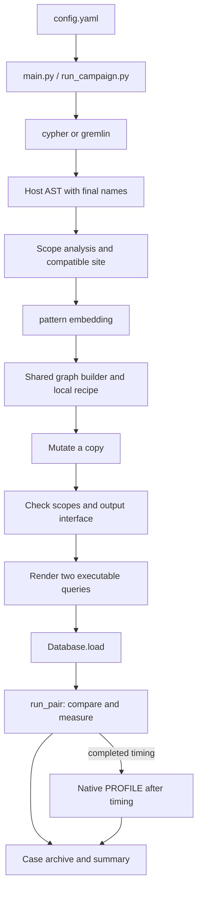

# GraphSymPerf code architecture

This document follows a test case from query generation through graph construction, measurement and archiving, then explains the language and database interfaces. [中文版本](architecture.zh-CN.md) · [Backend setup](backends.md) · [Testing](testing.md).

## 1. Purpose and invariants

GraphSymPerf searches for performance differences between graph queries related by a short-circuit or strict symmetry pattern. Each case selects one pattern and one local mutation. It constructs a graph containing the witnesses and potential work required by that pattern, then checks complete result equality before timing.

The source query Q is the host after pattern embedding. Q and its mutant Q′ must return the same result on the constructed graph.

The implementation maintains these invariants:

1. The host generator receives grammar capabilities, budgets, and an RNG, but no target pattern ID.
2. One compatible AST location is selected after host generation.
3. Names and constants are final when created. Mutation cannot draw fresh constants or names.
4. A case loads its graph once. Q/Q′ and their measurements share the same data and indexes.
5. Each backend generates cases compatible with its own query language and capabilities.
6. Complete typed results are compared before screening, and again during warmups and samples.
7. Query timeouts do not become measured runtimes. Unconfirmed termination stops further requests.

Random background data can leave a host predicate unsatisfied or a target unreachable. The run records these cases and retains the selected seed.

## 2. Source map and dependencies

| Path | Responsibility | Main interface |
| --- | --- | --- |
| [main.py](../main.py) | Configuration, random scheduling, case construction, execution, summary | `prepare_case`, `execute_case`, `schedule` |
| [scripts/run_campaign.py](../scripts/run_campaign.py) | Fixed seeds/scales, per-target budget, complete manifest | `main` |
| [replay.py](../replay.py) | Load archived graph and queries through the current connection | `replay_case` |
| [executor.py](../executor.py) | Typed comparison, paired timing, PROFILE, case serialization | `run_pair`, `save_case`, `workload_record` |
| [data_structures/](../data_structures/) | Shared AST utilities, case/graph/query contracts, typed values | `Case`, `Graph`, `Query`, `freeze` |
| [graph_generation/](../graph_generation/) | Background data, recipe dispatch, schema normalization | `build_graph`, `random_graph` |
| [cypher/](../cypher/) | Cypher AST, scopes, random grammar, patterns, rendering, schema | language module exports |
| [gremlin/](../gremlin/) | Traversal AST, scopes, random grammar, patterns, rendering, schema | language module exports |
| [databases/](../databases/) | Backend-specific loading, consumption, normalization, profiling | `Database` |
| [databases/gremlin_http.py](../databases/gremlin_http.py) | Shared JanusGraph/HugeGraph HTTP and GraphSON decoding | `GremlinHTTP`, `decode`, `normalize` |
| [scripts/check_interfaces.py](../scripts/check_interfaces.py) | Manual fixed checks against a real selected backend | `check` and backend-specific checks |
| [scripts/update_readme.py](../scripts/update_readme.py) | Generate README issue tables and the report index from `bugs.csv` | `main` |
| [databases/plans.py](../databases/plans.py) | Backend-neutral PROFILE summaries | `summarize` |
| [graph_generation/constraints.py](../graph_generation/constraints.py) | Host witness and anchor equality filters for the graph state | `plant_host_witness`, `apply_anchor_constraints` |



Language modules define query structure, transformations and rendering. Adapters handle database communication, loading and result conversion. The executor compares results, measures the query pair and collects profiles.

## 3. Data contracts

### AST names and variables

`data_structures/ast.py` defines `ASTNode`, `Symbol(name, kind)`, `sample_constant(rng, kind)` and `Variable(name, kind, labels, nullable)`, plus `walk`, `at`, and `replace_at`.

A Symbol is the final name of a label, relationship type, or property key. It is a `str` that also records its kind, so schema registration and background data can collect a query's terminals by kind; `Graph` stores plain strings. Scalar constants are drawn by `sample_constant()` when the generator creates them. A Variable records a query binding, its type and its label provenance. At execution time, each row supplies its value.

An AST path is a tuple of field names and list indices. For example, `("clauses", 0, "items", 0, "expression")` addresses a Cypher projection expression. Paths avoid parent pointers. `replace_at` also handles tuple fields such as CASE branches.

### Case

`Case(pattern, seed, query, target, host_symbols, payload)` holds construction state:

- `query`: the embedded source query.
- `target`: the mutation location. Matching-order patterns store the containing query and a `swap_index` in the payload.
- `host_symbols`: labels, relationship types, and keys of the original host, including those later replaced by a query-level pattern.
- `payload`: pattern-local roles, witnesses, guard choice, prepared replacement, anchors, and expansion allocation.

The mutant is produced from a deep copy, leaving the source intact.

### Graph

`Graph` contains four serializable fields:

```python
nodes = [{"labels": ["Label"], "properties": {"uid": 0, "keep": True}}]
relationships = [{"start": 0, "end": 1, "type": "EDGE", "properties": {}}]
indexes = [["Label", "uid"]]
schema = {
    "nodes": {"Label": {"uid": "int", "keep": "bool"}},
    "relationships": {
        "EDGE": {"endpoints": [["Label", "Other"]], "properties": {}}
    },
}
```

The example shows field shapes; a complete graph must contain both endpoints and their declarations. `Graph.node()` assigns `uid` from the node's list position. Relationship endpoints use those positions. Adapters translate logical UIDs to native IDs during loading.

Schema declarations exist independently of stored instances, so an empty label or region still has a declared type. Supported scalar property kinds are `int`, `float`, `bool`, and `string`.

Before `pattern.populate()`, [graph_generation/constraints.py](../graph_generation/constraints.py) plants one host witness: the non-optional Cypher `MATCH` paths, or the Gremlin root traversal's hops and `has` filters, with literal property filters. Planted nodes reuse the first existing node with the required labels, so they are ordinary candidates. After `populate()`, short-circuit anchor roots also receive the host's equality filters on the anchor. `host_witness` and `anchor_constraints` are archived under `construction`.

`Graph.candidates(variable)` selects nodes matching the variable's label provenance. It does not evaluate the host's WHERE predicates. `shares(total, count)` divides a case-wide expansion budget across distinct anchors; repeated runtime rows do not create additional graph expansion units.

### Executable query and normalized result

`data_structures/query.py` defines `Query(text, parameters, columns)`. Cypher currently renders literals inline; Gremlin binds predicate values and renders traversal structure explicitly. Gremlin has one declared output column, `result`.

`freeze()` preserves scalar types, nulls, list order, map entries, and duplicates. Floats are represented by their hexadecimal value. Backend normalizers handle native entities and paths before using the shared scalar/list conversion. Ladybug entity IDs include both table and offset; a table-local offset alone is not an identity.

The executor compares `(column_names, Counter(normalized_rows))`, preserving scalar types, duplicate rows, and the order within returned lists and paths.

## 4. Construction flow

`prepare_case()` is the main reading entrypoint:

1. Create a case-local `random.Random(seed)`.
2. Select the language module and backend capability dictionary.
3. Generate the complete host AST with final names and constants.
4. Analyze scopes and choose one compatible pattern site.
5. Embed the source form and prepare mutation metadata.
6. Build graph data.
7. Mutate a deep copy.
8. Check references and the output interface for both forms.
9. Render two executable queries.

`build_graph()` creates typed random background data, invokes `pattern.populate()` with the case payload, prepares requested indexes, and registers schema using the selected language. Cypher schema registration examines both source and mutant ASTs. Gremlin schema registration collects source, payload, and host names, then derives endpoint pairs from stored graph relationships. The finished schema is normalized to plain strings.

Names owned by a pattern use a `Pattern_` prefix and host names use a `Random_` prefix. This separates their labels and relationship types. An unrestricted scan can still visit both regions.

AST checks cover structure, scope and output compatibility. Database execution checks result equality; timing and profiles establish the performance evidence.


## 5. Cypher implementation

### Grammar

`cypher/ast_nodes/` separates queries, clauses, expressions, and graph patterns. The random grammar includes MATCH/OPTIONAL MATCH, WITH, UNWIND, RETURN, UNION, supported CALL subqueries, scalar CASE/coalesce, predicates, lists, quantifiers, and expression subqueries. Capability dictionaries restrict each target's grammar.

`generation.nodes` limits grammar expansion. Expression and subquery depth have separate limits. Generation favors terminal expressions as the budget runs out.

Pagination sorts every projected scalar column first. Aggregate inputs are constant in the generated aggregate branch, keeping `collect` independent of input ordering. Embedding excludes collect arguments so a replacement cannot make their order observable.

### Scope and dependency analysis

`cypher/scope.py` tracks `local` and `imported` variables separately. MATCH introduces variables; WHERE can read the variables introduced by that MATCH. A matching-structure replacement sees the input scope before those bindings are introduced.

CALL imports explicitly selected variables and exposes only its declared output columns. UNION branches share output names and types. Quantifier variables are local to their predicate. Variables introduced in a pattern comprehension remain local to it.

By default, imports survive projections. ArcadeDB uses `persistent_imports: false`: WITH removes unprojected imported variables, and generation, site selection, and final checks all apply this rule.

Memgraph and Ladybug use `subquery_unwind: false` to exclude subquery-producing work items inside UNWIND expressions. Memgraph also excludes the CALL-based bounded SC6 variant from expression-subquery positions. A host with no compatible position becomes `Inapplicable` rather than receiving a repaired query skeleton.

### Pattern catalog

| pattern | Local relation | Graph recipe or condition |
| --- | --- | --- |
| SC1 | True OR guard protects a replaceable operand | Fixed true guard; LOW/HIGH work regions |
| SC2 | False AND guard protects a replaceable operand | Fixed false guard; LOW/HIGH work regions |
| SC3 | Change an unselected CASE result or later WHEN condition | Earlier branch decides the result |
| SC4 | Change an operand after a non-null coalesce prefix | Prefix remains non-null, including false or zero |
| SC5 | Change work under zero output demand | Local query retains LIMIT 0 |
| SC6 | Change work beyond bounded output demand | Fixed witnesses or shared native-limit witnesses satisfy k rows |
| SC7 | Change the domain under EXISTS/NOT EXISTS | Direct witnesses on both sides |
| SC8 | Change work after mandatory empty input | pattern-owned false input remains in place |
| SY1 | Swap the same AND operands | False guard and work predicate, or two ordinary predicates |
| SY2 | Swap the same OR operands | True guard and work predicate, or two ordinary predicates |
| SY3 | Reflect a one-edge path | Preserve endpoint variables, labels, constraints, and direction meaning |
| SY4 | Reflect a bounded path | Preserve order-insensitive observation and the all-node keep condition |
| SY5 | Swap independent MATCH clauses | Selective or empty component versus a larger component |
| SY6 | Swap matches sharing a root | Small and large branches share the same root |
| SY7 | Swap two connected matching stages | Large right-side chains include disconnected candidates |
| SY8 | Swap independent OPTIONAL MATCH branches | Mandatory root retained; cover both, one, and neither branch matching |

SC1–SC8 replace protected work. SY1–SY8 preserve and reorder the same operands or matching structure. The catalog defines executable transformations; `bugs.csv` records their associations with reported issues.

`operands.py` owns the decisive candidate pool, anchors, work expressions, and common regional recipe. COUNT can return an integer, a Boolean comparison, or a converted scalar. Ladybug uses MATCH-body COUNT with native CAST for STRING/DOUBLE. FalkorDB uses pattern comprehensions. Its count candidates have passing endpoints, and its existence candidate has none. The [Cypher catalog](pattern-catalog.en.md#case-construction) gives the graph layouts and budget units for all 16 patterns.

The native SC6 variant for Ladybug/FalkorDB retains the random prefix, adds a local MATCH, returns identical constants, and applies a global LIMIT k. LOW and HIGH share k witnesses per anchor; HIGH adds the expansion units. The CALL/UNION variant uses an unchanged witness branch before replaceable work.

SY4 gives the graph a valid path plus expandable branches crossing a failing node. A unit can contain several nodes/edges. Path reflection rejects contexts that directly observe reversed path order; supported length and order-insensitive quantifier observations can remain.

## 6. Gremlin implementation

`gremlin/ast_nodes/` defines `Traversal`, `Step`, `Predicate`, and typed `Value`. Root traversals start at `g.V()`; child traversals use `__`. Seed generation does not restart a child traversal at V; only the SY5 `match()` patterns use a mid-traversal `V()`.

`gremlin/scope.py` tracks the current object, guaranteed label bindings, and whether the current scalar is constant. `as/select` records and reads bindings. Predicate children can read outer bindings without exporting new labels. `count` and `fold` replace their traversal's current bindings; branch outputs retain only common guarantees. Constant-only fold keeps list values independent of traversal order. `match()` binds the one start label that no pattern produces to the incoming object, binds every other pattern label, and emits a map; its patterns are not mutation sites.

All sixteen patterns are implemented:

| pattern | Gremlin form |
| --- | --- |
| SC1/SC2 | `or`/`and` predicates with a decisive child and LOW/HIGH work |
| SC3 | Three-argument `choose`, changing the unselected branch |
| SC4 | `coalesce`, changing a branch after a productive prefix |
| SC5/SC6 | Expansion, identical constant projection, and global `limit(0/k)` |
| SC7 | `filter`/`not` over a one-hop existence traversal; LOW and HIGH each match on every anchor |
| SC8 | An unproductive predicate before expansion |
| SY1/SY2 | Reverse the same two pure predicate subtrees |
| SY3/SY4 | After `V().hasLabel(X).has('p_anchor', 1)`, a `match()` whose first pattern binds one target and whose second is `where()` over one edge (SY3) or a bounded `repeat(both())` walk (SY4); the mutation rewrites that filter from the target back to the root. `where()` keeps the start label independent of pattern order |
| SY5–SY7 | After `V().hasLabel(X).has('p_anchor', 1)`, exchange two `match()` patterns: independent mid-traversal `V()` lookups, two arms from the root, or a two-stage chain; `select()` restores the root |
| SY8 | Exchange two `match()` arms of the form `coalesce(out(R).hasLabel(L), constant(sentinel))`; four workload roots cover both, one or neither arm matching |

Productivity is different from truth: `constant(false)` and `constant(0)` both emit a value. Predicate work regions use `keep=false`; count work items can still consume their entire region. The anchor comes from the current object or an existing node binding. A context without a suitable anchor is inapplicable.

Rendering uses bindings for predicate values. JanusGraph and HugeGraph use a `d` suffix for Groovy floating literals. The output interface remains one declared `result` column.

## 7. Backend boundary

`databases.select_database()` imports the chosen adapter. Each adapter exposes:

```python
Database(config)                    # ArcadeDB additionally selects language
load(graph)                         # replace and prepare one experiment graph
execute(query, timeout)              # columns, normalized rows, elapsed_ms
profile(query, timeout)              # native plan/metrics dictionary
close()                             # release client resources
```

| Target | Loading and identity | Query/PROFILE boundary |
| --- | --- | --- |
| Neo4j | Cypher batches, temporary UID loading indexes removed, requested indexes awaited | Bolt, Cypher 25, native query timeout and plan tree |
| Memgraph | Cypher batches, temporary UID label/index removed, requested indexes and ANALYZE GRAPH | Bolt, checked global settings, recognized native timeout, PROFILE table |
| ArcadeDB | Explicit property types, Cypher batches, requested indexes | HTTP, declared columns, native Cypher deadline; Gremlin deadline-triggered tagged cancellation |
| LadybugDB | Fresh temporary database, typed node/edge tables, CSV COPY; unquoted null versus quoted empty string | Embedded pybind, native timeout, native profile text |
| FalkorDB | Named graph replacement, batches and temporary loading indexes; full-result setting checked | Redis graph API, native query/PROFILE timeout, profile lines |
| JanusGraph | Drop/reopen experiment graph; typed SINGLE keys, MULTI edges, fresh composite indexes; committed ID maps | Gremlin HTTP, GraphSON 3, native evaluation deadline, TraversalMetrics |
| HugeGraph | Native clear; typed schema; parent/child edge labels and `_gsp_eid`; REST batches | Gremlin HTTP plus REST loading; GraphSON 3 and native metrics |

HugeGraph queries retain logical parent relationship labels. The loader stores endpoint-specific child labels and uses the archived relationship position as `_gsp_eid`, preserving parallel edges across batches. It enables label indexes and creates property indexes requested by `Graph.indexes`; it does not add indexes after a query rejection.

Schema-property types are global in JanusGraph/HugeGraph, so adapters reject conflicting declarations once at the loading boundary. Null properties are omitted where the native store represents missing properties; empty strings remain values.

## 8. Measurement, failures, and persistence

`execute_case()` loads the graph and calls `run_pair()`, then `probe_scale()` for a `no_gap` pair. The executor first compares complete results. Check mode returns after this comparison. Experiment mode performs discovery warmups and AB/BA pairs, then confirmation only when discovery qualifies. Every measured or warmup execution is also checked against the reference result.

For each phase:

- Choose the slower side using the two medians.
- Compute the ratio of the larger median to the smaller median.
- Compute the median paired difference in the selected direction.
- Count the fraction of paired differences with that direction.

Defaults are 5x, 100 ms, and 0.8 direction consistency. Confirmation must retain the discovery phase's slower side. Discovery uses three warmups and six pairs; confirmation uses five warmups and twenty pairs.

`run_pair(..., phases, gate, profile)` can run selected phases without the ratio screen. `probe_scale()` rebuilds the case with `high_units // scale_factor`, requires identical query text, and passes both graphs to `executor.scale_probe()`. The probe compares the gap between the two forms at both scales (`growth()`); a gap that grows by at least `growth_ratio`, by at least `minimum_delta_ms`, with the usual direction consistency, in discovery and in a confirmation at both scales, yields `scale_candidate`. The result's `scale` record keeps both measurements; plans at the smaller scale go to `plans-small.json`. `scale_factor: null` disables the probe; the campaign runner calls the same probe.

Adapters measure execution through complete result consumption. Loading, canonical normalization, and PROFILE are outside ordinary query timing. Completed timing outcomes (`no_gap`, `unconfirmed`, `candidate`) receive native profiles afterward. [databases/plans.py](../databases/plans.py) adds a `summary` to each profile: normalized operator names, total reported work, and the hottest operator.

| Outcome | Meaning and continuation |
| --- | --- |
| `skipped` | Host/site/recipe is inapplicable; continue scheduling |
| `generated` | Case saved without DB execution |
| `equivalent` | Check-only result comparison passed |
| `no_gap` | Discovery did not meet all thresholds |
| `unconfirmed` | Confirmation did not retain the qualifying gap/direction |
| `candidate` | Both measured phases qualified; root-cause review remains |
| `scale_candidate` | The ratio screen failed, but the gap grew with the high-cost units in discovery and confirmation |
| `result_mismatch` | Complete typed results differ; main records it, fixed campaign stops |
| `backend_rejected` | Recognized HugeGraph missing-index rejection; archive and continue |
| `timeout` | A native query timeout interrupted the protocol; the case has no completed timing sample |
| `error` / `interrupted` | Unexpected execution failure or interruption; archive and stop |

`stop_run` is independent of timing status. JanusGraph/HugeGraph native timeouts set `termination_confirmed=false` and `stop_run=true`. A PROFILE timeout can therefore leave a `no_gap` or `candidate` result while stopping the run. The terminating case is written to the summary before the exception is exposed.

ArcadeDB Gremlin records tagged cancellation responses. Unconfirmed cancellation or transport completion becomes an error and stops execution. Other adapters may continue after a recognized native timeout when termination is confirmed.

`save_case()` writes actual queries, parameters, columns, graph/schema/index data, configuration, version metadata, construction details, and measurements. Native plans are separate. Password values are obtained through environment variables and are not serialized by the configuration.

Replay uses saved inputs and archived measurement settings with the current selected connection. It requires matching language and system, and never regenerates a case from its seed. A replay writes `replay-result.json` and resets workload execution assessments.

## 9. Workload evidence

`workload_record()` saves the AST target path/kind, local roles and conditions, expansion budget, anchors, allocation, and stored label/relationship counts. SC5 records its `LIMIT 0` demand.

Construction counts describe potential work. Execution and opportunity start as `unknown`. Plan reviews record `observed`, `eliminated`, `unreached` or `unknown` in a separate file, together with references to native PROFILE fields. The timing outcome is stored separately.

A zero-row result can follow extensive scanning. A nonempty aggregate or fold can follow empty input. Output counts for a fused expansion/filter step do not expose all candidate visits. Plan review uses these distinctions to assess whether the target had an execution opportunity.


## 10. Fixed-seed campaigns

`scripts/run_campaign.py` reads the same configuration plus:

```yaml
campaign:
  seeds: [3, 4, 5, 6, 7]
  high_units: [1000]
  minutes_per_target: 30
  max_nodes: 500000
  max_relationships: 1000000
```

It requires experiment mode, `save_all=true`, and a new output directory. A complete manifest is written before execution. Patterns are shuffled within each seed round, and scales are attempted for each selected pattern/seed. No seed is replaced after a skip or failure.

The scheduling budget is checked before a new case starts; a current case can finish beyond that boundary. Actual generation, loading, measurement/PROFILE, and wall durations are recorded. Size caps apply to constructed graph nodes and relationships.

Unexpected errors, result mismatches, or unconfirmed termination stop the target. Ctrl-C during generation/loading/measurement records `interrupted`, preserves available cancellation evidence, marks pending entries accordingly, and exits with code 130. The manifest retains unsubmitted cases. Reports include client process CPU and peak RSS; database resource sampling is a separate experiment activity.

Query/input fingerprints identify identical serialized inputs and exclude seeds and execution metadata. A scale-control study checks that query fingerprints and fixed graph structure remain unchanged.

## 11. Extending the code

For another backend using an existing language, implement its adapter, register it in `databases/__init__.py`, define capability values, and enable the language/system pair in the entrypoints. Add real checks for schema, loading, complete typed results, timeout behavior, and PROFILE before enabling generated cases. Global edge labels, native IDs, CSV nulls, and cancellation semantics belong in the adapter.

For another pattern, implement `accepts`, `embed`, `populate`, and `mutate` in the appropriate language package, register it in that language's catalog, and identify its actual graph conditions. Keep random host generation independent of the pattern ID. Validate source/mutant scope and result equality, then inspect actual work separately from runtime thresholds.

For a new language, provide the exports used by `prepare_case`: generation, site selection, pattern lookup, schema registration, pair checking, and rendering. The branches in `main.py` show how the two supported languages provide these interfaces.

## 12. Verification

Follow the [testing guide](testing.md) after changing generation, transformations or an adapter:

1. Generate a small case offline and inspect its queries, graph and construction metadata.
2. Select a dedicated target from [backend setup](backends.md) and check the query pair's complete results.
3. Replay the saved case; use experiment mode to collect timing and native profiles.
