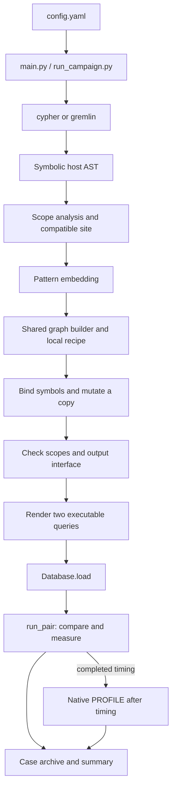

# GraphSymPerf code architecture

This document describes the executable code in this repository. It follows one case from a random symbolic host to a measured query pair, then explains the language and database boundaries. [中文版本](architecture.zh-CN.md) · [Backend setup](backends.md) · [Validation record](validation.md).

## 1. Purpose and invariants

GraphSymPerf searches for performance differences between graph queries related by a short-circuit or strict symmetry Pattern. Each case selects one Pattern and one local mutation. It constructs a graph containing the witnesses and potential work required by that Pattern, then checks complete result equality before timing.

The source query is the host **after Pattern embedding**. It need not preserve the meaning of the original random host. The required relation is between the embedded source and its mutant on the constructed graph.

The implementation maintains these invariants:

1. The host generator receives grammar capabilities, budgets, and an RNG, but no target Pattern ID.
2. One compatible AST location is selected after host generation.
3. Symbol binding is shared by both query forms. Mutation cannot draw fresh constants or names.
4. A case loads its graph once. Q1/Q2 and their measurements share the same data and indexes.
5. Each backend may generate its own cases. No cross-system result or runtime equality is assumed.
6. Complete typed results are compared before screening, and again during warmups and samples.
7. Query timeouts do not become measured runtimes. Unconfirmed termination stops further requests.

Random background data is not a solution to all host predicates. A syntactically compatible case can have an empty result or an unreachable target. These outcomes remain evidence rather than triggering automatic regeneration.

## 2. Source map and dependencies

| Path | Responsibility | Main interface |
| --- | --- | --- |
| [main.py](../main.py) | Configuration, random scheduling, case construction, execution, summary | `prepare_case`, `execute_case`, `schedule` |
| [scripts/run_campaign.py](../scripts/run_campaign.py) | Fixed seeds/scales, per-target budget, complete manifest | `main` |
| [replay.py](../replay.py) | Load archived graph and queries through the current connection | `replay_case` |
| [executor.py](../executor.py) | Typed comparison, paired timing, PROFILE, case serialization | `run_pair`, `save_case`, `workload_record` |
| [data_structures/](../data_structures/) | Shared AST utilities, case/graph/query contracts, typed values | `Case`, `Graph`, `Query`, `freeze` |
| [graph_generation/](../graph_generation/) | Symbol binding, background data, recipe dispatch | `build_graph`, `bind_symbols`, `random_graph` |
| [cypher/](../cypher/) | Cypher AST, scopes, random grammar, Patterns, rendering, schema | language module exports |
| [gremlin/](../gremlin/) | Traversal AST, scopes, random grammar, Patterns, rendering, schema | language module exports |
| [databases/](../databases/) | Backend-specific loading, consumption, normalization, profiling | `Database` |
| [databases/gremlin_http.py](../databases/gremlin_http.py) | Shared JanusGraph/HugeGraph HTTP and GraphSON decoding | `GremlinHTTP`, `decode`, `normalize` |
| [scripts/check_interfaces.py](../scripts/check_interfaces.py) | Manual fixed checks against a real selected backend | `check` and backend-specific checks |
| [scripts/update_readme.py](../scripts/update_readme.py) | Derive the README issue summary/tables from `bugs.csv` | `main` |



Language modules own query meaning and syntax. Adapters own native communication and storage conventions. The executor does not choose a query rewrite or interpret a backend's optimizer plan.

## 3. Data contracts

### Symbolic AST and variables

`data_structures/ast.py` defines `ASTNode`, immutable `Symbol(name, kind)` and `Variable(name, kind, labels, nullable)`, plus `walk`, `at`, and `replace_at`.

A Symbol represents a label, relationship type, property key, or scalar constant that will be bound later. A Variable describes a query binding and its type/label provenance. It is not a permanently assigned graph node.

An AST path is a tuple of field names and list indices. For example, `("clauses", 0, "items", 0, "expression")` addresses a Cypher projection expression. Paths avoid parent pointers. `replace_at` also handles tuple fields such as CASE branches.

### Case

`Case(pattern, seed, query, target, host_symbols, payload, bindings)` holds construction state:

- `query`: the embedded symbolic source, then its bound form.
- `target`: the mutation location. Matching-order Patterns store the containing query and a `swap_index` in the payload.
- `host_symbols`: symbols retained from the original host, including those later replaced by a query-level Pattern.
- `payload`: Pattern-local roles, witnesses, guard choice, prepared replacement, anchors, and expansion allocation.
- `bindings`: the shared terminal-value mapping.

`instantiate()` recursively binds both `query` and `payload`. The mutant is produced from a deep copy, leaving the source intact.

### Graph

`Graph` contains four serializable fields:

```python
nodes = [{"labels": ["Label"], "properties": {"uid": 0, "keep": True}}]
relationships = [{"start": 0, "end": 1, "type": "EDGE", "properties": {}}]
indexes = [["Label", "uid"]]
schema = {
    "nodes": {"Label": {"uid": "int", "keep": "bool"}},
    "relationships": {
        "EDGE": {"endpoints": [["Label", "Other"]], "properties": {}}
    },
}
```

The example shows field shapes; a complete graph must contain both endpoints and their declarations. `Graph.node()` assigns `uid` from the node's list position. Relationship endpoints use those positions. Adapters translate logical UIDs to native IDs during loading.

Schema declarations exist independently of stored instances, so an empty label or region still has a declared type. Supported scalar property kinds are `int`, `float`, `bool`, and `string`.

`Graph.candidates(variable)` selects nodes matching the variable's label provenance. It does not evaluate the host's WHERE predicates. `shares(total, count)` divides a case-wide expansion budget across distinct anchors; repeated runtime rows do not create additional graph expansion units.

### Executable query and normalized result

`data_structures/query.py` defines `Query(text, parameters, columns)`. Cypher currently renders literals inline; Gremlin binds predicate values and renders traversal structure explicitly. Gremlin has one declared output column, `result`.

`freeze()` preserves scalar types, nulls, list order, map entries, and duplicates. Floats are represented by their hexadecimal value. Backend normalizers handle native entities and paths before using the shared scalar/list conversion. Ladybug entity IDs include both table and offset; a table-local offset alone is not an identity.

The executor compares `(column_names, Counter(normalized_rows))`. It does not sort the contents of lists or paths, collapse Boolean and integer values, or discard duplicate rows.

## 4. Construction flow

`prepare_case()` is the main reading entrypoint:

1. Create a case-local `random.Random(seed)`.
2. Select the language module and backend capability dictionary.
3. Generate the complete symbolic host AST.
4. Analyze scopes and choose one compatible Pattern site.
5. Embed the source form and prepare mutation metadata.
6. Build graph data and terminal bindings.
7. Instantiate the AST and payload.
8. Mutate a deep copy.
9. Check references and the output interface for both forms.
10. Render two executable queries.

`build_graph()` first binds symbols, then creates typed random background data, invokes `pattern.populate()`, prepares requested indexes, and registers schema using the selected language. Cypher schema registration creates a bound copy and examines both source and mutant ASTs. Gremlin schema registration collects source, payload, and host symbols, then derives endpoint pairs from stored graph relationships. Final instantiation of the source happens after graph construction.

Pattern names receive a `Pattern_` prefix and host names a `Random_` prefix. These names prevent accidental role overlap; they do not hide Pattern nodes from unrestricted host scans.

The AST checks establish structure, scope, and output compatibility. Full result equality is checked by the database. They do not prove a performance difference or guarantee that the host reaches the Pattern.

### Concrete example: LadybugDB S4

With the default grammar budgets, Pattern S4, seed 4, and `high_units=1000`, the generated source is:

```cypher
RETURN DISTINCT coalesce(null, "kept", CAST(COUNT {
MATCH (p_root:`Pattern_p_root`)-[:`Pattern_p_low_edge`]->(p_low_node:`Pattern_p_low`) WHERE (p_low_node.`keep` = true)
}, "STRING")) AS v2
```

The mutant changes the low-region query to its high-region counterpart. The non-null `"kept"` prefix is unchanged. The graph has 50 background nodes, one private anchor, one LOW node, and 1,000 HIGH nodes: 1,052 nodes and 1,101 relationships including the 100 background relationships. Both regions are present in the same graph.

The AST declares a string output; native CAST retains that type. Real acceptance returned one equal row on both sides. This construction provides potential work; whether the engine evaluates the protected COUNT still requires native execution evidence.

## 5. Cypher implementation

### Grammar

`cypher/ast_nodes/` separates queries, clauses, expressions, and graph patterns. The random grammar includes MATCH/OPTIONAL MATCH, WITH, UNWIND, RETURN, UNION, supported CALL subqueries, scalar CASE/coalesce, predicates, lists, quantifiers, and expression subqueries. Capability dictionaries restrict each target's grammar.

`generation.nodes` is a decreasing expansion budget, not an exact AST-node count. Expression and subquery depth have separate limits. Generation favors terminal expressions as the budget runs out.

Pagination sorts every projected scalar column first. Aggregate inputs are constant in the generated aggregate branch, keeping `collect` independent of input ordering. Embedding excludes collect arguments so a replacement cannot make their order observable.

### Scope and dependency analysis

`cypher/scope.py` tracks `local` and `imported` variables separately. MATCH introduces variables; WHERE can read the variables introduced by that MATCH. A matching-structure replacement sees the input scope before those bindings are introduced.

CALL imports explicitly selected variables and exposes only its declared output columns. UNION branches share output names and types. Quantifier variables are local to their predicate. Pattern-comprehension variables do not escape the comprehension.

By default, imports survive projections. ArcadeDB uses `persistent_imports: false`: WITH removes unprojected imported variables, and generation, site selection, and final checks all apply this rule.

Memgraph and Ladybug use `subquery_unwind: false` to exclude subquery-producing work items inside UNWIND expressions. Memgraph also excludes the CALL-based bounded S6 variant from expression-subquery positions. A host with no compatible position becomes `Inapplicable` rather than receiving a repaired query skeleton.

### Pattern catalog

| Pattern | Local relation | Graph recipe or condition |
| --- | --- | --- |
| S1 | True OR guard protects a replaceable operand | Fixed true guard; LOW/HIGH work regions |
| S2 | False AND guard protects a replaceable operand | Fixed false guard; LOW/HIGH work regions |
| S3 | Change an unselected CASE result or later WHEN condition | Earlier branch decides the result |
| S4 | Change an operand after a non-null coalesce prefix | Prefix remains non-null, including false or zero |
| S5 | Change work under zero output demand | Local query retains LIMIT 0 |
| S6 | Change work beyond bounded output demand | Fixed witnesses or shared native-limit witnesses satisfy k rows |
| S7 | Change the domain under EXISTS/NOT EXISTS | Direct witnesses on both sides, or an unchanged UNION witness |
| S8 | Change work after mandatory empty input | Pattern-owned false input remains in place |
| Y1 | Swap the same AND operands | False decisive operand and unchanged work operand |
| Y2 | Swap the same OR operands | True decisive operand and unchanged work operand |
| Y3 | Reflect a one-edge path | Preserve endpoint variables, labels, constraints, and direction meaning |
| Y4 | Reflect a bounded path | Preserve order-insensitive observation and the all-node keep condition |
| Y5 | Swap independent MATCH clauses | Selective or empty component versus a larger component |
| Y6 | Swap matches sharing a root | Small and large branches share the same root |
| Y7 | Swap two connected matching stages | Large right-side chains include disconnected candidates |
| Y8 | Swap independent OPTIONAL MATCH branches | Mandatory root retained; cover both, one, and neither branch matching |

S1–S8 use protected replacement, not strict symmetry. Y1–Y8 preserve and reorder the same operands or matching structure. Historical issue-to-Pattern mappings in `bugs.csv` are broader associations and are not executable Pattern definitions.

`operands.py` owns the decisive candidate pool, anchors, work expressions, and common regional recipe. COUNT can return an integer, a Boolean comparison, or a converted scalar. Ladybug uses MATCH-body COUNT with native CAST for STRING/DOUBLE. FalkorDB uses pattern-comprehension lists, with separate true witnesses and failing work candidates.

The native S6 variant for Ladybug/FalkorDB retains the random prefix, adds a local MATCH, returns identical constants, and applies a global LIMIT k. LOW and HIGH share k witnesses per anchor; HIGH adds the expansion units. The CALL/UNION variant uses an unchanged witness branch before replaceable work.

Y4 gives the graph a valid path plus expandable branches crossing a failing node. A unit can contain several nodes/edges. Path reflection rejects contexts that directly observe reversed path order; supported length and order-insensitive quantifier observations can remain.

## 6. Gremlin implementation

`gremlin/ast_nodes/` defines `Traversal`, `Step`, `Predicate`, and typed `Value`. Root traversals start at `g.V()`; child traversals use `__`. The generator does not restart a child traversal at V.

`gremlin/scope.py` tracks the current object, guaranteed label bindings, and whether the current scalar is constant. `as/select` records and reads bindings. Predicate children can read outer bindings without exporting new labels. `count` and `fold` replace their traversal's current bindings; branch outputs retain only common guarantees. Constant-only fold keeps list values independent of traversal order.

Only S1–S6, S8, Y1, and Y2 are implemented:

| Pattern | Gremlin form |
| --- | --- |
| S1/S2 | `or`/`and` predicates with a decisive child and LOW/HIGH work |
| S3 | Three-argument `choose`, changing the unselected branch |
| S4 | `coalesce`, changing a branch after a productive prefix |
| S5/S6 | Expansion, identical constant projection, and global `limit(0/k)` |
| S8 | An unproductive predicate before expansion |
| Y1/Y2 | Reverse the same two pure predicate subtrees |

Productivity is different from truth: `constant(false)` and `constant(0)` both emit a value. Predicate work regions use `keep=false`; count work items can still consume their entire region. A traceable node is taken from the current object or an existing binding. No global fallback traversal is invented when no anchor exists.

Rendering uses bindings for predicate values. JanusGraph and HugeGraph use a `d` suffix for Groovy floating literals. The output interface remains one declared `result` column.

## 7. Backend boundary

`databases.select_database()` imports the chosen adapter. Each adapter exposes:

```python
Database(config)                    # ArcadeDB additionally selects language
load(graph)                         # replace and prepare one experiment graph
execute(query, timeout)              # columns, normalized rows, elapsed_ms
profile(query, timeout)              # native plan/metrics dictionary
close()                             # release client resources
```

| Target | Loading and identity | Query/PROFILE boundary |
| --- | --- | --- |
| Neo4j | Cypher batches, temporary UID loading indexes removed, requested indexes awaited | Bolt, Cypher 25, native query timeout and plan tree |
| Memgraph | Cypher batches, temporary UID label/index removed, requested indexes and ANALYZE GRAPH | Bolt, checked global settings, recognized native timeout, PROFILE table |
| ArcadeDB | Explicit property types, Cypher batches, requested indexes | HTTP, declared columns, native Cypher deadline; Gremlin deadline-triggered tagged cancellation |
| LadybugDB | Fresh temporary database, typed node/edge tables, CSV COPY; unquoted null versus quoted empty string | Embedded pybind, native timeout, native profile text |
| FalkorDB | Named graph replacement, batches and temporary loading indexes; full-result setting checked | Redis graph API, native query/PROFILE timeout, profile lines |
| JanusGraph | Drop/reopen experiment graph; typed SINGLE keys, MULTI edges, fresh composite indexes; committed ID maps | Gremlin HTTP, GraphSON 3, native evaluation deadline, TraversalMetrics |
| HugeGraph | Native clear; typed schema; parent/child edge labels and `_gsp_eid`; REST batches | Gremlin HTTP plus REST loading; GraphSON 3 and native metrics |

HugeGraph queries retain logical parent relationship labels. The loader stores endpoint-specific child labels and uses the archived relationship position as `_gsp_eid`, preserving parallel edges across batches. It enables label indexes and creates property indexes requested by `Graph.indexes`; it does not add indexes after a query rejection.

Schema-property types are global in JanusGraph/HugeGraph, so adapters reject conflicting declarations once at the loading boundary. Null properties are omitted where the native store represents missing properties; empty strings remain values.

## 8. Measurement, failures, and persistence

`execute_case()` loads the graph and calls `run_pair()`. The executor first compares complete results. Check mode returns after this comparison. Experiment mode performs discovery warmups and AB/BA pairs, then confirmation only when discovery qualifies. Every measured or warmup execution is also checked against the reference result.

For each phase:

- Choose the slower side using the two medians.
- Compute the ratio of the larger median to the smaller median.
- Compute the median paired difference in the selected direction.
- Count the fraction of paired differences with that direction.

Defaults are 5x, 100 ms, and 0.8 direction consistency. Confirmation must retain the discovery phase's slower side. Discovery uses three warmups and six pairs; confirmation uses five warmups and twenty pairs.

Adapters measure execution through complete result consumption. Loading, canonical normalization, and PROFILE are outside ordinary query timing. Completed timing outcomes (`no_gap`, `unconfirmed`, `candidate`) receive native profiles afterward.

| Outcome | Meaning and continuation |
| --- | --- |
| `skipped` | Host/site/recipe is inapplicable; continue scheduling |
| `generated` | Case saved without DB execution |
| `equivalent` | Check-only result comparison passed |
| `no_gap` | Discovery did not meet all thresholds |
| `unconfirmed` | Confirmation did not retain the qualifying gap/direction |
| `candidate` | Both measured phases qualified; root-cause review remains |
| `result_mismatch` | Complete typed results differ; main records it, fixed campaign stops |
| `backend_rejected` | Recognized HugeGraph missing-index rejection; archive and continue |
| `timeout` | A native query timeout interrupted the protocol; no censored runtime is invented |
| `error` / `interrupted` | Unexpected execution failure or interruption; archive and stop |

`stop_run` is independent of timing status. JanusGraph/HugeGraph native timeout responses do not prove worker termination, so they set `termination_confirmed=false` and `stop_run=true`. A PROFILE timeout can therefore leave a `no_gap` or `candidate` result while stopping the run. The terminating case is written to the summary before the exception is exposed.

ArcadeDB Gremlin records tagged cancellation responses. Unconfirmed cancellation or transport completion becomes an error and stops execution. Ordinary native timeouts on adapters with an accepted recovery path may allow subsequent cases. No runner automatically restarts a database.

`save_case()` writes actual queries, parameters, columns, graph/schema/index data, configuration, version metadata, construction details, and measurements. Native plans are separate. Password values are obtained through environment variables and are not serialized by the configuration.

Replay uses saved inputs and archived measurement settings with the current selected connection. It requires matching language and system, and never regenerates a case from its seed. A replay writes `replay-result.json` and resets workload execution assessments.

## 9. Workload evidence

`workload_record()` saves the AST target path/kind, local roles and conditions, expansion budget, anchors, allocation, and stored label/relationship counts. S5 records actual LIMIT 0; an unused recipe draw is not reported as its query limit.

Construction counts describe potential work. Execution and opportunity start as `unknown`. Local review sidecars may classify a query side as `observed`, `eliminated`, `unreached`, or `unknown`, pointing to native PROFILE evidence. They do not change the measurement result.

A zero-row result can follow extensive scanning. A nonempty aggregate or fold can follow empty input. Output counts for a fused expansion/filter step do not expose all candidate visits. These distinctions matter when assessing whether a Pattern had an execution opportunity. The repository does not contain a general cross-backend plan classifier or a solver for arbitrary nested host contexts.

## 10. Fixed-seed campaigns

`scripts/run_campaign.py` reads the same configuration plus:

```yaml
campaign:
  seeds: [3, 4, 5, 6, 7]
  high_units: [1000]
  minutes_per_target: 30
  max_nodes: 500000
  max_relationships: 1000000
```

It requires experiment mode, `save_all=true`, and a new output directory. A complete manifest is written before execution. Patterns are shuffled within each seed round, and scales are attempted for each selected Pattern/seed. No seed is replaced after a skip or failure.

The scheduling budget is checked before a new case starts; a current case can finish beyond that boundary. Actual generation, loading, measurement/PROFILE, and wall durations are recorded. Size caps apply to constructed graph nodes and relationships.

Unexpected errors, result mismatches, or unconfirmed termination stop the target. Ctrl-C during generation/loading/measurement records `interrupted`, preserves available cancellation evidence, marks pending entries accordingly, and exits with code 130. The manifest retains unsubmitted cases. Reports include client process CPU and peak RSS; database resource sampling is a separate experiment activity.

Query/input fingerprints exclude seeds and execution metadata. They identify identical serialized inputs, not semantic equivalence classes. A scale-control study should verify that query fingerprints and fixed graph structure remain unchanged.

## 11. Extending the code

For another backend using an existing language, implement its adapter, register it in `databases/__init__.py`, define capability values, and enable the language/system pair in the entrypoints. Add real checks for schema, loading, complete typed results, timeout behavior, and PROFILE before enabling generated cases. Global edge labels, native IDs, CSV nulls, and cancellation semantics belong in the adapter.

For another Pattern, implement `accepts`, `embed`, `populate`, and `mutate` in the appropriate language package, register it in that language's catalog, and identify its actual graph conditions. Keep random host generation independent of the Pattern ID. Validate source/mutant scope and result equality, then inspect actual work separately from runtime thresholds.

For a new language, provide the exports used by `prepare_case`: generation, site selection, Pattern lookup, schema registration, pair checking, and rendering. The existing branches in `main.py` make the current two-language differences explicit; no plugin framework is required.

## 12. Validation and documentation ownership

The [validation record](validation.md) lists completed local runs and their boundaries. `scripts/check_interfaces.py` exercises real adapters; it is a manual acceptance tool, not a substitute for generated-case coverage. No production database is required for generate mode or offline graph/query comparisons.

`bugs.csv` is the issue ledger. README issue tables and summary blocks are generated by `scripts/update_readme.py`; edit the CSV and regenerate those blocks. Architecture and backend instructions are maintained directly. `paper/`, `BUG list/`, `reference/`, and `picture/` are retained research materials and are not automatically synchronized with executable behavior.
