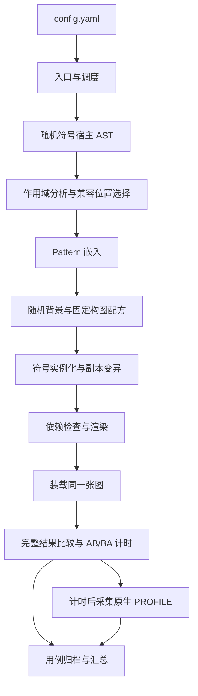

# GraphSymPerf 代码架构

本文按当前可执行代码说明一次用例如何从随机符号 AST 进入构图、变异、执行和归档，并解释语言层与数据库接口的分工。[English](architecture.md) · [后端部署](backends.md) · [验证记录](validation.md)。

## 1. 方法目标与约束

GraphSymPerf 寻找短路或严格对称 Pattern 所关联的查询性能差异。每个用例只有一个目标 Pattern 和一个局部变异。图中包含保证该 Pattern 条件的固定结构，以及随 `high_units` 扩张的候选区域。

Q1 是完成 Pattern 嵌入后的源查询，Q2 是对它进行局部变异后的查询。两者需要在构造出的同一张图上等价；未嵌入 Pattern 的原随机宿主不参与这项等价要求。

实现遵守以下约束：

1. 随机生成器接收语法能力、预算和随机数生成器，不接收目标 Pattern 编号。
2. 完整宿主 AST 生成后，才选择兼容位置。
3. Q1/Q2 共用符号绑定，变异阶段不重新抽取常量或名称。
4. 每个用例只装载一次图，查询对及其计时期间的数据和索引不变。
5. 各数据库独立生成兼容用例，不要求跨系统结果或耗时可比。
6. 先比较完整带类型结果，再计时；预热和计时中的结果仍逐次比较。
7. 超时不折算成实际耗时，终止未确认时停止后续请求。

随机背景图不求解全部宿主谓词。因此，语法合法、位置兼容的查询仍可能返回空结果，或无法到达目标区域。程序保留这类结果，不自动换种子或补图来制造成功样本。

## 2. 目录与依赖关系

| 位置 | 职责 | 主要入口 |
| --- | --- | --- |
| [main.py](../main.py) | 配置、随机调度、单用例构造、执行和汇总 | `prepare_case`、`execute_case`、`schedule` |
| [scripts/run_campaign.py](../scripts/run_campaign.py) | 固定种子和规模、预算、完整计划清单 | `main` |
| [replay.py](../replay.py) | 用当前连接执行保存的图和查询 | `replay_case` |
| [executor.py](../executor.py) | 结果比较、交替计时、PROFILE、归档 | `run_pair`、`save_case`、`workload_record` |
| [data_structures/](../data_structures/) | 公共 AST 工具、用例、图、查询和结果类型 | `Case`、`Graph`、`Query`、`freeze` |
| [graph_generation/](../graph_generation/) | 符号绑定、随机背景、配方调度 | `build_graph`、`bind_symbols`、`random_graph` |
| [cypher/](../cypher/) | Cypher AST、作用域、生成、Pattern、渲染和 schema | 语言模块导出的函数 |
| [gremlin/](../gremlin/) | 遍历 AST、作用域、生成、Pattern、渲染和 schema | 语言模块导出的函数 |
| [databases/](../databases/) | 各数据库的装载、执行、解码和计划采集 | `Database` |
| [databases/gremlin_http.py](../databases/gremlin_http.py) | JanusGraph/HugeGraph 共用的 HTTP 和 GraphSON 处理 | `GremlinHTTP`、`decode`、`normalize` |
| [scripts/check_interfaces.py](../scripts/check_interfaces.py) | 选定数据库上的少量真实接口验收 | `check` 及各后端检查 |
| [scripts/update_readme.py](../scripts/update_readme.py) | 从 `bugs.csv` 生成 README issue 区域 | `main` |



语言层负责查询的结构和语义，数据库接口负责原生通信与存储约定。执行器不选择变异方式，也不解释某个后端的优化器实现。

## 3. 公共数据结构

### 符号、变量和 AST 路径

`data_structures/ast.py` 定义 `ASTNode`、不可变的 `Symbol(name, kind)` 和 `Variable(name, kind, labels, nullable)`。

Symbol 表示稍后绑定的标签、关系类型、属性键或标量常量。Variable 保存查询变量的类型、标签来源和可空性，不代表某一个永久绑定的图节点。

`walk()` 遍历 AST，`at()` 读取路径，`replace_at()` 替换节点。路径由字段名和序号组成，例如：

```python
("clauses", 0, "items", 0, "expression")
```

这条路径定位到 Cypher 第一个投影项的表达式。CASE 分支包含元组，`replace_at()` 会重建相应元组，而不是试图原位修改元组成员。

### Case

`Case` 包含：

- `pattern`、`seed`：用例身份。
- `query`：嵌入后的符号源查询，随后变为绑定后的查询。
- `target`：局部变异位置；匹配顺序 Pattern 保存所属 Query，再用 `payload.swap_index` 定位要交换的子句。
- `host_symbols`：原宿主使用的符号，包括后来被查询级 Pattern 替换的部分。
- `payload`：局部角色、决定项、见证、预备变异、锚点及扩张分配。
- `bindings`：两条查询共享的终端绑定。

`instantiate()` 同时绑定 AST 和 payload。`pattern.mutate()` 接收深拷贝，保持源查询不变。

### Graph

图由节点、关系、索引和 schema 四部分组成：

```python
nodes = [{"labels": ["Label"], "properties": {"uid": 0, "keep": True}}]
relationships = [{"start": 0, "end": 1, "type": "EDGE", "properties": {}}]
indexes = [["Label", "uid"]]
schema = {
    "nodes": {"Label": {"uid": "int", "keep": "bool"}},
    "relationships": {
        "EDGE": {"endpoints": [["Label", "Other"]], "properties": {}}
    },
}
```

上面只展示字段形状；完整图还需包含所有端点及其声明。`Graph.node()` 将节点列表位置写为 `uid`，关系端点也使用这个位置。装载时，各后端把它映射为原生 ID。

schema 与实例分开，允许空标签或空区域保留类型声明。属性标量类型为 `int`、`float`、`bool` 和 `string`。

`Graph.candidates()` 按变量的标签来源选择候选节点，不执行宿主 WHERE。`shares()` 按不同锚点分配整个用例的扩张总数。一个锚点在运行时出现多次，不会使构图预算重复增加，但可能造成重复访问。

### 可执行查询和结果

`Query(text, parameters, columns)` 保存查询文本、绑定参数和声明列。当前 Cypher 渲染器内联字面量；Gremlin 将谓词值作为参数，结构和必要的常量按原生形式渲染。Gremlin 的输出列固定为 `result`。

后端把结果转换为公共的带类型表示。`freeze()` 区分 null、布尔、整数、浮点数、字符串、列表和映射；浮点数用十六进制值表示。实体和路径由各后端先处理，Ladybug 的实体身份同时包含表编号和表内偏移。

执行器比较的是列名顺序与结果行多重集：

```python
(columns, Counter(normalized_rows))
```

行顺序不参与多重集比较，重复行数量保留；列表与路径的内部顺序也保留。

## 4. 一次用例的完整过程

从 `main.prepare_case()` 开始阅读：

1. 用种子创建用例私有 RNG。
2. 选择语言模块及数据库能力字典。
3. 生成完整符号宿主 AST。
4. 分析作用域，选择兼容位置。
5. 嵌入 Pattern 源形式，并准备变异元数据。
6. 构造图和符号绑定。
7. 实例化查询及 payload。
8. 对副本执行局部变异。
9. 检查两侧引用和输出接口。
10. 渲染为两条可执行查询。

`build_graph()` 内部依次绑定符号、生成随机背景、调用 `pattern.populate()`、准备索引并登记 schema。Cypher 的 schema 登记使用已绑定副本检查源查询和变异查询；Gremlin 收集源查询、payload 和宿主符号，并从实际关系取得端点组合。最终源查询在下一步正式实例化。

Pattern 符号绑定到 `Pattern_` 前缀，宿主符号绑定到 `Random_` 前缀。名称隔离避免角色意外重叠，但不会让 Pattern 数据对无标签扫描不可见。

依赖检查说明结构、作用域和输出接口满足当前约束。完整结果是否相同要由数据库验证；目标是否被执行及是否存在性能差异也分别保留证据。

### 具体示例：LadybugDB S4

默认语法预算下，S4、seed 4、`high_units=1000` 的源查询为：

```cypher
RETURN DISTINCT coalesce(null, "kept", CAST(COUNT {
MATCH (p_root:`Pattern_p_root`)-[:`Pattern_p_low_edge`]->(p_low_node:`Pattern_p_low`) WHERE (p_low_node.`keep` = true)
}, "STRING")) AS v2
```

变异查询将 LOW 区域替换为 HIGH 区域，非空前缀 `"kept"` 保持不变。图中有 50 个背景节点、一个独立锚点、一个 LOW 节点和 1,000 个 HIGH 节点，共 1,052 个节点；加上 100 条背景关系，共 1,101 条关系。两种区域始终同时存在。

AST 声明字符串输出，原生 CAST 保持该类型。真实验收中，两侧返回一行相同结果。构图说明潜在工作存在，受保护 COUNT 是否实际求值仍要看原生执行证据。

## 5. Cypher 语言层

### 随机语法

`cypher/ast_nodes/` 分别定义查询、子句、表达式和图匹配结构。语法包括 MATCH/OPTIONAL MATCH、WITH、UNWIND、RETURN、UNION、受后端能力约束的 CALL、CASE/coalesce、谓词、列表、量词和表达式子查询。

`generation.nodes` 是逐步递减的展开预算，不是精确的 AST 节点数。表达式深度和子查询深度单独限制；预算减少后，生成更倾向于终端。

分页前按全部投影标量排序，使排序并列行具有相同返回值。生成的聚合分支使用常量输入；嵌入时排除 collect 参数内部位置，避免改变列表顺序的可观察性。

### 作用域与依赖

`cypher/scope.py` 分开保存局部变量和导入变量。MATCH 引入变量，WHERE 可读这些新变量；替换匹配结构的位置使用的是进入该 MATCH 之前的作用域。

CALL 只导入显式选中的变量，只向外暴露返回列。UNION 分支使用同名同类型的输出。量词变量仅在自身谓词中有效，模式推导新变量不泄露到外层。

默认导入变量在投影后仍可见。ArcadeDB 设置 `persistent_imports: false`，WITH 后仅保留显式投影的变量；生成、位置选择和最终检查共用此规则。

Memgraph 与 Ladybug 设置 `subquery_unwind: false`，排除 UNWIND 表达式内部的子查询工作项。Memgraph 的 CALL/UNION S6 变体也不能嵌入表达式子查询。无兼容位置时返回 `Inapplicable`。

### Pattern 目录

| Pattern | 变换 | 构图与条件 |
| --- | --- | --- |
| S1 | 真决定项保护 OR 的另一个操作数 | 保留决定项，替换 LOW/HIGH 工作项 |
| S2 | 假决定项保护 AND 的另一个操作数 | 保留决定项，替换 LOW/HIGH 工作项 |
| S3 | 改变未选 CASE 结果或后续 WHEN 条件 | 先前分支已确定结果 |
| S4 | 改变非空 coalesce 前缀后的操作数 | 前缀可为 false 或 0，只需非空 |
| S5 | 替换零输出需求下的工作 | 局部查询始终保留 LIMIT 0 |
| S6 | 替换有限需求之后的工作 | 固定见证或共享见证满足 k 行需求 |
| S7 | 改变 EXISTS/NOT EXISTS 的查询域 | 两侧直接见证，或不变的 UNION 见证 |
| S8 | 替换必选空输入之后的工作 | 保留 Pattern 自身的空输入 |
| Y1/Y2 | 交换原有 AND/OR 操作数 | 不改写操作数和图区域 |
| Y3 | 反射单边路径 | 保留端点变量、约束和方向含义 |
| Y4 | 反射有界路径 | 保留顺序无关观察和全路径节点条件 |
| Y5 | 交换独立 MATCH | 选择性或空分量与较大分量 |
| Y6 | 交换共享根的 MATCH | 同一根上的小分支与大分支 |
| Y7 | 交换链式匹配阶段 | 大量右侧候选没有连接到指定左侧根 |
| Y8 | 交换独立 OPTIONAL MATCH 分支 | 根保持必选，覆盖双侧、单侧和无匹配 |

S1–S8 是受条件保护的替换；Y1–Y8 是保留原操作数或结构的严格对称变换。`bugs.csv` 中历史 issue 与 Pattern 的宽泛关联，不替代这里的可执行定义。

`operands.py` 集中实现决定项候选池、锚点、工作表达式和公共区域配方。COUNT 可用于整数、布尔比较或转换后的标量。Ladybug 使用 MATCH 子查询体和原生 STRING/DOUBLE CAST；FalkorDB 使用模式推导列表，决定项见证与不满足谓词的工作候选分开。

Ladybug/FalkorDB 的 S6 原生变体保留随机前缀，追加区域 MATCH、常量投影和全局 LIMIT k。LOW/HIGH 共用每个锚点的 k 个见证，HIGH 再增加扩张节点。CALL/UNION 变体则将不变的见证分支放在可替换工作之前。

Y4 同时构造有效路径和经过失败节点的扩张分支，一个扩张单元可能包含多条边。若外层直接观察完整路径顺序，就拒绝路径反射；长度和支持的顺序无关量词观察可以保留。

## 6. Gremlin 语言层

`gremlin/ast_nodes/` 定义 `Traversal`、`Step`、`Predicate` 和带类型 `Value`。根遍历从 `g.V()` 开始，子遍历使用 `__`，不会在子遍历中重新全图扫描 V。

作用域保存当前对象、保证可用的标签绑定和当前标量是否为常量。`as/select` 写入和读取绑定；谓词子遍历可读外层绑定，但不导出自身新标签。count/fold 清除其遍历内的旧绑定，分支只保留共同保证的绑定。fold 仅处理常量标量，避免图迭代顺序影响列表结果。

当前只实现九个 Pattern：

| Pattern | 原生形式 |
| --- | --- |
| S1/S2 | 带决定项和工作项的 or/and |
| S3 | 三参数 choose 的未选分支 |
| S4 | coalesce 首个产出值的分支之后的工作 |
| S5/S6 | 扩张、相同常量投影和全局 limit(0/k) |
| S8 | 不产出值的谓词之后的扩张 |
| Y1/Y2 | 交换原有两个纯谓词子树 |

Gremlin 的 `constant(false)` 和 `constant(0)` 都会产出值。`coalesce()` 选择首个有产出的分支。谓词工作区域使用 `keep=false`；COUNT 工作项仍可能消费整个区域。锚点来自当前对象或已有绑定，必须是来源可追踪的节点；没有锚点就跳过，不构造全局扫描兜底。

谓词值通过参数绑定传递。JanusGraph/HugeGraph 的 Groovy 浮点字面量带 `d` 后缀。输出接口统一为 `result` 列。

## 7. 数据库边界

每个适配器提供 `load`、`execute`、`profile`、`close`，并在初始化时记录版本。ArcadeDB 额外接收查询语言。

| 数据库 | 装载和身份 | 执行与 PROFILE |
| --- | --- | --- |
| Neo4j | Cypher 批量装载；移除临时 UID 索引，等待正式索引 | Bolt、Cypher 25、原生查询时限、计划树 |
| Memgraph | 批量装载；移除临时标签/索引，建立正式索引并 ANALYZE GRAPH | Bolt、连接时检查全局设置、原生超时、计划表 |
| ArcadeDB | 显式属性类型、Cypher 批量装载、正式索引 | HTTP 声明列；Cypher 原生时限；Gremlin 定时触发带标签的原生取消 |
| LadybugDB | 每次新建临时库、显式表、CSV COPY；区分 null 和空字符串 | 嵌入式 pybind、原生超时、文本计划 |
| FalkorDB | 替换指定图、批量写入、临时装载索引 | Redis graph API、显式时限、计划行 |
| JanusGraph | 重建实验图；全局类型键、SINGLE 属性、MULTI 边、原生 ID 映射 | HTTP、GraphSON 3、原生时限、TraversalMetrics |
| HugeGraph | clear、schema、父子边标签、`_gsp_eid`、REST 批量装载 | Gremlin HTTP 与 REST、GraphSON 3、原生指标 |

HugeGraph 的查询保留逻辑父边标签，存储边使用按端点类型排序生成的子标签。归档中的边序号作为 `_gsp_eid`，保证跨批次平行边身份不冲突。标签索引开启，属性索引来自 `Graph.indexes`；查询因缺索引拒绝后不自动补索引。

JanusGraph/HugeGraph 的属性键类型是全局的，因此在装载边界拒绝类型冲突。对以属性缺失表示空值的后端省略 null，保留空字符串。

## 8. 结果比较、计时与停止

`execute_case()` 装载图后调用 `run_pair()`。检查模式在完整比较后结束；实验模式继续初筛预热和 AB/BA 配对，初筛达标后才进入确认。预热和每个计时样本都会重新核对结果。

每阶段先由 A/B 各自中位耗时确定慢侧，再计算中位耗时比、沿该方向的配对差值中位数，以及方向一致比例。默认阈值为 5 倍、100 ms、0.8；确认阶段还必须保持同一慢侧。初筛每侧预热 3 次、执行 6 对；确认每侧预热 5 次、执行 20 对。

普通计时覆盖执行与完整结果消费。装载、规范化和 PROFILE 不计入普通耗时。`no_gap`、`unconfirmed` 和 `candidate` 完成计时后都采集计划。

| 状态 | 含义 |
| --- | --- |
| `skipped` | 随机宿主、位置或配方不适用，继续调度 |
| `generated` | 只生成归档 |
| `equivalent` | 检查模式下完整结果相同 |
| `no_gap` | 初筛没有同时达到全部阈值 |
| `unconfirmed` | 确认阶段未保持差异或方向 |
| `candidate` | 两阶段达标，等待机制和根因核对 |
| `result_mismatch` | 完整带类型结果不同；普通入口记录，固定清单运行停止 |
| `backend_rejected` | 已识别的 HugeGraph 缺索引拒绝，归档后继续 |
| `timeout` | 原生查询时限中断流程，不构造被截断的耗时样本 |
| `error` / `interrupted` | 意外失败或中断，归档并停止 |

`stop_run` 与计时状态分开。JanusGraph/HugeGraph 的原生超时响应不能证明工作线程结束，因此记录 `termination_confirmed=false` 并停止。PROFILE 超时可能保留 `no_gap` 或 `candidate`，同时设置停止标志。终止用例先写入汇总表并刷新，再暴露停止异常。

ArcadeDB Gremlin 保存带标签查询的取消响应；取消或传输完成状态未确认时停止。其他后端已验收的普通原生超时路径可按现有规则继续后续用例。程序没有自动重启数据库的恢复逻辑。

`save_case()` 保存实际查询、参数、列、图/schema/索引、配置、版本、构图信息和测量值，原生计划单独保存。配置记录的是密码环境变量名称，不是密码值。

重放要求系统和语言相同，使用当前连接和归档中的测量设置，直接读取图和查询，不按旧种子重新生成。新结果写入 `replay-result.json`，工作量执行判定重置。

## 9. 工作量证据

`workload_record()` 记录目标路径/节点类型、局部角色和条件、预算、锚点分配及实际图计数。S5 写入真正的 LIMIT 0，不把配方中未使用的随机值当作需求限制。

构图计数只描述潜在工作，测试机会和执行判定初始均为 `unknown`。核对原生计划后，可在独立 sidecar 中记录 `observed`、`eliminated`、`unreached` 或 `unknown`，并指向原始 PROFILE 的字段位置。这些结论不会改写计时状态。

空结果可能来自大量扫描后的过滤；非空聚合或 fold 也可能来自空输入。融合扩张和过滤的输出数量不能直接代表候选访问数。当前仓库没有通用的跨后端计划分类器，也不求解任意嵌套宿主的执行条件。

## 10. 固定种子运行

在已有配置中增加：

```yaml
campaign:
  seeds: [3, 4, 5, 6, 7]
  high_units: [1000]
  minutes_per_target: 30
  max_nodes: 500000
  max_relationships: 1000000
```

`scripts/run_campaign.py` 要求 experiment 模式、`save_all=true` 和一个新输出目录。它先写出完整清单，按种子轮次打乱 Pattern，再依次尝试各规模。不因跳过或失败替换种子。

预算在新用例开始前检查；当前用例可能在预算边界后完成。生成、装载、测量/PROFILE 和总耗时分别记录，规模上限作用于构造后的节点与关系数量。

意外错误、结果不一致和终止未确认会停止本组。生成、装载或测量期间的 Ctrl-C 记录为 `interrupted`，保存已有取消证据，未提交项也注明中断原因，进程退出码为 130。清单保留所有未执行项。报告记录客户端 CPU 和峰值 RSS，数据库资源采样属于独立实验记录。

输入和查询指纹不包含种子及执行信息，只识别序列化输入相同，不代表查询语义等价。规模对照还需核对查询指纹和固定图结构。

## 11. 扩展方式

接入使用现有语言的数据库时，实现适配器、注册模块、声明能力并启用入口中的语言/系统组合。先验证 schema、装载、完整带类型结果、原生超时和 PROFILE，再接入真实生成。原生 ID、全局标签、CSV 空值和取消机制都由适配器处理。

增加 Pattern 时，在对应语言包实现 `accepts`、`embed`、`populate` 和 `mutate`，登记目录并明确构图条件。宿主生成仍不接收 Pattern 编号。先验证作用域与结果等价，再分别检查实际工作量和性能阈值。

增加语言时，需要提供 `prepare_case()` 使用的生成、位置选择、Pattern 查找、schema 登记、检查和渲染接口。当前入口显式处理两种语言的差异，不需要为此建立插件框架。

## 12. 验证与文档维护

[验证记录](validation.md) 区分已完成的本地运行与新验收。`scripts/check_interfaces.py` 是真实接口的手动验收工具，不等于随机生成覆盖。纯生成和离线图/查询核对不连接数据库。

`bugs.csv` 是 issue 总表，README 中带标记的摘要和表格由 `scripts/update_readme.py` 生成。修改 CSV 后重新生成，不手改生成区域。架构和部署文档直接维护。保留的 `paper/`、`BUG list/`、`reference/`、`picture/` 是研究材料，其内容不自动代表当前可执行行为。
